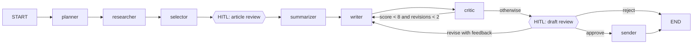

# 📰 Newsletter Agent

An autonomous AI agent, built with **LangGraph** and **Google Gemini**, that turns a plain-English goal like

> "Create a weekly newsletter on latest AI agent news and send it to our subscribers."

into a researched, summarized, self-critiqued HTML newsletter, then simulates sending it to a subscriber list.

**Live demo:** <APP_URL>

## How it works



| Stage | What the agent decides |
|---|---|
| **planner** | Turns the goal into search queries, an audience, a tone, relevance criteria, and an outline |
| **researcher** | Runs a tool-calling loop: Gemini chooses queries for `web_search` (Tavily) and `news_feed` (Google News RSS) and decides when it has enough. Results are merged and de-duplicated, and the search window widens if too few are found |
| **selector** | Ranks candidates and picks the top 5-7 for relevance, recency, and variety |
| **summarizer** | Calls `fetch_article` for each article's full text, then summarizes each one and says why it matters |
| **writer** | Writes the subject, intro, items, and outro, then renders them with `render_html` |
| **critic** | Self-reflection: scores the draft 1-10 against a checklist. Below 8, the draft goes back to the writer with the critique (up to 2 times) |
| **draft_review / sender** | `send_email` writes one `.eml` per subscriber plus `newsletter.html` |

## Requirement checklist

| Requirement | Where |
|---|---|
| Plain-English goal input | Goal box in the UI; `run_newsletter_agent(goal)` |
| Research the latest news | `agent/nodes/researcher.py` + `services/news_sources.py` |
| Summarize the top 5-7 articles | `agent/nodes/selector.py`, `agent/nodes/summarizer.py` |
| Clean HTML/Markdown newsletter | `services/newsletter_renderer.py`, `services/templates/newsletter.html.j2` |
| Simulated sending | `services/email_outbox.py` (`.eml` files + downloads) |
| Multi-step reasoning | LangGraph stages in `agent/graph.py` |
| Tool use (5 tools) | `tools/`: `web_search`, `news_feed`, `fetch_article`, `render_html`, `send_email` |
| Self-critique and improvement | `agent/nodes/critic.py` + `agent/routing.py` revision loop |
| One-call autonomy | `newsletter_agent.agent.runner.run_newsletter_agent(goal)` |
| Autonomous / HITL toggle | Mode switch in the sidebar; LangGraph `interrupt()` in `article_review` and `draft_review` |
| Frontend | Streamlit `app.py` |

## Run it yourself

Requires Python 3.11+, a free [Gemini API key](https://aistudio.google.com/apikey), and a free [Tavily API key](https://app.tavily.com).

```bash
git clone https://github.com/PewDieRes/newsletter-agent.git
cd newsletter-agent
python -m venv .venv
source .venv/bin/activate          # Windows Git Bash: source .venv/Scripts/activate
pip install -r requirements-dev.txt
cp .env.example .env               # then fill in your keys

streamlit run app.py               # web UI
python main.py --mode auto         # one-call autonomous run in the terminal
python main.py --mode hitl         # human-in-the-loop in the terminal
```

`GEMINI_FALLBACK_MODEL` (default `gemini-3.5-flash-lite`) is used when the primary `GEMINI_MODEL` fails, for example during a 503 overload. After such a failure the agent keeps using the fallback for a few minutes before trying the primary again. Set it to an empty value to disable the fallback.

From Python:

```python
from newsletter_agent.agent.runner import run_newsletter_agent

result = run_newsletter_agent(
    "Create a weekly newsletter on latest AI agent news and send it to our subscribers."
)
print(result.status, result.final_state["delivery_report"])
```

To watch the agent work, stream its trace instead:

```python
from newsletter_agent.agent.runner import get_default_runner, new_thread_id

runner = get_default_runner()
thread_id = new_thread_id()
for trace_entry in runner.stream_run(
    "Create a weekly newsletter on latest AI agent news and send it to our subscribers.",
    "auto",
    thread_id,
):
    print(f"{trace_entry.step}: {trace_entry.message}")
print(runner.get_result(thread_id).status)
```

## Tests

```bash
pytest                 # offline, uses fakes, no API keys needed
pytest -m smoke -s     # one real run against Gemini + Tavily
ruff check . && ruff format --check .
```

## Project layout

```
newsletter_agent/
  domain/      Pydantic models shared by every layer
  services/    adapters for LLM, news sources, article fetching, rendering, email outbox
  tools/       LangChain tools (thin wrappers over services)
  agent/       state, prompts, one file per node, routing, graph wiring, public runner
  ui/          Streamlit components
app.py         Streamlit entry point
main.py        CLI entry point
```

Design notes: every external dependency sits behind a small protocol (`NewsSource`, `ArticleFetcher`, `EmailSender`, `LanguageModelGateway`) and is injected into node factories, so each node can be tested in isolation and providers can be swapped without touching the agent.
