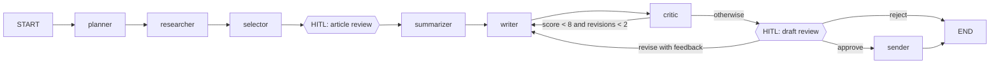

# Newsletter Agent Implementation Plan

> **For agentic workers:** REQUIRED SUB-SKILL: Use superpowers:subagent-driven-development (recommended) or superpowers:executing-plans to implement this plan task-by-task. Steps use checkbox (`- [ ]`) syntax for tracking.

**Goal:** Build and host a LangGraph "Newsletter Agent" that turns a plain-English goal into a researched, summarized, self-critiqued HTML newsletter and simulates sending it, with a Fully Autonomous / Human-in-the-Loop toggle and a Streamlit front end.

**Architecture:** A LangGraph `StateGraph` with fixed, visible stages (planner → researcher → selector → article_review → summarizer → writer → critic ⟲ → draft_review → sender). The LLM makes the decisions inside the stages: a tool-calling research loop over Tavily and Google News RSS, and a critique-driven revision loop. External concerns (LLM, news sources, article fetching, rendering, email outbox) sit behind small protocols in `services/` and are injected into node factories, so every node is testable offline with fakes. Human-in-the-loop uses LangGraph `interrupt()` with an in-memory checkpointer; Streamlit and the CLI only call the public runner API.

**Tech Stack:** Python 3.11, LangGraph 1.x, LangChain Core 1.x, langchain-google-genai (Gemini Flash), tavily-python, feedparser, httpx, trafilatura, Jinja2, Markdown, Pydantic v2, pydantic-settings, Streamlit, pytest, ruff.

**Spec:** `docs/superpowers/specs/2026-10-14-newsletter-agent-design.md`

## Global Constraints

- Python 3.11 (`requires-python = ">=3.11"`); Streamlit Cloud deploys with Python 3.11.
- Development machine is Windows; run every command from Git Bash in the project root `C:\Users\vazem\Downloads\newsletter-agent`, using `.venv/Scripts/python`.
- LLM: Google Gemini via `langchain-google-genai`; model name from `GEMINI_MODEL` (default `gemini-3.8-flash`).
- Limits live in `newsletter_agent/config.py` only: `MIN_ARTICLES=5`, `MAX_ARTICLES=7`, `QUALITY_THRESHOLD=8`, `MAX_REVISIONS=2`, `MAX_RESEARCH_TOOL_CALLS=4`, `DEFAULT_RECENCY_DAYS=7`, widened window 14 days, `FETCH_TIMEOUT_SECONDS=8`, `RUNS_PER_SESSION=3`, run timeout 120 seconds.
- Descriptive names everywhere; **no single-character identifiers**, including loop variables, comprehension variables, lambda parameters, and exception aliases.
- Full type hints; docstrings on public functions and classes.
- All prompt text lives in `newsletter_agent/agent/prompts.py`.
- SOLID: nodes are built by factory functions that receive their dependencies; `graph.py` only wires; `app.py` and `cli.py` only call `newsletter_agent.agent.runner`.
- Secrets come only from environment variables or `.env` (gitignored). On Streamlit Community Cloud, root-level secrets are exposed as environment variables, so `Settings` reads them without importing Streamlit (this satisfies the spec's "reads st.secrets when available" while keeping `config.py` UI-agnostic).
- Every test runs offline without API keys, except the opt-in `smoke` marker.
- Pre-push gate: `ruff check .`, `ruff format --check .`, `pytest` all pass.
- Commit messages end with:
  ```
  Co-Authored-By: Claude Opus 5.5 <noreply@anthropic.com>
  Claude-Session: https://claude.ai/code/session_01UmGkfGoaV4Uam9a8FMRp1N
  ```

## Review Focus

1. **Human unchecks every article at article review** → the agent keeps its own selection and logs it; the UI also refuses to submit an empty selection. Test: Task 12 `test_apply_article_review_keeps_agent_selection_when_human_approves_none`.
2. **Human clicks "Request revision" with empty feedback** → a default revision instruction is used and the writer still rewrites. Test: Task 15 `test_blank_revision_feedback_uses_default_instruction`.
3. **Selector LLM returns out-of-range, duplicate, or too few article numbers** → invalid numbers dropped, duplicates removed, topped up to 5 in candidate order, capped at 7. Test: Task 12 `test_choose_articles_drops_invalid_and_tops_up`.
4. **Titles or summaries containing HTML/Markdown special characters or non-ASCII text** (`<script>`, `&`, `[`, `✨`) → escaped in HTML, links intact in Markdown, UTF-8 subject survives the `.eml` round trip. Tests: Task 6 `test_render_html_escapes_untrusted_text`, `test_render_markdown_escapes_link_brackets`; Task 7 `test_send_preserves_non_ascii_subject`.
5. **The same story arrives from both sources with different URLs** (Google News redirect link vs publisher link) → de-duplicated by normalized title, keeping the publisher URL. Test: Task 4 `test_deduplicate_prefers_publisher_url_over_google_news_link`.

---

## File Map

```
newsletter-agent/
  .env                      # local secrets (already created, gitignored)
  .env.example
  .gitignore                # already created
  .streamlit/config.toml
  pyproject.toml            # ruff + pytest config
  requirements.txt          # runtime deps (pinned in Task 19)
  requirements-dev.txt
  README.md
  app.py                    # Streamlit entry point (flow only)
  main.py                   # CLI entry point (one line into cli.py)
  data/subscribers.json     # mock subscriber list
  newsletter_agent/
    __init__.py
    config.py               # Settings, get_settings, DEFAULT_GOAL, PROJECT_ROOT
    errors.py               # NewsletterAgentError hierarchy
    cli.py                  # terminal runner + HITL prompts
    domain/
      __init__.py
      models.py             # Article, NewsletterPlan, ArticleSummary, NewsletterDraft, CritiqueReport, TraceEntry, Subscriber, DeliveryReport
      llm_outputs.py        # ArticleSelection, ArticleCopy, SummaryBatch, NewsletterCopy
    services/
      __init__.py
      news_sources.py       # NewsSource protocol, TavilyNewsSource, GoogleNewsRssSource
      news_aggregator.py    # NewsAggregator, deduplicate_articles
      article_fetcher.py    # ArticleFetcher protocol, HttpArticleFetcher
      newsletter_renderer.py
      templates/newsletter.html.j2
      email_outbox.py       # EmailSender protocol, EmlFileOutbox
      subscribers.py        # load_subscribers
      llm_gateway.py        # LanguageModelGateway protocol, ChatModelGateway
      llm_factory.py        # build_chat_model (only place that knows Gemini)
    tools/
      __init__.py
      search_tools.py       # web_search, news_feed
      content_tools.py      # fetch_article, render_html
      delivery_tools.py     # send_email
    agent/
      __init__.py
      state.py
      node_names.py
      interrupts.py
      prompts.py
      routing.py
      dependencies.py       # AgentDependencies, build_default_dependencies
      graph.py              # build_newsletter_graph (wiring only)
      runner.py             # public API
      nodes/
        __init__.py
        guard.py
        formatting.py
        planner.py
        researcher.py
        selector.py
        article_review.py
        summarizer.py
        writer.py
        critic.py
        draft_review.py
        sender.py
    ui/
      __init__.py
      components.py         # Streamlit render functions
  tests/
    __init__.py
    fakes.py
    fixtures/google_news_sample.xml
    test_*.py
```

---

### Task 1: Environment, project scaffold, and settings

**Files:**
- Create: `pyproject.toml`, `requirements.txt`, `requirements-dev.txt`, `.env.example`, `data/subscribers.json`, `newsletter_agent/__init__.py`, `newsletter_agent/config.py`, `tests/__init__.py`
- Test: `tests/test_config.py`

**Interfaces:**
- Consumes: nothing.
- Produces: `newsletter_agent.config.Settings` (fields listed in Step 6), `get_settings() -> Settings` (cached), `DEFAULT_GOAL: str`, `PROJECT_ROOT: Path`.

- [ ] **Step 1: Install Python 3.11**

Run:
```bash
winget install --id Python.Python.3.11 -e --accept-source-agreements --accept-package-agreements
"$LOCALAPPDATA/Programs/Python/Python311/python.exe" --version
```
Expected: `Python 3.11.x`. If winget installed elsewhere, locate it with `ls "$LOCALAPPDATA/Programs/Python"` and use that path below.

- [ ] **Step 2: Create the virtual environment**

Run:
```bash
cd /c/Users/vazem/Downloads/newsletter-agent
"$LOCALAPPDATA/Programs/Python/Python311/python.exe" -m venv .venv
.venv/Scripts/python -m pip install --upgrade pip
```
Expected: `.venv/Scripts/python.exe` exists.

- [ ] **Step 3: Write dependency files**

`requirements.txt`:
```
langgraph>=1.0,<2
langchain-core>=1.0,<2
langchain-google-genai>=3.0,<5
tavily-python>=0.7,<1
feedparser>=6.0,<7
httpx>=0.27,<1
trafilatura>=2.0,<3
jinja2>=3.1,<4
markdown>=3.6,<4
pydantic>=2.7,<3
pydantic-settings>=2.3,<3
streamlit>=1.40,<2
```

`requirements-dev.txt`:
```
-r requirements.txt
pytest>=8,<10
ruff>=0.6
```

Run: `.venv/Scripts/python -m pip install -r requirements-dev.txt`
Expected: installs without resolver errors. If a version range cannot be resolved, widen only the conflicting upper bound and note it in the commit message.

- [ ] **Step 4: Write `pyproject.toml`**

```toml
[project]
name = "newsletter-agent"
version = "0.1.0"
description = "Autonomous LangGraph agent that researches, writes, critiques, and sends an AI news newsletter."
requires-python = ">=3.11"

[tool.ruff]
line-length = 100
target-version = "py311"

[tool.ruff.lint]
select = ["E", "F", "I", "B", "UP", "N", "SIM", "RUF"]
# Line length is enforced by the formatter; prompts contain long lines and typographic punctuation.
ignore = ["E501", "RUF001"]

[tool.ruff.lint.isort]
known-first-party = ["newsletter_agent", "tests"]

[tool.pytest.ini_options]
testpaths = ["tests"]
pythonpath = ["."]
markers = ["smoke: real network and API calls; run with -m smoke"]
addopts = "-m 'not smoke'"
```

- [ ] **Step 5: Write the failing test**

`tests/__init__.py`: empty file.

`tests/test_config.py`:
```python
from newsletter_agent.config import DEFAULT_GOAL, PROJECT_ROOT, Settings


def test_settings_defaults_match_spec() -> None:
    settings = Settings(_env_file=None)

    assert settings.min_articles == 5
    assert settings.max_articles == 7
    assert settings.quality_threshold == 8
    assert settings.max_revisions == 2
    assert settings.max_research_tool_calls == 4
    assert settings.default_recency_days == 7
    assert settings.widened_recency_days == 14
    assert settings.fetch_timeout_seconds == 8.0
    assert settings.runs_per_session == 3
    assert settings.run_timeout_seconds == 120.0
    assert settings.subscribers_path == PROJECT_ROOT / "data" / "subscribers.json"


def test_settings_read_environment_variables(monkeypatch) -> None:
    monkeypatch.setenv("GEMINI_MODEL", "gemini-test-model")
    monkeypatch.setenv("MAX_REVISIONS", "1")

    settings = Settings(_env_file=None)

    assert settings.gemini_model == "gemini-test-model"
    assert settings.max_revisions == 1


def test_default_goal_is_the_assignment_goal() -> None:
    assert DEFAULT_GOAL == (
        "Create a weekly newsletter on latest AI agent news and send it to our subscribers."
    )
```

- [ ] **Step 6: Run test to verify it fails**

Run: `.venv/Scripts/python -m pytest tests/test_config.py -v`
Expected: FAIL with `ModuleNotFoundError: No module named 'newsletter_agent'`.

- [ ] **Step 7: Implement the package and settings**

`newsletter_agent/__init__.py`:
```python
"""Autonomous newsletter agent built with LangGraph."""
```

`newsletter_agent/config.py`:
```python
"""Application settings loaded from environment variables or a local .env file."""

from functools import lru_cache
from pathlib import Path

from pydantic_settings import BaseSettings, SettingsConfigDict

PROJECT_ROOT = Path(__file__).resolve().parent.parent

DEFAULT_GOAL = (
    "Create a weekly newsletter on latest AI agent news and send it to our subscribers."
)


class Settings(BaseSettings):
    """Every tunable value for the agent. Secrets come from the environment only."""

    model_config = SettingsConfigDict(env_file=PROJECT_ROOT / ".env", extra="ignore")

    google_api_key: str = ""
    tavily_api_key: str = ""
    gemini_model: str = "gemini-3.8-flash"
    # Google recommends the default temperature of 1.0 for Gemini 3 models.
    llm_temperature: float = 1.0
    llm_timeout_seconds: float = 60.0
    llm_max_retries: int = 3

    min_articles: int = 5
    max_articles: int = 7
    quality_threshold: int = 8
    max_revisions: int = 2
    max_research_tool_calls: int = 4
    max_search_queries: int = 4
    default_recency_days: int = 7
    widened_recency_days: int = 14
    results_per_search: int = 8
    fetch_timeout_seconds: float = 8.0
    max_article_characters: int = 3000

    runs_per_session: int = 3
    run_timeout_seconds: float = 120.0

    newsletter_name: str = "AI Agents Weekly"
    sender_address: str = "AI Agents Weekly <newsletter@example.com>"
    subscribers_path: Path = PROJECT_ROOT / "data" / "subscribers.json"
    outbox_directory: Path = PROJECT_ROOT / "outbox"


@lru_cache(maxsize=1)
def get_settings() -> Settings:
    """Return the process-wide settings instance."""
    return Settings()
```

`.env.example`:
```
GOOGLE_API_KEY=your-gemini-api-key
TAVILY_API_KEY=your-tavily-api-key
GEMINI_MODEL=gemini-3.8-flash
```

`data/subscribers.json`:
```json
[
  {"name": "Ada Lovelace", "email": "ada@example.com"},
  {"name": "Alan Turing", "email": "alan@example.com"},
  {"name": "Grace Hopper", "email": "grace@example.com"},
  {"name": "Katherine Johnson", "email": "katherine@example.com"},
  {"name": "Linus Torvalds", "email": "linus@example.com"}
]
```

- [ ] **Step 8: Run test to verify it passes**

Run: `.venv/Scripts/python -m pytest tests/test_config.py -v`
Expected: 3 passed.

- [ ] **Step 9: Lint and commit**

```bash
.venv/Scripts/python -m ruff format . && .venv/Scripts/python -m ruff check .
git add .gitignore pyproject.toml requirements.txt requirements-dev.txt .env.example data newsletter_agent tests
git commit -m "chore: scaffold project with settings and tooling

Co-Authored-By: Claude Opus 5.5 <noreply@anthropic.com>
Claude-Session: https://claude.ai/code/session_01UmGkfGoaV4Uam9a8FMRp1N"
```

---

### Task 2: Domain models, LLM output schemas, errors, and test builders

**Files:**
- Create: `newsletter_agent/domain/__init__.py`, `newsletter_agent/domain/models.py`, `newsletter_agent/domain/llm_outputs.py`, `newsletter_agent/errors.py`, `tests/fakes.py`
- Test: `tests/test_models.py`

**Interfaces:**
- Consumes: nothing.
- Produces:
  - `AgentMode = Literal["auto", "hitl"]`, `ReviewDecision = Literal["approve", "revise", "reject"]`
  - `Article(title, url, source_name, published_at: datetime | None = None, snippet="", content="")`
  - `NewsletterPlan(topic, audience, tone, search_queries: list[str], recency_days: int, relevance_criteria: list[str], section_outline: list[str])`
  - `ArticleSummary(article: Article, summary: str, why_it_matters: str = "")`
  - `NewsletterDraft(subject, preheader, intro, items: list[ArticleSummary], outro, html_body="", markdown_body="")`
  - `CritiqueReport(score: int 1-10, issues: list[str], suggested_fixes: list[str], passes: bool)`
  - `TraceEntry(step: str, message: str, timestamp: datetime)`
  - `Subscriber(name, email)`, `DeliveryReport(recipient_count, subject, outbox_paths: list[str], html_path: str)`
  - LLM outputs: `ArticleSelection(selected_article_numbers: list[int], rationale: str)`, `ArticleCopy(article_number: int, summary: str, why_it_matters: str)`, `SummaryBatch(items: list[ArticleCopy])`, `NewsletterCopy(subject, preheader, intro, items: list[ArticleCopy], outro)`
  - Errors: `NewsletterAgentError`, `StructuredOutputError`, `ResearchFailedError`, `NodeExecutionError(step_name, original_error)`, `RunTimeoutError`
  - `tests/fakes.py` builders: `make_article(number, source_name="Example News", url=None)`, `make_plan()`, `make_summary(number)`, `make_draft(article_count=5)`, `make_article_copies(count)`, `make_summary_batch(count=7)`, `make_newsletter_copy(count=7)`, `make_critique(score)`, `TEST_SUBSCRIBERS`

- [ ] **Step 1: Write the failing test**

`tests/test_models.py`:
```python
import pytest
from pydantic import ValidationError

from newsletter_agent.domain.models import Article, CritiqueReport, TraceEntry
from newsletter_agent.errors import NewsletterAgentError, NodeExecutionError


def test_article_defaults_are_empty_strings() -> None:
    article = Article(title="Agents ship", url="https://example.com/a", source_name="Example")

    assert article.snippet == ""
    assert article.content == ""
    assert article.published_at is None


@pytest.mark.parametrize("invalid_score", [0, 11])
def test_critique_score_must_be_between_one_and_ten(invalid_score: int) -> None:
    with pytest.raises(ValidationError):
        CritiqueReport(score=invalid_score, issues=[], suggested_fixes=[], passes=False)


def test_trace_entry_timestamp_is_timezone_aware() -> None:
    trace_entry = TraceEntry(step="planner", message="Planned")

    assert trace_entry.timestamp.tzinfo is not None


def test_node_execution_error_names_the_step() -> None:
    original_error = ValueError("bad output")

    node_error = NodeExecutionError("planner", original_error)

    assert isinstance(node_error, NewsletterAgentError)
    assert node_error.step_name == "planner"
    assert node_error.original_error is original_error
    assert "planner" in str(node_error)
    assert "bad output" in str(node_error)
```

- [ ] **Step 2: Run test to verify it fails**

Run: `.venv/Scripts/python -m pytest tests/test_models.py -v`
Expected: FAIL with `ModuleNotFoundError: No module named 'newsletter_agent.domain'`.

- [ ] **Step 3: Implement models, outputs, and errors**

`newsletter_agent/domain/__init__.py`:
```python
"""Domain objects shared by every layer."""
```

`newsletter_agent/domain/models.py`:
```python
"""Domain objects shared by every layer of the newsletter agent."""

from datetime import UTC, datetime
from typing import Literal

from pydantic import BaseModel, Field

AgentMode = Literal["auto", "hitl"]
ReviewDecision = Literal["approve", "revise", "reject"]


def utc_now() -> datetime:
    """Return the current time in UTC."""
    return datetime.now(UTC)


class Article(BaseModel):
    """A news article discovered during research."""

    title: str
    url: str
    source_name: str
    published_at: datetime | None = None
    snippet: str = ""
    content: str = ""


class NewsletterPlan(BaseModel):
    """The agent's plan for researching and writing one newsletter issue."""

    topic: str = Field(description="The newsletter subject in a few words")
    audience: str = Field(description="Who the newsletter is written for")
    tone: str = Field(description="The writing style to use")
    search_queries: list[str] = Field(description="Distinct news search queries")
    recency_days: int = Field(description="How many days back to search")
    relevance_criteria: list[str] = Field(description="Rules for including an article")
    section_outline: list[str] = Field(description="Ordered newsletter sections")


class ArticleSummary(BaseModel):
    """An article paired with its newsletter-ready summary."""

    article: Article
    summary: str
    why_it_matters: str = ""


class NewsletterDraft(BaseModel):
    """A complete newsletter issue, in structured, HTML, and Markdown form."""

    subject: str
    preheader: str
    intro: str
    items: list[ArticleSummary]
    outro: str
    html_body: str = ""
    markdown_body: str = ""


class CritiqueReport(BaseModel):
    """The critic's evaluation of a draft."""

    score: int = Field(ge=1, le=10, description="Overall quality from 1 to 10")
    issues: list[str] = Field(description="Concrete problems found in the draft")
    suggested_fixes: list[str] = Field(description="Changes that would resolve the issues")
    passes: bool = Field(description="True when the draft is ready to send")


class TraceEntry(BaseModel):
    """One human-readable line in the agent's execution trace."""

    step: str
    message: str
    timestamp: datetime = Field(default_factory=utc_now)


class Subscriber(BaseModel):
    """A newsletter recipient."""

    name: str
    email: str


class DeliveryReport(BaseModel):
    """What the (simulated) send produced."""

    recipient_count: int
    subject: str
    outbox_paths: list[str]
    html_path: str
```

`newsletter_agent/domain/llm_outputs.py`:
```python
"""Schemas the language model fills in through structured output."""

from pydantic import BaseModel, Field


class ArticleSelection(BaseModel):
    """The editor's choice of articles for the issue."""

    selected_article_numbers: list[int] = Field(
        description="Numbers of the chosen articles, most important first"
    )
    rationale: str = Field(description="One or two sentences explaining the choice")


class ArticleCopy(BaseModel):
    """Newsletter copy for one numbered article."""

    article_number: int = Field(description="The article's number from the provided list")
    summary: str = Field(description="Two or three sentences covering the key facts")
    why_it_matters: str = Field(description="One sentence on why the audience should care")


class SummaryBatch(BaseModel):
    """Summaries for every selected article."""

    items: list[ArticleCopy]


class NewsletterCopy(BaseModel):
    """All the copy needed to assemble one newsletter issue."""

    subject: str = Field(description="Email subject line under 70 characters")
    preheader: str = Field(description="Inbox preview text under 110 characters")
    intro: str = Field(description="Two or three sentences introducing the issue")
    items: list[ArticleCopy]
    outro: str = Field(description="One or two sentences closing the issue")
```

`newsletter_agent/errors.py`:
```python
"""Exceptions raised by the newsletter agent."""


class NewsletterAgentError(Exception):
    """Base class for every expected agent failure."""


class StructuredOutputError(NewsletterAgentError):
    """The language model did not return output matching the requested schema."""


class ResearchFailedError(NewsletterAgentError):
    """No usable articles could be found."""


class RunTimeoutError(NewsletterAgentError):
    """A run took longer than the configured time limit."""


class NodeExecutionError(NewsletterAgentError):
    """A graph node failed; records which step failed and why."""

    def __init__(self, step_name: str, original_error: Exception) -> None:
        super().__init__(f"Step '{step_name}' failed: {original_error}")
        self.step_name = step_name
        self.original_error = original_error
```

`tests/fakes.py`:
```python
"""Builders and fakes shared by the test suite."""

from datetime import UTC, datetime

from newsletter_agent.domain.llm_outputs import ArticleCopy, NewsletterCopy, SummaryBatch
from newsletter_agent.domain.models import (
    Article,
    ArticleSummary,
    CritiqueReport,
    NewsletterDraft,
    NewsletterPlan,
    Subscriber,
)

TEST_SUBSCRIBERS = [
    Subscriber(name="Ada Example", email="ada@example.com"),
    Subscriber(name="Grace Example", email="grace@example.com"),
    Subscriber(name="Linus Example", email="linus@example.com"),
]


def make_article(
    number: int, source_name: str = "Example News", url: str | None = None
) -> Article:
    return Article(
        title=f"AI agent story {number}",
        url=url or f"https://news.example.com/story-{number}",
        source_name=source_name,
        published_at=datetime(2026, 10, 12, 9, 0, tzinfo=UTC),
        snippet=f"Snippet about agent story {number}.",
    )


def make_plan() -> NewsletterPlan:
    return NewsletterPlan(
        topic="AI agents",
        audience="Engineers and product leaders",
        tone="Clear and upbeat",
        search_queries=["AI agents news", "agentic AI launch"],
        recency_days=7,
        relevance_criteria=["About AI agents", "Published this week"],
        section_outline=["Intro", "Top stories", "Outro"],
    )


def make_summary(number: int) -> ArticleSummary:
    return ArticleSummary(
        article=make_article(number),
        summary=f"Summary of story {number}.",
        why_it_matters=f"Story {number} matters.",
    )


def make_draft(article_count: int = 5) -> NewsletterDraft:
    return NewsletterDraft(
        subject="AI agents this week",
        preheader="The biggest agent news in five minutes",
        intro="Welcome to this week's issue.",
        items=[make_summary(number) for number in range(1, article_count + 1)],
        outro="See you next week.",
        html_body="<html><body>Draft</body></html>",
        markdown_body="# AI agents this week",
    )


def make_article_copies(count: int) -> list[ArticleCopy]:
    return [
        ArticleCopy(
            article_number=number,
            summary=f"Polished summary {number}.",
            why_it_matters=f"Polished reason {number}.",
        )
        for number in range(1, count + 1)
    ]


def make_summary_batch(count: int = 7) -> SummaryBatch:
    return SummaryBatch(items=make_article_copies(count))


def make_newsletter_copy(count: int = 7) -> NewsletterCopy:
    return NewsletterCopy(
        subject="Agents everywhere: this week's top stories",
        preheader="Five launches you should know about",
        intro="Agents had a big week.",
        items=make_article_copies(count),
        outro="Thanks for reading.",
    )


def make_critique(score: int) -> CritiqueReport:
    return CritiqueReport(
        score=score,
        issues=[] if score >= 8 else [f"Intro is too long (score {score})"],
        suggested_fixes=[] if score >= 8 else ["Cut the intro to two sentences"],
        passes=score >= 8,
    )
```

- [ ] **Step 4: Run test to verify it passes**

Run: `.venv/Scripts/python -m pytest tests/test_models.py -v`
Expected: 5 passed.

- [ ] **Step 5: Lint and commit**

```bash
.venv/Scripts/python -m ruff format . && .venv/Scripts/python -m ruff check .
git add newsletter_agent tests
git commit -m "feat: add domain models, LLM output schemas, and errors

Co-Authored-By: Claude Opus 5.5 <noreply@anthropic.com>
Claude-Session: https://claude.ai/code/session_01UmGkfGoaV4Uam9a8FMRp1N"
```

---

### Task 3: News sources (Tavily and Google News RSS)

**Files:**
- Create: `newsletter_agent/services/__init__.py`, `newsletter_agent/services/news_sources.py`, `tests/fixtures/google_news_sample.xml`
- Modify: `tests/fakes.py` (append `FakeNewsSource`)
- Test: `tests/test_news_sources.py`

**Interfaces:**
- Consumes: `Article` (Task 2).
- Produces:
  - `NewsSource` protocol: attribute `name: str`; `search(query: str, recency_days: int) -> list[Article]`
  - `TavilyNewsSource(search_client, max_results)` with `name = "web_search"`
  - `GoogleNewsRssSource(http_client: httpx.Client, max_results)` with `name = "news_feed"`
  - helpers `parse_published_date(raw_date) -> datetime | None`, `strip_html(raw_text) -> str`, `strip_source_suffix(title, source_name) -> str`, `domain_name(url) -> str`
  - `tests.fakes.FakeNewsSource(name, articles=None, error=None)` with `received_searches: list[tuple[str, int]]`

- [ ] **Step 1: Write the RSS fixture**

`tests/fixtures/google_news_sample.xml`:
```xml
<?xml version="1.0" encoding="UTF-8"?>
<rss version="2.0">
  <channel>
    <title>"AI agents" - Google News</title>
    <item>
      <title>OpenAI ships new agent toolkit - TechCrunch</title>
      <link>https://news.google.com/rss/articles/abc123</link>
      <pubDate>Mon, 12 Oct 2026 09:00:00 GMT</pubDate>
      <description>&lt;a href="https://techcrunch.com/agents"&gt;OpenAI ships new agent toolkit&lt;/a&gt;&amp;nbsp;&amp;nbsp;&lt;font color="#6f6f6f"&gt;TechCrunch&lt;/font&gt;</description>
      <source url="https://techcrunch.com">TechCrunch</source>
    </item>
    <item>
      <title>Startup raises $40M for agent observability - VentureBeat</title>
      <link>https://news.google.com/rss/articles/def456</link>
      <pubDate>Sun, 11 Oct 2026 15:30:00 GMT</pubDate>
      <description>&lt;a href="https://venturebeat.com/obs"&gt;Startup raises $40M&lt;/a&gt;</description>
      <source url="https://venturebeat.com">VentureBeat</source>
    </item>
  </channel>
</rss>
```

- [ ] **Step 2: Write the failing tests**

`tests/test_news_sources.py`:
```python
from pathlib import Path
from typing import Any

import httpx
import pytest

from newsletter_agent.services.news_sources import (
    GOOGLE_NEWS_RSS_URL,
    GoogleNewsRssSource,
    TavilyNewsSource,
    parse_published_date,
    strip_html,
    strip_source_suffix,
)

FIXTURE_PATH = Path(__file__).parent / "fixtures" / "google_news_sample.xml"


class StubTavilyClient:
    def __init__(self, response: dict[str, Any]) -> None:
        self.response = response
        self.received_arguments: list[dict[str, Any]] = []

    def search(self, **search_arguments: Any) -> dict[str, Any]:
        self.received_arguments.append(search_arguments)
        return self.response


def test_tavily_source_requests_recent_news_and_maps_results() -> None:
    search_client = StubTavilyClient(
        {
            "results": [
                {
                    "title": "Agents launch at scale",
                    "url": "https://www.techsite.com/agents",
                    "content": "Agents are <b>everywhere</b>.",
                    "published_date": "Mon, 12 Oct 2026 09:00:00 GMT",
                },
                {"title": "Missing URL is skipped", "url": ""},
            ]
        }
    )
    news_source = TavilyNewsSource(search_client, max_results=5)

    articles = news_source.search("AI agents", recency_days=7)

    assert search_client.received_arguments == [
        {"query": "AI agents", "topic": "news", "days": 7, "max_results": 5}
    ]
    assert len(articles) == 1
    assert articles[0].source_name == "techsite.com"
    assert articles[0].snippet == "Agents are everywhere ."
    assert articles[0].published_at is not None
    assert articles[0].published_at.year == 2026


def test_google_news_source_parses_feed_and_sends_recency_window() -> None:
    received_queries: list[str] = []

    def handle_request(request: httpx.Request) -> httpx.Response:
        received_queries.append(request.url.params["q"])
        return httpx.Response(200, text=FIXTURE_PATH.read_text(encoding="utf-8"))

    http_client = httpx.Client(transport=httpx.MockTransport(handle_request))
    news_source = GoogleNewsRssSource(http_client, max_results=1)

    articles = news_source.search("AI agents", recency_days=7)

    assert received_queries == ["AI agents when:7d"]
    assert len(articles) == 1
    assert articles[0].title == "OpenAI ships new agent toolkit"
    assert articles[0].source_name == "TechCrunch"
    assert articles[0].url == "https://news.google.com/rss/articles/abc123"
    assert "TechCrunch" in articles[0].snippet
    assert "<" not in articles[0].snippet


def test_google_news_source_raises_on_http_error() -> None:
    http_client = httpx.Client(
        transport=httpx.MockTransport(lambda request: httpx.Response(503))
    )
    news_source = GoogleNewsRssSource(http_client, max_results=5)

    with pytest.raises(httpx.HTTPStatusError):
        news_source.search("AI agents", recency_days=7)


def test_google_news_rss_url_is_the_search_endpoint() -> None:
    assert GOOGLE_NEWS_RSS_URL == "https://news.google.com/rss/search"


@pytest.mark.parametrize(
    ("raw_date", "expected_day"),
    [("Mon, 12 Oct 2026 09:00:00 GMT", 12), ("2026-10-13T08:00:00Z", 13)],
)
def test_parse_published_date_accepts_rfc_and_iso_formats(raw_date: str, expected_day: int) -> None:
    parsed_date = parse_published_date(raw_date)

    assert parsed_date is not None
    assert parsed_date.day == expected_day


@pytest.mark.parametrize("raw_date", [None, "", "not a date"])
def test_parse_published_date_returns_none_for_unusable_input(raw_date: str | None) -> None:
    assert parse_published_date(raw_date) is None


def test_strip_html_removes_tags_and_entities() -> None:
    assert strip_html("<a href='x'>Hello</a>&nbsp;&amp; world") == "Hello & world"


def test_strip_source_suffix_only_removes_matching_suffix() -> None:
    assert strip_source_suffix("Big news - TechCrunch", "TechCrunch") == "Big news"
    assert strip_source_suffix("Big news - Wired", "TechCrunch") == "Big news - Wired"
```

Note: the lambda parameter in `test_google_news_source_raises_on_http_error` is named `request`, which follows the naming rule.

- [ ] **Step 3: Run tests to verify they fail**

Run: `.venv/Scripts/python -m pytest tests/test_news_sources.py -v`
Expected: FAIL with `ModuleNotFoundError: No module named 'newsletter_agent.services'`.

- [ ] **Step 4: Implement the news sources**

`newsletter_agent/services/__init__.py`:
```python
"""Adapters for external systems: LLM, news, web, rendering, and email."""
```

`newsletter_agent/services/news_sources.py`:
```python
"""News sources the agent can search. Each source returns domain Article objects."""

import html
import re
from datetime import datetime
from email.utils import parsedate_to_datetime
from typing import Any, Protocol
from urllib.parse import urlsplit

import feedparser
import httpx

from newsletter_agent.domain.models import Article

GOOGLE_NEWS_RSS_URL = "https://news.google.com/rss/search"
HTML_TAG_PATTERN = re.compile(r"<[^>]+>")


class NewsSource(Protocol):
    """Anything that can search for recent news articles."""

    name: str

    def search(self, query: str, recency_days: int) -> list[Article]:
        """Return recent articles matching the query."""
        ...


class TavilySearchClient(Protocol):
    """The subset of tavily.TavilyClient used by TavilyNewsSource."""

    def search(self, **search_arguments: Any) -> dict[str, Any]:
        """Run a Tavily search and return the raw response."""
        ...


def parse_published_date(raw_date: str | None) -> datetime | None:
    """Parse RFC 2822 or ISO 8601 dates; return None when the input is unusable."""
    if not raw_date:
        return None
    try:
        return parsedate_to_datetime(raw_date)
    except (TypeError, ValueError):
        pass
    try:
        return datetime.fromisoformat(raw_date.replace("Z", "+00:00"))
    except ValueError:
        return None


def strip_html(raw_text: str) -> str:
    """Remove HTML tags and entities and collapse whitespace."""
    without_tags = HTML_TAG_PATTERN.sub(" ", raw_text)
    return " ".join(html.unescape(without_tags).split())


def strip_source_suffix(title: str, source_name: str) -> str:
    """Remove the trailing ' - Source' that Google News appends to titles."""
    suffix = f" - {source_name}"
    return title[: -len(suffix)] if source_name and title.endswith(suffix) else title


def domain_name(url: str) -> str:
    """Return the host name of a URL without a leading 'www.'."""
    return urlsplit(url).netloc.lower().removeprefix("www.")


class TavilyNewsSource:
    """Web news search through the Tavily API."""

    name = "web_search"

    def __init__(self, search_client: TavilySearchClient, max_results: int) -> None:
        self._search_client = search_client
        self._max_results = max_results

    def search(self, query: str, recency_days: int) -> list[Article]:
        """Search Tavily's news index for articles from the last `recency_days` days."""
        response = self._search_client.search(
            query=query, topic="news", days=recency_days, max_results=self._max_results
        )
        return [
            self._to_article(search_result)
            for search_result in response.get("results", [])
            if search_result.get("url")
        ]

    @staticmethod
    def _to_article(search_result: dict[str, Any]) -> Article:
        url = search_result["url"]
        return Article(
            title=search_result.get("title") or url,
            url=url,
            source_name=domain_name(url),
            published_at=parse_published_date(search_result.get("published_date")),
            snippet=strip_html(search_result.get("content") or ""),
        )


class GoogleNewsRssSource:
    """Headline search through the public Google News RSS feed (no API key)."""

    name = "news_feed"

    def __init__(self, http_client: httpx.Client, max_results: int) -> None:
        self._http_client = http_client
        self._max_results = max_results

    def search(self, query: str, recency_days: int) -> list[Article]:
        """Fetch Google News headlines matching the query from the last `recency_days` days."""
        response = self._http_client.get(
            GOOGLE_NEWS_RSS_URL,
            params={
                "q": f"{query} when:{recency_days}d",
                "hl": "en-US",
                "gl": "US",
                "ceid": "US:en",
            },
        )
        response.raise_for_status()
        feed = feedparser.parse(response.text)
        return [self._to_article(feed_entry) for feed_entry in feed.entries[: self._max_results]]

    @staticmethod
    def _to_article(feed_entry: Any) -> Article:
        source_name = feed_entry.get("source", {}).get("title", "Google News")
        return Article(
            title=strip_source_suffix(feed_entry.get("title", ""), source_name),
            url=feed_entry.get("link", ""),
            source_name=source_name,
            published_at=parse_published_date(feed_entry.get("published")),
            snippet=strip_html(feed_entry.get("summary", "")),
        )
```

- [ ] **Step 5: Append `FakeNewsSource` to `tests/fakes.py`**

Add to the imports at the top of `tests/fakes.py`:
```python
from collections.abc import Sequence
```

Append at the end of `tests/fakes.py`:
```python
class FakeNewsSource:
    """A NewsSource that returns canned articles or raises a canned error."""

    def __init__(
        self,
        name: str,
        articles: Sequence[Article] | None = None,
        error: Exception | None = None,
    ) -> None:
        self.name = name
        self._articles = list(articles or [])
        self._error = error
        self.received_searches: list[tuple[str, int]] = []

    def search(self, query: str, recency_days: int) -> list[Article]:
        self.received_searches.append((query, recency_days))
        if self._error is not None:
            raise self._error
        return list(self._articles)
```

- [ ] **Step 6: Run tests to verify they pass**

Run: `.venv/Scripts/python -m pytest tests/test_news_sources.py -v`
Expected: all passed. If `test_tavily_source_requests_recent_news_and_maps_results` fails only on the snippet's spacing, the expected string is `"Agents are everywhere ."` because tags are replaced by spaces before whitespace is collapsed. Keep the implementation and fix the assertion only if it differs because of that rule.

- [ ] **Step 7: Lint and commit**

```bash
.venv/Scripts/python -m ruff format . && .venv/Scripts/python -m ruff check .
git add newsletter_agent tests
git commit -m "feat: add Tavily and Google News RSS news sources

Co-Authored-By: Claude Opus 5.5 <noreply@anthropic.com>
Claude-Session: https://claude.ai/code/session_01UmGkfGoaV4Uam9a8FMRp1N"
```

---

### Task 4: News aggregator and de-duplication

**Files:**
- Create: `newsletter_agent/services/news_aggregator.py`
- Test: `tests/test_news_aggregator.py`

**Interfaces:**
- Consumes: `NewsSource` (Task 3), `Article` (Task 2), `ResearchFailedError` (Task 2), `FakeNewsSource` (Task 3).
- Produces:
  - `SourceFailure(source_name: str, query: str, error_message: str)` (frozen dataclass)
  - `AggregatedResults(articles: list[Article], failures: list[SourceFailure])` (frozen dataclass)
  - `NewsAggregator(news_sources: Sequence[NewsSource])` with `search_all(queries: Sequence[str], recency_days: int) -> AggregatedResults`. It raises `ResearchFailedError` when nothing was found and at least one search failed.
  - `deduplicate_articles(articles: Iterable[Article]) -> list[Article]`, `normalize_title(title) -> str`, `normalize_url(url) -> str`

- [ ] **Step 1: Write the failing tests**

`tests/test_news_aggregator.py`:
```python
import pytest

from newsletter_agent.domain.models import Article
from newsletter_agent.errors import ResearchFailedError
from newsletter_agent.services.news_aggregator import (
    NewsAggregator,
    deduplicate_articles,
    normalize_title,
    normalize_url,
)
from tests.fakes import FakeNewsSource, make_article


def test_search_all_queries_every_source_with_every_query() -> None:
    web_source = FakeNewsSource("web_search", [make_article(1)])
    feed_source = FakeNewsSource("news_feed", [make_article(2)])
    aggregator = NewsAggregator([web_source, feed_source])

    results = aggregator.search_all(["agents", "agentic AI"], recency_days=7)

    assert web_source.received_searches == [("agents", 7), ("agentic AI", 7)]
    assert feed_source.received_searches == [("agents", 7), ("agentic AI", 7)]
    assert [article.url for article in results.articles] == [
        make_article(1).url,
        make_article(2).url,
    ]
    assert results.failures == []


def test_search_all_survives_one_failing_source() -> None:
    web_source = FakeNewsSource("web_search", error=RuntimeError("quota exceeded"))
    feed_source = FakeNewsSource("news_feed", [make_article(2)])
    aggregator = NewsAggregator([web_source, feed_source])

    results = aggregator.search_all(["agents"], recency_days=7)

    assert [article.url for article in results.articles] == [make_article(2).url]
    assert results.failures[0].source_name == "web_search"
    assert "quota exceeded" in results.failures[0].error_message


def test_search_all_raises_when_every_source_fails() -> None:
    aggregator = NewsAggregator(
        [
            FakeNewsSource("web_search", error=RuntimeError("down")),
            FakeNewsSource("news_feed", error=RuntimeError("down")),
        ]
    )

    with pytest.raises(ResearchFailedError, match="down"):
        aggregator.search_all(["agents"], recency_days=7)


def test_search_all_returns_empty_results_when_nothing_found_without_errors() -> None:
    aggregator = NewsAggregator([FakeNewsSource("web_search"), FakeNewsSource("news_feed")])

    results = aggregator.search_all(["agents"], recency_days=7)

    assert results.articles == []
    assert results.failures == []


def test_deduplicate_removes_same_url_variants() -> None:
    first = make_article(1, url="https://www.example.com/story/")
    duplicate = make_article(2, url="http://example.com/story")

    assert deduplicate_articles([first, duplicate]) == [first]


def test_deduplicate_prefers_publisher_url_over_google_news_link() -> None:
    google_copy = Article(
        title="OpenAI ships new agent toolkit",
        url="https://news.google.com/rss/articles/abc123",
        source_name="TechCrunch",
    )
    publisher_copy = Article(
        title="OpenAI Ships New Agent Toolkit!",
        url="https://techcrunch.com/agents",
        source_name="techcrunch.com",
    )

    assert deduplicate_articles([google_copy, publisher_copy]) == [publisher_copy]


def test_normalizers() -> None:
    assert normalize_title("  OpenAI Ships: New Agent-Toolkit! ") == "openai ships new agenttoolkit"
    assert normalize_url("https://www.Example.com/a/b/?utm=1") == "example.com/a/b"
    assert normalize_url("not a url") == ""
```

- [ ] **Step 2: Run tests to verify they fail**

Run: `.venv/Scripts/python -m pytest tests/test_news_aggregator.py -v`
Expected: FAIL with `ModuleNotFoundError: No module named 'newsletter_agent.services.news_aggregator'`.

- [ ] **Step 3: Implement the aggregator**

`newsletter_agent/services/news_aggregator.py`:
```python
"""Combines several news sources into one de-duplicated list of articles."""

import re
from collections.abc import Iterable, Sequence
from dataclasses import dataclass, field
from itertools import chain
from urllib.parse import urlsplit

from newsletter_agent.domain.models import Article
from newsletter_agent.errors import ResearchFailedError
from newsletter_agent.services.news_sources import NewsSource

GOOGLE_NEWS_HOST = "news.google.com"
NON_ALPHANUMERIC_PATTERN = re.compile(r"[^a-z0-9 ]")


@dataclass(frozen=True)
class SourceFailure:
    """A single search that raised an error."""

    source_name: str
    query: str
    error_message: str


@dataclass(frozen=True)
class AggregatedResults:
    """Merged search results plus any searches that failed."""

    articles: list[Article]
    failures: list[SourceFailure] = field(default_factory=list)


def normalize_title(title: str) -> str:
    """Lowercase, strip punctuation, and collapse whitespace for duplicate detection."""
    return " ".join(NON_ALPHANUMERIC_PATTERN.sub("", title.lower()).split())


def normalize_url(url: str) -> str:
    """Reduce a URL to host + path so scheme, 'www.', query, and trailing slashes don't matter."""
    url_parts = urlsplit(url.strip())
    if not url_parts.netloc:
        return ""
    host = url_parts.netloc.lower().removeprefix("www.")
    return f"{host}{url_parts.path.rstrip('/')}"


def _is_google_news_link(url: str) -> bool:
    return urlsplit(url).netloc.lower() == GOOGLE_NEWS_HOST


def deduplicate_articles(articles: Iterable[Article]) -> list[Article]:
    """Keep the first copy of each story, preferring a publisher URL over a Google News link."""
    unique_articles: list[Article] = []
    positions_by_key: dict[str, int] = {}
    for article in articles:
        duplicate_keys = [
            duplicate_key
            for duplicate_key in (normalize_url(article.url), normalize_title(article.title))
            if duplicate_key
        ]
        existing_position = next(
            (
                positions_by_key[duplicate_key]
                for duplicate_key in duplicate_keys
                if duplicate_key in positions_by_key
            ),
            None,
        )
        if existing_position is None:
            positions_by_key.update(
                {duplicate_key: len(unique_articles) for duplicate_key in duplicate_keys}
            )
            unique_articles.append(article)
        elif _is_google_news_link(unique_articles[existing_position].url) and not (
            _is_google_news_link(article.url)
        ):
            unique_articles[existing_position] = article
            positions_by_key.update(
                {duplicate_key: existing_position for duplicate_key in duplicate_keys}
            )
    return unique_articles


class NewsAggregator:
    """Runs every query against every source and merges the results."""

    def __init__(self, news_sources: Sequence[NewsSource]) -> None:
        self._news_sources = list(news_sources)

    def search_all(self, queries: Sequence[str], recency_days: int) -> AggregatedResults:
        """Search all sources; raise ResearchFailedError only if nothing was found and errors occurred."""
        article_batches: list[list[Article]] = []
        failures: list[SourceFailure] = []
        for news_source in self._news_sources:
            for query in queries:
                try:
                    article_batches.append(news_source.search(query, recency_days))
                except Exception as search_error:
                    failures.append(
                        SourceFailure(
                            source_name=news_source.name,
                            query=query,
                            error_message=str(search_error),
                        )
                    )
        merged_articles = deduplicate_articles(chain.from_iterable(article_batches))
        if not merged_articles and failures:
            failure_details = "; ".join(
                f"{failure.source_name}: {failure.error_message}" for failure in failures
            )
            raise ResearchFailedError(f"Every news search failed: {failure_details}")
        return AggregatedResults(articles=merged_articles, failures=failures)
```

- [ ] **Step 4: Run tests to verify they pass**

Run: `.venv/Scripts/python -m pytest tests/test_news_aggregator.py -v`
Expected: 7 passed.

- [ ] **Step 5: Lint and commit**

```bash
.venv/Scripts/python -m ruff format . && .venv/Scripts/python -m ruff check .
git add newsletter_agent tests
git commit -m "feat: add news aggregator with cross-source de-duplication

Co-Authored-By: Claude Opus 5.5 <noreply@anthropic.com>
Claude-Session: https://claude.ai/code/session_01UmGkfGoaV4Uam9a8FMRp1N"
```

---

### Task 5: Article fetcher

**Files:**
- Create: `newsletter_agent/services/article_fetcher.py`
- Modify: `tests/fakes.py` (append `FakeArticleFetcher`)
- Test: `tests/test_article_fetcher.py`

**Interfaces:**
- Consumes: nothing project-specific.
- Produces:
  - `ArticleFetcher` protocol: `fetch(url: str) -> str`. It returns readable text, or `""` on any failure.
  - `HttpArticleFetcher(http_client: httpx.Client, max_characters: int)`
  - `tests.fakes.FakeArticleFetcher(contents: dict[str, str] | None = None)` with `fetched_urls: list[str]`

- [ ] **Step 1: Write the failing tests**

`tests/test_article_fetcher.py`:
```python
import httpx

from newsletter_agent.services.article_fetcher import HttpArticleFetcher

ARTICLE_PARAGRAPH = (
    "Autonomous AI agents are moving from research demos into production systems. "
    "This week several companies announced agent platforms that plan tasks, call tools, "
    "and check their own work before reporting back to users. "
)
ARTICLE_HTML = f"""
<html><head><title>Agents arrive</title></head>
<body>
  <nav>Home | News | About</nav>
  <article>
    <h1>Agents arrive in production</h1>
    <p>{ARTICLE_PARAGRAPH * 3}</p>
    <p>{ARTICLE_PARAGRAPH * 3}</p>
    <p>{ARTICLE_PARAGRAPH * 3}</p>
  </article>
  <footer>Copyright 2026</footer>
</body></html>
"""


def build_fetcher(handle_request, max_characters: int = 3000) -> HttpArticleFetcher:
    http_client = httpx.Client(transport=httpx.MockTransport(handle_request))
    return HttpArticleFetcher(http_client, max_characters=max_characters)


def test_fetch_extracts_article_text() -> None:
    fetcher = build_fetcher(lambda request: httpx.Response(200, text=ARTICLE_HTML))

    article_text = fetcher.fetch("https://example.com/agents")

    assert "Autonomous AI agents" in article_text
    assert "Copyright 2026" not in article_text


def test_fetch_truncates_to_max_characters() -> None:
    fetcher = build_fetcher(
        lambda request: httpx.Response(200, text=ARTICLE_HTML), max_characters=50
    )

    assert len(fetcher.fetch("https://example.com/agents")) <= 50


def test_fetch_returns_empty_string_on_http_error() -> None:
    fetcher = build_fetcher(lambda request: httpx.Response(404))

    assert fetcher.fetch("https://example.com/missing") == ""


def test_fetch_returns_empty_string_on_timeout() -> None:
    def raise_timeout(request: httpx.Request) -> httpx.Response:
        raise httpx.ConnectTimeout("timed out", request=request)

    fetcher = build_fetcher(raise_timeout)

    assert fetcher.fetch("https://example.com/slow") == ""
```

- [ ] **Step 2: Run tests to verify they fail**

Run: `.venv/Scripts/python -m pytest tests/test_article_fetcher.py -v`
Expected: FAIL with `ModuleNotFoundError: No module named 'newsletter_agent.services.article_fetcher'`.

- [ ] **Step 3: Implement the fetcher**

`newsletter_agent/services/article_fetcher.py`:
```python
"""Downloads article pages and extracts their readable text."""

from typing import Protocol

import httpx
import trafilatura


class ArticleFetcher(Protocol):
    """Anything that can turn a URL into readable article text."""

    def fetch(self, url: str) -> str:
        """Return the article's text, or an empty string if it cannot be fetched."""
        ...


class HttpArticleFetcher:
    """Fetches pages over HTTP and extracts the main text with trafilatura."""

    def __init__(self, http_client: httpx.Client, max_characters: int) -> None:
        self._http_client = http_client
        self._max_characters = max_characters

    def fetch(self, url: str) -> str:
        """Return up to `max_characters` of article text; never raises for network problems."""
        try:
            response = self._http_client.get(url)
            response.raise_for_status()
        except httpx.HTTPError:
            return ""
        extracted_text = trafilatura.extract(response.text) or ""
        return extracted_text[: self._max_characters]
```

- [ ] **Step 4: Append `FakeArticleFetcher` to `tests/fakes.py`**

```python
class FakeArticleFetcher:
    """An ArticleFetcher that returns canned page text by URL."""

    def __init__(self, contents: dict[str, str] | None = None) -> None:
        self._contents = dict(contents or {})
        self.fetched_urls: list[str] = []

    def fetch(self, url: str) -> str:
        self.fetched_urls.append(url)
        return self._contents.get(url, "")
```

- [ ] **Step 5: Run tests to verify they pass**

Run: `.venv/Scripts/python -m pytest tests/test_article_fetcher.py -v`
Expected: 4 passed. If `test_fetch_extracts_article_text` fails because trafilatura returns `None` for the sample, add `favor_recall=True` to the `trafilatura.extract` call and re-run.

- [ ] **Step 6: Lint and commit**

```bash
.venv/Scripts/python -m ruff format . && .venv/Scripts/python -m ruff check .
git add newsletter_agent tests
git commit -m "feat: add HTTP article fetcher with safe fallbacks

Co-Authored-By: Claude Opus 5.5 <noreply@anthropic.com>
Claude-Session: https://claude.ai/code/session_01UmGkfGoaV4Uam9a8FMRp1N"
```

---

### Task 6: Newsletter renderer (HTML and Markdown)

**Files:**
- Create: `newsletter_agent/services/newsletter_renderer.py`, `newsletter_agent/services/templates/newsletter.html.j2`
- Test: `tests/test_newsletter_renderer.py`

**Interfaces:**
- Consumes: `NewsletterDraft`, `ArticleSummary` (Task 2); `make_draft` (Task 2).
- Produces: `NewsletterRenderer(newsletter_name: str, issue_date_provider: Callable[[], date] = date.today)` with:
  - `render_html(draft: NewsletterDraft) -> str`
  - `render_markdown(draft: NewsletterDraft) -> str`
  - `render_html_from_markdown(subject: str, preheader: str, markdown_text: str) -> str`

- [ ] **Step 1: Write the failing tests**

`tests/test_newsletter_renderer.py`:
```python
from datetime import date

from newsletter_agent.domain.models import Article, ArticleSummary
from newsletter_agent.services.newsletter_renderer import NewsletterRenderer
from tests.fakes import make_draft


def build_renderer() -> NewsletterRenderer:
    return NewsletterRenderer("AI Agents Weekly", issue_date_provider=lambda: date(2026, 10, 14))


def test_render_html_includes_subject_items_links_and_date() -> None:
    draft = make_draft(article_count=3)

    rendered_html = build_renderer().render_html(draft)

    assert "<title>AI agents this week</title>" in rendered_html
    assert "AI Agents Weekly" in rendered_html
    assert "October 14, 2026" in rendered_html
    for item in draft.items:
        assert item.article.url in rendered_html
        assert item.summary in rendered_html
        assert item.why_it_matters in rendered_html


def test_render_html_escapes_untrusted_text() -> None:
    risky_item = ArticleSummary(
        article=Article(
            title="Agents <script>alert(1)</script> & tools",
            url="https://example.com/risky",
            source_name="Example",
        ),
        summary="Uses <b>bold</b> claims",
    )
    draft = make_draft(article_count=0).model_copy(update={"items": [risky_item]})

    rendered_html = build_renderer().render_html(draft)

    assert "<script>alert(1)</script>" not in rendered_html
    assert "&lt;script&gt;" in rendered_html
    assert "&amp; tools" in rendered_html


def test_render_html_omits_empty_why_it_matters() -> None:
    plain_item = ArticleSummary(
        article=Article(title="Plain", url="https://example.com/plain", source_name="Example"),
        summary="Only a summary.",
    )
    draft = make_draft(article_count=0).model_copy(update={"items": [plain_item]})

    assert "Why it matters" not in build_renderer().render_html(draft)


def test_render_markdown_lists_every_item_with_link() -> None:
    draft = make_draft(article_count=2)

    rendered_markdown = build_renderer().render_markdown(draft)

    assert rendered_markdown.startswith("# AI agents this week")
    assert "## 1. [AI agent story 1](https://news.example.com/story-1)" in rendered_markdown
    assert "**Why it matters:** Story 2 matters." in rendered_markdown
    assert rendered_markdown.rstrip().endswith("See you next week.")


def test_render_markdown_escapes_link_brackets() -> None:
    bracket_item = ArticleSummary(
        article=Article(
            title="Agents [beta] launch ✨", url="https://example.com/beta", source_name="Example"
        ),
        summary="Beta.",
    )
    draft = make_draft(article_count=0).model_copy(update={"items": [bracket_item]})

    rendered_markdown = build_renderer().render_markdown(draft)

    assert "[Agents \\[beta\\] launch ✨](https://example.com/beta)" in rendered_markdown


def test_render_html_from_markdown_converts_human_edits() -> None:
    rendered_html = build_renderer().render_html_from_markdown(
        "Edited subject", "Preview", "# Heading\n\nA **bold** edit."
    )

    assert "<title>Edited subject</title>" in rendered_html
    assert "<h1>Heading</h1>" in rendered_html
    assert "<strong>bold</strong>" in rendered_html
```

- [ ] **Step 2: Run tests to verify they fail**

Run: `.venv/Scripts/python -m pytest tests/test_newsletter_renderer.py -v`
Expected: FAIL with `ModuleNotFoundError: No module named 'newsletter_agent.services.newsletter_renderer'`.

- [ ] **Step 3: Write the email template**

`newsletter_agent/services/templates/newsletter.html.j2`:
```html
<!DOCTYPE html>
<html lang="en">
<head>
<meta charset="utf-8">
<meta name="viewport" content="width=device-width, initial-scale=1">
<title>{{ subject }}</title>
</head>
<body style="margin:0;padding:0;background-color:#f4f5f7;font-family:Arial,Helvetica,sans-serif;color:#1f2933;">
<span style="display:none;max-height:0;overflow:hidden;">{{ preheader }}</span>
<table role="presentation" width="100%" cellpadding="0" cellspacing="0" style="background-color:#f4f5f7;">
<tr><td align="center" style="padding:24px 12px;">
<table role="presentation" width="600" cellpadding="0" cellspacing="0" style="max-width:600px;width:100%;background-color:#ffffff;border-radius:8px;">
<tr><td style="padding:28px 32px;background-color:#1e3a8a;border-radius:8px 8px 0 0;">
<h1 style="margin:0;font-size:24px;color:#ffffff;">{{ newsletter_name }}</h1>
<p style="margin:6px 0 0;font-size:14px;color:#c7d2fe;">{{ issue_date }}</p>
</td></tr>

<tr><td style="padding:24px 32px;font-size:15px;line-height:1.6;">{{ markdown_html | safe }}</td></tr>

<tr><td style="padding:24px 32px 8px;font-size:15px;line-height:1.6;">{{ intro }}</td></tr>

<tr><td style="padding:16px 32px;border-top:1px solid #e5e7eb;">
<h2 style="margin:0 0 6px;font-size:18px;line-height:1.3;"><a href="{{ item.article.url }}" style="color:#1e3a8a;text-decoration:none;">{{ loop.index }}. {{ item.article.title }}</a></h2>
<p style="margin:0 0 8px;font-size:12px;color:#6b7280;">{{ item.article.source_name }} &middot; {{ item.article.published_at.strftime('%b %d, %Y') }}</p>
<p style="margin:0 0 8px;font-size:15px;line-height:1.6;">{{ item.summary }}</p>
<p style="margin:0;font-size:14px;line-height:1.5;color:#374151;"><strong>Why it matters:</strong> {{ item.why_it_matters }}</p>
</td></tr>

<tr><td style="padding:16px 32px 24px;border-top:1px solid #e5e7eb;font-size:15px;line-height:1.6;">{{ outro }}</td></tr>

<tr><td style="padding:16px 32px;background-color:#f9fafb;border-radius:0 0 8px 8px;font-size:12px;color:#9ca3af;">You are receiving this because you subscribed to {{ newsletter_name }}. This issue was written by an AI agent and sent in simulation mode.</td></tr>
</table>
</td></tr>
</table>
</body>
</html>
```

- [ ] **Step 4: Implement the renderer**

`newsletter_agent/services/newsletter_renderer.py`:
```python
"""Turns a NewsletterDraft into email-safe HTML and Markdown."""

from collections.abc import Callable
from datetime import date
from pathlib import Path

import markdown
from jinja2 import Environment, FileSystemLoader

from newsletter_agent.domain.models import NewsletterDraft

TEMPLATES_DIRECTORY = Path(__file__).parent / "templates"
NEWSLETTER_TEMPLATE_NAME = "newsletter.html.j2"
ISSUE_DATE_FORMAT = "%B %d, %Y"


def escape_markdown_link_text(link_text: str) -> str:
    """Escape square brackets so a title cannot break a Markdown link."""
    return link_text.replace("[", "\\[").replace("]", "\\]")


class NewsletterRenderer:
    """Renders newsletters with a single Jinja2 email template."""

    def __init__(
        self,
        newsletter_name: str,
        issue_date_provider: Callable[[], date] = date.today,
    ) -> None:
        self._newsletter_name = newsletter_name
        self._issue_date_provider = issue_date_provider
        self._environment = Environment(
            loader=FileSystemLoader(TEMPLATES_DIRECTORY), autoescape=True
        )

    def render_html(self, draft: NewsletterDraft) -> str:
        """Render the structured draft as a complete HTML email."""
        return self._render(
            subject=draft.subject,
            preheader=draft.preheader,
            intro=draft.intro,
            items=draft.items,
            outro=draft.outro,
            markdown_html=None,
        )

    def render_html_from_markdown(self, subject: str, preheader: str, markdown_text: str) -> str:
        """Render human-edited Markdown inside the same email shell."""
        return self._render(
            subject=subject,
            preheader=preheader,
            intro="",
            items=[],
            outro="",
            markdown_html=markdown.markdown(markdown_text, extensions=["extra"]),
        )

    def render_markdown(self, draft: NewsletterDraft) -> str:
        """Render the structured draft as Markdown (used for plain-text email and editing)."""
        lines = [f"# {draft.subject}", "", draft.intro, ""]
        for position, item in enumerate(draft.items, start=1):
            link_text = escape_markdown_link_text(item.article.title)
            lines.extend(
                [
                    f"## {position}. [{link_text}]({item.article.url})",
                    f"*{item.article.source_name}*",
                    "",
                    item.summary,
                    "",
                ]
            )
            if item.why_it_matters:
                lines.extend([f"**Why it matters:** {item.why_it_matters}", ""])
        lines.append(draft.outro)
        return "\n".join(lines)

    def _render(self, **template_values: object) -> str:
        template = self._environment.get_template(NEWSLETTER_TEMPLATE_NAME)
        return template.render(
            newsletter_name=self._newsletter_name,
            issue_date=self._issue_date_provider().strftime(ISSUE_DATE_FORMAT),
            **template_values,
        )
```

- [ ] **Step 5: Run tests to verify they pass**

Run: `.venv/Scripts/python -m pytest tests/test_newsletter_renderer.py -v`
Expected: 6 passed.

- [ ] **Step 6: Lint and commit**

```bash
.venv/Scripts/python -m ruff format . && .venv/Scripts/python -m ruff check .
git add newsletter_agent tests
git commit -m "feat: add HTML and Markdown newsletter renderer

Co-Authored-By: Claude Opus 5.5 <noreply@anthropic.com>
Claude-Session: https://claude.ai/code/session_01UmGkfGoaV4Uam9a8FMRp1N"
```

---

### Task 7: Email outbox and subscriber loading

**Files:**
- Create: `newsletter_agent/services/email_outbox.py`, `newsletter_agent/services/subscribers.py`
- Test: `tests/test_email_outbox.py`

**Interfaces:**
- Consumes: `NewsletterDraft`, `Subscriber`, `DeliveryReport` (Task 2); `make_draft`, `TEST_SUBSCRIBERS` (Task 2).
- Produces:
  - `EmailSender` protocol: `send(draft: NewsletterDraft, recipients: Sequence[Subscriber], batch_name: str) -> DeliveryReport`
  - `EmlFileOutbox(outbox_directory: Path, sender_address: str)` writes `<outbox>/<safe batch_name>/newsletter.html` and one `<safe email>.eml` per recipient.
  - `safe_filename(raw_name: str) -> str`
  - `load_subscribers(subscribers_path: Path) -> list[Subscriber]`

- [ ] **Step 1: Write the failing tests**

`tests/test_email_outbox.py`:
```python
import json
from email import message_from_bytes, policy
from pathlib import Path

from newsletter_agent.services.email_outbox import EmlFileOutbox, safe_filename
from newsletter_agent.services.subscribers import load_subscribers
from tests.fakes import TEST_SUBSCRIBERS, make_draft

SENDER_ADDRESS = "AI Agents Weekly <newsletter@example.com>"


def test_send_writes_html_and_one_eml_per_recipient(tmp_path: Path) -> None:
    outbox = EmlFileOutbox(tmp_path / "outbox", SENDER_ADDRESS)
    draft = make_draft()

    delivery_report = outbox.send(draft, TEST_SUBSCRIBERS, batch_name="run-1")

    batch_directory = tmp_path / "outbox" / "run-1"
    assert delivery_report.recipient_count == len(TEST_SUBSCRIBERS)
    assert delivery_report.subject == draft.subject
    assert Path(delivery_report.html_path) == batch_directory / "newsletter.html"
    assert Path(delivery_report.html_path).read_text(encoding="utf-8") == draft.html_body
    assert len(delivery_report.outbox_paths) == len(TEST_SUBSCRIBERS)
    assert sorted(eml_path.name for eml_path in batch_directory.glob("*.eml")) == [
        "ada_example.com.eml",
        "grace_example.com.eml",
        "linus_example.com.eml",
    ]


def test_eml_file_is_a_valid_multipart_email(tmp_path: Path) -> None:
    outbox = EmlFileOutbox(tmp_path, SENDER_ADDRESS)
    draft = make_draft()

    delivery_report = outbox.send(draft, TEST_SUBSCRIBERS[:1], batch_name="run-2")

    parsed_message = message_from_bytes(
        Path(delivery_report.outbox_paths[0]).read_bytes(), policy=policy.default
    )
    assert parsed_message["Subject"] == draft.subject
    assert parsed_message["From"] == SENDER_ADDRESS
    assert parsed_message["To"] == "Ada Example <ada@example.com>"
    assert parsed_message.get_body(preferencelist=("plain",)).get_content().strip() == (
        draft.markdown_body
    )
    assert "Draft" in parsed_message.get_body(preferencelist=("html",)).get_content()


def test_send_preserves_non_ascii_subject(tmp_path: Path) -> None:
    outbox = EmlFileOutbox(tmp_path, SENDER_ADDRESS)
    draft = make_draft().model_copy(update={"subject": "Agents weekly ✨ — édition"})

    delivery_report = outbox.send(draft, TEST_SUBSCRIBERS[:1], batch_name="run-3")

    parsed_message = message_from_bytes(
        Path(delivery_report.outbox_paths[0]).read_bytes(), policy=policy.default
    )
    assert parsed_message["Subject"] == "Agents weekly ✨ — édition"


def test_safe_filename_replaces_unsafe_characters() -> None:
    assert safe_filename("a+b@example.com") == "a_b_example.com"
    assert safe_filename("../../etc") == ".._.._etc"


def test_load_subscribers_reads_json_list(tmp_path: Path) -> None:
    subscribers_path = tmp_path / "subscribers.json"
    subscribers_path.write_text(
        json.dumps([{"name": "Ada", "email": "ada@example.com"}]), encoding="utf-8"
    )

    subscribers = load_subscribers(subscribers_path)

    assert [subscriber.email for subscriber in subscribers] == ["ada@example.com"]


def test_project_subscriber_file_loads() -> None:
    from newsletter_agent.config import Settings

    subscribers = load_subscribers(Settings(_env_file=None).subscribers_path)

    assert len(subscribers) == 5
```

- [ ] **Step 2: Run tests to verify they fail**

Run: `.venv/Scripts/python -m pytest tests/test_email_outbox.py -v`
Expected: FAIL with `ModuleNotFoundError: No module named 'newsletter_agent.services.email_outbox'`.

- [ ] **Step 3: Implement the outbox and subscriber loader**

`newsletter_agent/services/email_outbox.py`:
```python
"""Simulated email delivery: writes real .eml files to an outbox directory."""

import re
from collections.abc import Sequence
from email.message import EmailMessage
from email.utils import formataddr
from pathlib import Path
from typing import Protocol

from newsletter_agent.domain.models import DeliveryReport, NewsletterDraft, Subscriber

UNSAFE_FILENAME_PATTERN = re.compile(r"[^A-Za-z0-9._-]")
HTML_FILENAME = "newsletter.html"


def safe_filename(raw_name: str) -> str:
    """Replace every character that is unsafe in a file name with an underscore."""
    return UNSAFE_FILENAME_PATTERN.sub("_", raw_name)


class EmailSender(Protocol):
    """Anything that can deliver a newsletter to recipients."""

    def send(
        self, draft: NewsletterDraft, recipients: Sequence[Subscriber], batch_name: str
    ) -> DeliveryReport:
        """Deliver the draft and report what was sent."""
        ...


class EmlFileOutbox:
    """Writes one .eml file per recipient plus the HTML issue into a per-run folder."""

    def __init__(self, outbox_directory: Path, sender_address: str) -> None:
        self._outbox_directory = outbox_directory
        self._sender_address = sender_address

    def send(
        self, draft: NewsletterDraft, recipients: Sequence[Subscriber], batch_name: str
    ) -> DeliveryReport:
        """Write the newsletter files and return a delivery report."""
        batch_directory = self._outbox_directory / safe_filename(batch_name)
        batch_directory.mkdir(parents=True, exist_ok=True)
        html_path = batch_directory / HTML_FILENAME
        html_path.write_text(draft.html_body, encoding="utf-8")
        outbox_paths: list[str] = []
        for recipient in recipients:
            eml_path = batch_directory / f"{safe_filename(recipient.email)}.eml"
            eml_path.write_bytes(self._build_message(draft, recipient).as_bytes())
            outbox_paths.append(str(eml_path))
        return DeliveryReport(
            recipient_count=len(recipients),
            subject=draft.subject,
            outbox_paths=outbox_paths,
            html_path=str(html_path),
        )

    def _build_message(self, draft: NewsletterDraft, recipient: Subscriber) -> EmailMessage:
        message = EmailMessage()
        message["Subject"] = draft.subject
        message["From"] = self._sender_address
        message["To"] = formataddr((recipient.name, recipient.email))
        message.set_content(draft.markdown_body)
        message.add_alternative(draft.html_body, subtype="html")
        return message
```

`newsletter_agent/services/subscribers.py`:
```python
"""Loads the mock subscriber list."""

import json
from pathlib import Path

from newsletter_agent.domain.models import Subscriber


def load_subscribers(subscribers_path: Path) -> list[Subscriber]:
    """Read subscribers from a JSON array of {name, email} objects."""
    raw_subscribers = json.loads(subscribers_path.read_text(encoding="utf-8"))
    return [Subscriber.model_validate(raw_subscriber) for raw_subscriber in raw_subscribers]
```

- [ ] **Step 4: Run tests to verify they pass**

Run: `.venv/Scripts/python -m pytest tests/test_email_outbox.py -v`
Expected: 6 passed.

- [ ] **Step 5: Lint and commit**

```bash
.venv/Scripts/python -m ruff format . && .venv/Scripts/python -m ruff check .
git add newsletter_agent tests
git commit -m "feat: add .eml outbox and subscriber loader

Co-Authored-By: Claude Opus 5.5 <noreply@anthropic.com>
Claude-Session: https://claude.ai/code/session_01UmGkfGoaV4Uam9a8FMRp1N"
```

---

### Task 8: Language model gateway and Gemini factory

**Files:**
- Create: `newsletter_agent/services/llm_gateway.py`, `newsletter_agent/services/llm_factory.py`
- Modify: `tests/fakes.py` (append `FakeLanguageModel`)
- Test: `tests/test_llm_gateway.py`

**Interfaces:**
- Consumes: `Settings` (Task 1), `StructuredOutputError` (Task 2).
- Produces:
  - `LanguageModelGateway` protocol:
    - `generate_structured(system_prompt: str, user_prompt: str, output_schema: type[SchemaT]) -> SchemaT`
    - `invoke_with_tools(messages: Sequence[BaseMessage], tools: Sequence[BaseTool]) -> AIMessage`
  - `ChatModelGateway(chat_model: BaseChatModel)`: retries a parse failure once with `STRUCTURED_OUTPUT_REMINDER`, then raises `StructuredOutputError`.
  - `build_chat_model(settings: Settings) -> BaseChatModel` (returns `ChatGoogleGenerativeAI`)
  - `tests.fakes.FakeLanguageModel(structured_responses: dict[type, list] | None, tool_responses: list[AIMessage] | None)` with `call_count(schema) -> int`, `last_prompt(schema) -> str`, `tool_call_messages`

- [ ] **Step 1: Write the failing tests**

`tests/test_llm_gateway.py`:
```python
from typing import Any

import pytest
from langchain_core.exceptions import OutputParserException
from langchain_core.messages import AIMessage, HumanMessage
from langchain_google_genai import ChatGoogleGenerativeAI

from newsletter_agent.config import Settings
from newsletter_agent.domain.models import CritiqueReport
from newsletter_agent.errors import StructuredOutputError
from newsletter_agent.services.llm_factory import build_chat_model
from newsletter_agent.services.llm_gateway import STRUCTURED_OUTPUT_REMINDER, ChatModelGateway
from tests.fakes import make_critique


class StubRunnable:
    def __init__(self, responses: list[Any]) -> None:
        self._responses = list(responses)
        self.received_messages: list[list[Any]] = []

    def invoke(self, messages: list[Any]) -> Any:
        self.received_messages.append(list(messages))
        response = self._responses.pop(0)
        if isinstance(response, Exception):
            raise response
        return response


class StubChatModel:
    def __init__(self, structured_responses: list[Any], tool_responses: list[Any] | None = None):
        self.structured_runnable = StubRunnable(structured_responses)
        self.tool_runnable = StubRunnable(tool_responses or [])
        self.bound_tools: list[Any] = []

    def with_structured_output(self, output_schema: type) -> StubRunnable:
        return self.structured_runnable

    def bind_tools(self, tools: list[Any]) -> StubRunnable:
        self.bound_tools = tools
        return self.tool_runnable


def test_generate_structured_returns_parsed_model() -> None:
    chat_model = StubChatModel([make_critique(9)])
    gateway = ChatModelGateway(chat_model)

    critique = gateway.generate_structured("system", "user", CritiqueReport)

    assert critique.score == 9
    sent_messages = chat_model.structured_runnable.received_messages[0]
    assert [message.content for message in sent_messages] == ["system", "user"]


def test_generate_structured_retries_once_with_reminder() -> None:
    chat_model = StubChatModel([None, make_critique(7)])
    gateway = ChatModelGateway(chat_model)

    critique = gateway.generate_structured("system", "user", CritiqueReport)

    assert critique.score == 7
    retry_messages = chat_model.structured_runnable.received_messages[1]
    assert isinstance(retry_messages[-1], HumanMessage)
    assert retry_messages[-1].content == STRUCTURED_OUTPUT_REMINDER


def test_generate_structured_raises_after_second_failure() -> None:
    chat_model = StubChatModel([OutputParserException("bad json"), None])
    gateway = ChatModelGateway(chat_model)

    with pytest.raises(StructuredOutputError, match="CritiqueReport"):
        gateway.generate_structured("system", "user", CritiqueReport)


def test_invoke_with_tools_binds_tools_and_returns_message() -> None:
    tool_reply = AIMessage(content="done")
    chat_model = StubChatModel([], tool_responses=[tool_reply])
    gateway = ChatModelGateway(chat_model)
    sentinel_tool = object()

    reply = gateway.invoke_with_tools([HumanMessage(content="go")], [sentinel_tool])

    assert reply is tool_reply
    assert chat_model.bound_tools == [sentinel_tool]


def test_build_chat_model_uses_configured_gemini_model() -> None:
    settings = Settings(_env_file=None, google_api_key="test-key", gemini_model="gemini-test")

    chat_model = build_chat_model(settings)

    assert isinstance(chat_model, ChatGoogleGenerativeAI)
    assert chat_model.model.endswith("gemini-test")
```

- [ ] **Step 2: Run tests to verify they fail**

Run: `.venv/Scripts/python -m pytest tests/test_llm_gateway.py -v`
Expected: FAIL with `ModuleNotFoundError: No module named 'newsletter_agent.services.llm_factory'`.

- [ ] **Step 3: Implement the gateway and factory**

`newsletter_agent/services/llm_gateway.py`:
```python
"""A small, provider-agnostic interface over LangChain chat models."""

from collections.abc import Sequence
from typing import Any, Protocol, TypeVar, cast

from langchain_core.exceptions import OutputParserException
from langchain_core.language_models import BaseChatModel
from langchain_core.messages import AIMessage, BaseMessage, HumanMessage, SystemMessage
from langchain_core.tools import BaseTool
from pydantic import BaseModel, ValidationError

from newsletter_agent.errors import StructuredOutputError

SchemaT = TypeVar("SchemaT", bound=BaseModel)

STRUCTURED_OUTPUT_REMINDER = (
    "Your previous reply could not be parsed. Respond again with output that matches "
    "the requested schema exactly, filling in every required field."
)


class LanguageModelGateway(Protocol):
    """What the agent's nodes need from a language model."""

    def generate_structured(
        self, system_prompt: str, user_prompt: str, output_schema: type[SchemaT]
    ) -> SchemaT:
        """Return the model's answer parsed into `output_schema`."""
        ...

    def invoke_with_tools(
        self, messages: Sequence[BaseMessage], tools: Sequence[BaseTool]
    ) -> AIMessage:
        """Send the conversation with tools bound and return the model's reply."""
        ...


class ChatModelGateway:
    """LanguageModelGateway backed by any LangChain chat model."""

    def __init__(self, chat_model: BaseChatModel) -> None:
        self._chat_model = chat_model

    def generate_structured(
        self, system_prompt: str, user_prompt: str, output_schema: type[SchemaT]
    ) -> SchemaT:
        """Ask for structured output; retry once with a reminder if parsing fails."""
        structured_model = self._chat_model.with_structured_output(output_schema)
        first_messages: list[BaseMessage] = [
            SystemMessage(content=system_prompt),
            HumanMessage(content=user_prompt),
        ]
        retry_messages = [*first_messages, HumanMessage(content=STRUCTURED_OUTPUT_REMINDER)]
        failure_reason = "no attempt made"
        for attempt_messages in (first_messages, retry_messages):
            try:
                parsed_output = structured_model.invoke(attempt_messages)
            except (OutputParserException, ValidationError) as parse_error:
                failure_reason = str(parse_error)
                continue
            if isinstance(parsed_output, output_schema):
                return parsed_output
            failure_reason = f"model returned {type(parsed_output).__name__}"
        raise StructuredOutputError(
            f"{output_schema.__name__} could not be generated: {failure_reason}"
        )

    def invoke_with_tools(
        self, messages: Sequence[BaseMessage], tools: Sequence[BaseTool]
    ) -> AIMessage:
        """Bind the tools and return the model's reply, which may contain tool calls."""
        tool_model: Any = self._chat_model.bind_tools(list(tools))
        return cast(AIMessage, tool_model.invoke(list(messages)))
```

`newsletter_agent/services/llm_factory.py`:
```python
"""Builds the configured chat model. The only module that knows the LLM provider."""

from langchain_core.language_models import BaseChatModel
from langchain_google_genai import ChatGoogleGenerativeAI

from newsletter_agent.config import Settings


def build_chat_model(settings: Settings) -> BaseChatModel:
    """Create the Gemini chat model with retries and a request timeout."""
    return ChatGoogleGenerativeAI(
        model=settings.gemini_model,
        google_api_key=settings.google_api_key,
        temperature=settings.llm_temperature,
        timeout=settings.llm_timeout_seconds,
        max_retries=settings.llm_max_retries,
    )
```

- [ ] **Step 4: Append `FakeLanguageModel` to `tests/fakes.py`**

Add to the imports at the top of `tests/fakes.py`:
```python
from typing import Any

from langchain_core.messages import AIMessage, BaseMessage
```

Append:
```python
class FakeLanguageModel:
    """A LanguageModelGateway with scripted replies.

    Structured responses are queued per schema; the last queued response repeats.
    Tool responses are consumed in order; when exhausted, a reply without tool calls is returned.
    """

    def __init__(
        self,
        structured_responses: dict[type, list[Any]] | None = None,
        tool_responses: list[AIMessage] | None = None,
    ) -> None:
        self._structured_responses = {
            output_schema: list(responses)
            for output_schema, responses in (structured_responses or {}).items()
        }
        self._tool_responses = list(tool_responses or [])
        self.structured_calls: list[tuple[type, str]] = []
        self.tool_call_messages: list[list[BaseMessage]] = []

    def generate_structured(self, system_prompt: str, user_prompt: str, output_schema: type) -> Any:
        self.structured_calls.append((output_schema, user_prompt))
        queued_responses = self._structured_responses.get(output_schema)
        if not queued_responses:
            raise AssertionError(f"No fake response queued for {output_schema.__name__}")
        if len(queued_responses) > 1:
            return queued_responses.pop(0)
        return queued_responses[0]

    def invoke_with_tools(self, messages: Sequence[BaseMessage], tools: Sequence[Any]) -> AIMessage:
        self.tool_call_messages.append(list(messages))
        if not self._tool_responses:
            return AIMessage(content="Research complete.")
        return self._tool_responses.pop(0)

    def call_count(self, output_schema: type) -> int:
        return sum(
            1 for called_schema, _prompt in self.structured_calls if called_schema is output_schema
        )

    def last_prompt(self, output_schema: type) -> str:
        matching_prompts = [
            user_prompt
            for called_schema, user_prompt in self.structured_calls
            if called_schema is output_schema
        ]
        return matching_prompts[-1]
```

- [ ] **Step 5: Run tests to verify they pass**

Run: `.venv/Scripts/python -m pytest tests/test_llm_gateway.py -v`
Expected: 5 passed. If `ChatGoogleGenerativeAI` rejects the `google_api_key` keyword in the installed version, use `api_key=` instead (the two are aliases in recent releases) and re-run.

- [ ] **Step 6: Lint and commit**

```bash
.venv/Scripts/python -m ruff format . && .venv/Scripts/python -m ruff check .
git add newsletter_agent tests
git commit -m "feat: add language model gateway and Gemini factory

Co-Authored-By: Claude Opus 5.5 <noreply@anthropic.com>
Claude-Session: https://claude.ai/code/session_01UmGkfGoaV4Uam9a8FMRp1N"
```

---

### Task 9: Agent tools

**Files:**
- Create: `newsletter_agent/tools/__init__.py`, `newsletter_agent/tools/search_tools.py`, `newsletter_agent/tools/content_tools.py`, `newsletter_agent/tools/delivery_tools.py`
- Test: `tests/test_tools.py`

**Interfaces:**
- Consumes: `NewsSource` (Task 3), `ArticleFetcher` (Task 5), `NewsletterRenderer` (Task 6), `EmailSender` (Task 7), domain models (Task 2), fakes.
- Produces:
  - `WEB_SEARCH_TOOL_NAME = "web_search"`, `NEWS_FEED_TOOL_NAME = "news_feed"`
  - `build_search_tools(web_search_source: NewsSource, news_feed_source: NewsSource) -> list[BaseTool]`. Each tool's args are `{"query": str, "recency_days": int = 7}` and it returns `list[Article]`.
  - `ContentTools(fetch_article: BaseTool, render_html: BaseTool)` dataclass. `fetch_article` takes `{"url": str}` and returns `str`. `render_html` takes `{"draft": NewsletterDraft}` and returns `str`.
  - `build_content_tools(article_fetcher: ArticleFetcher, renderer: NewsletterRenderer) -> ContentTools`
  - `build_send_email_tool(email_sender: EmailSender) -> BaseTool`. It takes `{"draft", "recipients", "batch_name"}` and returns `DeliveryReport`.

- [ ] **Step 1: Write the failing tests**

`tests/test_tools.py`:
```python
from pathlib import Path

from newsletter_agent.domain.models import DeliveryReport
from newsletter_agent.services.email_outbox import EmlFileOutbox
from newsletter_agent.services.newsletter_renderer import NewsletterRenderer
from newsletter_agent.tools.content_tools import build_content_tools
from newsletter_agent.tools.delivery_tools import build_send_email_tool
from newsletter_agent.tools.search_tools import (
    NEWS_FEED_TOOL_NAME,
    WEB_SEARCH_TOOL_NAME,
    build_search_tools,
)
from tests.fakes import (
    TEST_SUBSCRIBERS,
    FakeArticleFetcher,
    FakeNewsSource,
    make_article,
    make_draft,
)


def test_search_tools_delegate_to_their_sources() -> None:
    web_source = FakeNewsSource("web_search", [make_article(1)])
    feed_source = FakeNewsSource("news_feed", [make_article(2)])

    web_search, news_feed = build_search_tools(web_source, feed_source)

    assert (web_search.name, news_feed.name) == (WEB_SEARCH_TOOL_NAME, NEWS_FEED_TOOL_NAME)
    assert web_search.invoke({"query": "agents", "recency_days": 3}) == [make_article(1)]
    assert news_feed.invoke({"query": "agents"}) == [make_article(2)]
    assert web_source.received_searches == [("agents", 3)]
    assert feed_source.received_searches == [("agents", 7)]


def test_search_tools_describe_themselves_for_the_model() -> None:
    web_search, news_feed = build_search_tools(
        FakeNewsSource("web_search"), FakeNewsSource("news_feed")
    )

    assert "web" in web_search.description.lower()
    assert "google news" in news_feed.description.lower()
    assert set(web_search.args) == {"query", "recency_days"}


def test_fetch_article_tool_returns_page_text() -> None:
    content_tools = build_content_tools(
        FakeArticleFetcher({"https://example.com/a": "Full text"}), NewsletterRenderer("Weekly")
    )

    assert content_tools.fetch_article.name == "fetch_article"
    assert content_tools.fetch_article.invoke({"url": "https://example.com/a"}) == "Full text"


def test_render_html_tool_renders_draft() -> None:
    content_tools = build_content_tools(FakeArticleFetcher(), NewsletterRenderer("Weekly"))
    draft = make_draft(article_count=2)

    rendered_html = content_tools.render_html.invoke({"draft": draft})

    assert content_tools.render_html.name == "render_html"
    assert draft.items[0].article.url in rendered_html


def test_send_email_tool_returns_delivery_report(tmp_path: Path) -> None:
    send_email = build_send_email_tool(EmlFileOutbox(tmp_path, "News <news@example.com>"))

    delivery_report = send_email.invoke(
        {"draft": make_draft(), "recipients": TEST_SUBSCRIBERS, "batch_name": "run-1"}
    )

    assert send_email.name == "send_email"
    assert isinstance(delivery_report, DeliveryReport)
    assert delivery_report.recipient_count == len(TEST_SUBSCRIBERS)
```

- [ ] **Step 2: Run tests to verify they fail**

Run: `.venv/Scripts/python -m pytest tests/test_tools.py -v`
Expected: FAIL with `ModuleNotFoundError: No module named 'newsletter_agent.tools'`.

- [ ] **Step 3: Implement the tools**

`newsletter_agent/tools/__init__.py`:
```python
"""LangChain tools the agent uses. Thin wrappers that delegate to services."""
```

`newsletter_agent/tools/search_tools.py`:
```python
"""Search tools the research loop exposes to the language model."""

from langchain_core.tools import BaseTool, tool

from newsletter_agent.domain.models import Article
from newsletter_agent.services.news_sources import NewsSource

WEB_SEARCH_TOOL_NAME = "web_search"
NEWS_FEED_TOOL_NAME = "news_feed"


def build_search_tools(
    web_search_source: NewsSource, news_feed_source: NewsSource
) -> list[BaseTool]:
    """Create the web_search and news_feed tools bound to their news sources."""

    @tool(WEB_SEARCH_TOOL_NAME)
    def web_search(query: str, recency_days: int = 7) -> list[Article]:
        """Search the web for recent news articles. Returns titles, sources, dates, and rich snippets.

        Args:
            query: A news search query, for example "AI agent framework launch".
            recency_days: Only include articles published within this many days.
        """
        return web_search_source.search(query, recency_days)

    @tool(NEWS_FEED_TOOL_NAME)
    def news_feed(query: str, recency_days: int = 7) -> list[Article]:
        """Search the Google News headline feed for recent articles about a query.

        Args:
            query: A news search query, for example "agentic AI funding".
            recency_days: Only include articles published within this many days.
        """
        return news_feed_source.search(query, recency_days)

    return [web_search, news_feed]
```

`newsletter_agent/tools/content_tools.py`:
```python
"""Tools for reading articles and producing newsletter HTML."""

from dataclasses import dataclass

from langchain_core.tools import BaseTool, tool

from newsletter_agent.domain.models import NewsletterDraft
from newsletter_agent.services.article_fetcher import ArticleFetcher
from newsletter_agent.services.newsletter_renderer import NewsletterRenderer


@dataclass(frozen=True)
class ContentTools:
    """The content tools, by role."""

    fetch_article: BaseTool
    render_html: BaseTool


def build_content_tools(
    article_fetcher: ArticleFetcher, renderer: NewsletterRenderer
) -> ContentTools:
    """Create the fetch_article and render_html tools."""

    @tool("fetch_article")
    def fetch_article(url: str) -> str:
        """Download an article and return its readable text, or an empty string on failure."""
        return article_fetcher.fetch(url)

    @tool("render_html")
    def render_html(draft: NewsletterDraft) -> str:
        """Render a newsletter draft as an email-safe HTML document."""
        return renderer.render_html(draft)

    return ContentTools(fetch_article=fetch_article, render_html=render_html)
```

`newsletter_agent/tools/delivery_tools.py`:
```python
"""Tool for (simulated) newsletter delivery."""

from langchain_core.tools import BaseTool, tool

from newsletter_agent.domain.models import DeliveryReport, NewsletterDraft, Subscriber
from newsletter_agent.services.email_outbox import EmailSender


def build_send_email_tool(email_sender: EmailSender) -> BaseTool:
    """Create the send_email tool bound to an email sender."""

    @tool("send_email")
    def send_email(
        draft: NewsletterDraft, recipients: list[Subscriber], batch_name: str
    ) -> DeliveryReport:
        """Send the newsletter to every recipient. Simulated: writes .eml files to the outbox."""
        return email_sender.send(draft, recipients, batch_name)

    return send_email
```

- [ ] **Step 4: Run tests to verify they pass**

Run: `.venv/Scripts/python -m pytest tests/test_tools.py -v`
Expected: 5 passed. If `render_html` or `send_email` receive dicts instead of model instances in the installed langchain-core version (the test fails with `AttributeError: 'dict' object has no attribute ...`), convert at the top of each tool body with `NewsletterDraft.model_validate(draft)` and `[Subscriber.model_validate(recipient) for recipient in recipients]`, then re-run.

- [ ] **Step 5: Lint and commit**

```bash
.venv/Scripts/python -m ruff format . && .venv/Scripts/python -m ruff check .
git add newsletter_agent tests
git commit -m "feat: add search, content, and delivery tools

Co-Authored-By: Claude Opus 5.5 <noreply@anthropic.com>
Claude-Session: https://claude.ai/code/session_01UmGkfGoaV4Uam9a8FMRp1N"
```

---

### Task 10: Agent foundations (state, names, interrupts, prompts, formatting, guard) and the planner node

**Files:**
- Create: `newsletter_agent/agent/__init__.py`, `newsletter_agent/agent/state.py`, `newsletter_agent/agent/node_names.py`, `newsletter_agent/agent/interrupts.py`, `newsletter_agent/agent/prompts.py`, `newsletter_agent/agent/nodes/__init__.py`, `newsletter_agent/agent/nodes/guard.py`, `newsletter_agent/agent/nodes/formatting.py`, `newsletter_agent/agent/nodes/planner.py`
- Test: `tests/test_agent_foundations.py`, `tests/test_planner.py`

**Interfaces:**
- Consumes: domain models, errors, `LanguageModelGateway`, `Settings`, `FakeLanguageModel`.
- Produces:
  - `NewsletterState` TypedDict (`total=False`) with keys: `goal`, `mode`, `plan`, `candidate_articles`, `selected_articles`, `article_summaries`, `draft`, `critique_history` (add reducer), `revision_count`, `human_feedback`, `review_decision`, `trace_log` (add reducer), `delivery_report`
  - node names: `PLANNER, RESEARCHER, SELECTOR, ARTICLE_REVIEW, SUMMARIZER, WRITER, CRITIC, DRAFT_REVIEW, SENDER` and the ordered tuple `PIPELINE_ORDER`
  - interrupts: `ARTICLE_REVIEW_INTERRUPT = "article_review"`, `DRAFT_REVIEW_INTERRUPT = "draft_review"`, `DEFAULT_REVISION_FEEDBACK`, TypedDicts `ArticleReviewPayload`, `ArticleReviewResponse`, `DraftReviewPayload`, `DraftReviewResponse`
  - prompts: `PLANNER_*`, `RESEARCHER_*`, `SELECTOR_*`, `SUMMARIZER_*`, `WRITER_*`, `CRITIC_*` (`*_SYSTEM_PROMPT` / `*_USER_PROMPT`)
  - formatting: `format_bullets`, `format_published_date`, `format_candidate_list`, `format_articles_with_content`, `format_summary_list`
  - `guard_node(step_name, node_function) -> node_function` (wraps failures in `NodeExecutionError`, passes LangGraph interrupts through)
  - `build_planner_node(language_model, settings) -> Callable[[NewsletterState], dict]`

- [ ] **Step 1: Write the failing tests**

`tests/test_agent_foundations.py`:
```python
import inspect

import pytest
from langgraph.errors import GraphInterrupt

from newsletter_agent.agent.node_names import PIPELINE_ORDER, PLANNER
from newsletter_agent.agent.nodes.formatting import (
    format_articles_with_content,
    format_bullets,
    format_candidate_list,
    format_summary_list,
)
from newsletter_agent.agent.nodes.guard import guard_node
from newsletter_agent.errors import NodeExecutionError
from tests.fakes import make_article, make_summary


def test_pipeline_order_lists_every_stage() -> None:
    assert PIPELINE_ORDER == (
        "planner",
        "researcher",
        "selector",
        "article_review",
        "summarizer",
        "writer",
        "critic",
        "draft_review",
        "sender",
    )


def test_guard_node_wraps_failures_with_step_name() -> None:
    def failing_node(state: dict) -> dict:
        raise ValueError("model exploded")

    guarded = guard_node(PLANNER, failing_node)

    with pytest.raises(NodeExecutionError) as raised:
        guarded({})
    assert raised.value.step_name == PLANNER
    assert isinstance(raised.value.original_error, ValueError)


def test_guard_node_lets_graph_interrupts_through() -> None:
    def interrupting_node(state: dict) -> dict:
        raise GraphInterrupt()

    with pytest.raises(GraphInterrupt):
        guard_node(PLANNER, interrupting_node)({})


def test_guard_node_preserves_signature_and_result() -> None:
    def node_with_config(state: dict, config: dict) -> dict:
        return {"seen": config["value"]}

    guarded = guard_node(PLANNER, node_with_config)

    assert list(inspect.signature(guarded).parameters) == ["state", "config"]
    assert guarded({}, {"value": 3}) == {"seen": 3}


def test_format_bullets_handles_empty_lists() -> None:
    assert format_bullets(["one", "two"]) == "- one\n- two"
    assert format_bullets([]) == "- none"


def test_format_candidate_list_numbers_articles() -> None:
    formatted = format_candidate_list([make_article(1), make_article(2)])

    assert formatted.startswith("1. AI agent story 1 (Example News, 2026-10-12)")
    assert "2. AI agent story 2" in formatted
    assert format_candidate_list([]) == "No results."


def test_format_articles_with_content_prefers_content_and_truncates() -> None:
    article_with_content = make_article(1).model_copy(update={"content": "x" * 50})

    formatted = format_articles_with_content([article_with_content, make_article(2)], 10)

    assert "Text: xxxxxxxxxx\n" in formatted
    assert formatted.endswith("Text: Snippet ab")


def test_format_summary_list_includes_urls() -> None:
    formatted = format_summary_list([make_summary(1)])

    assert "https://news.example.com/story-1" in formatted
    assert "Why it matters: Story 1 matters." in formatted
```

Note: `"x" * 50` is a string literal, not a variable name.

`tests/test_planner.py`:
```python
from newsletter_agent.agent.nodes.planner import build_planner_node
from newsletter_agent.config import DEFAULT_GOAL, Settings
from newsletter_agent.domain.models import NewsletterPlan
from tests.fakes import FakeLanguageModel, make_plan


def run_planner(plan: NewsletterPlan) -> tuple[dict, FakeLanguageModel]:
    language_model = FakeLanguageModel({NewsletterPlan: [plan]})
    planner_node = build_planner_node(language_model, Settings(_env_file=None))
    return planner_node({"goal": DEFAULT_GOAL, "mode": "auto"}), language_model


def test_planner_returns_plan_and_trace() -> None:
    update, language_model = run_planner(make_plan())

    assert update["plan"].topic == "AI agents"
    assert update["revision_count"] == 0
    assert update["trace_log"][0].step == "planner"
    assert "AI agents news" in update["trace_log"][0].message
    assert DEFAULT_GOAL in language_model.last_prompt(NewsletterPlan)


def test_planner_caps_queries_and_clamps_recency() -> None:
    oversized_plan = make_plan().model_copy(
        update={"search_queries": [f"query {number}" for number in range(10)], "recency_days": 90}
    )

    update, _language_model = run_planner(oversized_plan)

    assert len(update["plan"].search_queries) == 4
    assert update["plan"].recency_days == 30


def test_planner_falls_back_to_topic_when_no_queries() -> None:
    empty_plan = make_plan().model_copy(update={"search_queries": [], "recency_days": 0})

    update, _language_model = run_planner(empty_plan)

    assert update["plan"].search_queries == ["AI agents"]
    assert update["plan"].recency_days == 1
```

- [ ] **Step 2: Run tests to verify they fail**

Run: `.venv/Scripts/python -m pytest tests/test_agent_foundations.py tests/test_planner.py -v`
Expected: FAIL with `ModuleNotFoundError: No module named 'newsletter_agent.agent'`.

- [ ] **Step 3: Implement state, names, and interrupts**

`newsletter_agent/agent/__init__.py`:
```python
"""The LangGraph newsletter agent."""
```

`newsletter_agent/agent/state.py`:
```python
"""The shared state passed between graph nodes."""

import operator
from typing import Annotated, TypedDict

from newsletter_agent.domain.models import (
    AgentMode,
    Article,
    ArticleSummary,
    CritiqueReport,
    DeliveryReport,
    NewsletterDraft,
    NewsletterPlan,
    ReviewDecision,
    TraceEntry,
)


class NewsletterState(TypedDict, total=False):
    """Everything the agent knows during one run. List fields with reducers accumulate."""

    goal: str
    mode: AgentMode
    plan: NewsletterPlan
    candidate_articles: list[Article]
    selected_articles: list[Article]
    article_summaries: list[ArticleSummary]
    draft: NewsletterDraft
    critique_history: Annotated[list[CritiqueReport], operator.add]
    revision_count: int
    human_feedback: str | None
    review_decision: ReviewDecision | None
    trace_log: Annotated[list[TraceEntry], operator.add]
    delivery_report: DeliveryReport | None
```

`newsletter_agent/agent/node_names.py`:
```python
"""Graph node names, used for wiring, routing, and trace entries."""

PLANNER = "planner"
RESEARCHER = "researcher"
SELECTOR = "selector"
ARTICLE_REVIEW = "article_review"
SUMMARIZER = "summarizer"
WRITER = "writer"
CRITIC = "critic"
DRAFT_REVIEW = "draft_review"
SENDER = "sender"

PIPELINE_ORDER = (
    PLANNER,
    RESEARCHER,
    SELECTOR,
    ARTICLE_REVIEW,
    SUMMARIZER,
    WRITER,
    CRITIC,
    DRAFT_REVIEW,
    SENDER,
)
```

`newsletter_agent/agent/interrupts.py`:
```python
"""The contract between human-in-the-loop nodes and the front ends that answer them."""

from typing import Any, Literal, NotRequired, TypedDict

from newsletter_agent.domain.models import ReviewDecision

ARTICLE_REVIEW_INTERRUPT = "article_review"
DRAFT_REVIEW_INTERRUPT = "draft_review"
DEFAULT_REVISION_FEEDBACK = "Improve the overall quality of the newsletter based on the critique."


class ArticleReviewPayload(TypedDict):
    """Sent to the human when the agent pauses to confirm article selection."""

    type: Literal["article_review"]
    selected_urls: list[str]
    candidates: list[dict[str, Any]]


class ArticleReviewResponse(TypedDict):
    """The human's final article selection, as URLs in display order."""

    selected_urls: list[str]


class DraftReviewPayload(TypedDict):
    """Sent to the human when the agent pauses before sending."""

    type: Literal["draft_review"]
    draft: dict[str, Any]
    critique: dict[str, Any]


class DraftReviewResponse(TypedDict):
    """The human's decision on the draft, with optional edits or feedback."""

    decision: ReviewDecision
    edited_subject: NotRequired[str]
    edited_markdown: NotRequired[str]
    feedback: NotRequired[str]
```

- [ ] **Step 4: Implement prompts**

`newsletter_agent/agent/prompts.py`:
```python
"""Every prompt the agent sends to the language model."""

PLANNER_SYSTEM_PROMPT = (
    "You are the planning module of an autonomous newsletter agent. Turn the user's goal "
    "into a concrete research and writing plan. Search queries must target news from the "
    "requested time window and be phrased the way a news search engine expects."
)

PLANNER_USER_PROMPT = """Goal: {goal}
Today's date: {today}
Default search window: {default_recency_days} days

Produce a plan with:
- topic: the newsletter's subject in a few words
- audience: who the newsletter is for
- tone: the writing style to use
- search_queries: 3 to {max_search_queries} distinct news search queries covering different angles of the topic (product launches, research, funding, open source, policy)
- recency_days: how many days back to search (use the default unless the goal implies otherwise)
- relevance_criteria: 3 to 5 rules for deciding whether an article belongs in the newsletter
- section_outline: the ordered sections of the newsletter"""

RESEARCHER_SYSTEM_PROMPT = """You are the research module of an autonomous newsletter agent. You have two tools:
- web_search: broad web news search with rich snippets
- news_feed: the Google News headline feed

Rules:
- Use BOTH tools at least once.
- Start from the planned queries; refine them if results are thin or off-topic.
- You may call several tools at once. Your total budget is {max_tool_calls} tool calls.
- When you have enough varied, recent, relevant results, reply with one sentence describing what you found and make no further tool calls."""

RESEARCHER_USER_PROMPT = """Topic: {topic}
Planned queries:
{queries}
Search window: last {recency_days} days
Relevance criteria:
{criteria}

Start researching."""

SELECTOR_SYSTEM_PROMPT = (
    "You are the editor of an autonomous newsletter agent. Choose the most newsworthy "
    "articles for this week's issue."
)

SELECTOR_USER_PROMPT = """Relevance criteria:
{criteria}

Candidate articles:
{numbered_candidates}

Select between {min_articles} and {max_articles} articles. Prefer articles that are clearly relevant to the topic, recently published, and substantive news (launches, research, funding, policy) rather than opinion pieces or listicles. Cover a variety of sources and subtopics, and never pick two articles about the same story. Return the chosen article numbers in the order they should appear, most important first, plus a short rationale."""

SUMMARIZER_SYSTEM_PROMPT = (
    "You summarize news articles accurately for a newsletter. Use only facts present in "
    "the provided text. Never invent numbers, quotes, names, or dates."
)

SUMMARIZER_USER_PROMPT = """Audience: {audience}

Articles:
{numbered_articles}

For every article return its article_number, a 2-3 sentence summary of the key facts, and one sentence (why_it_matters) explaining why it matters to the audience."""

WRITER_SYSTEM_PROMPT = (
    "You are the writer of {newsletter_name}, a weekly email newsletter. Write clear, "
    "engaging, accurate copy. Keep every fact consistent with the provided summaries and "
    "do not add new facts."
)

WRITER_USER_PROMPT = """Audience: {audience}
Tone: {tone}
Section outline: {section_outline}

Article summaries (keep this order):
{numbered_summaries}

{revision_guidance}

Write:
- subject: a specific, compelling email subject line under 70 characters
- preheader: one sentence under 110 characters shown as inbox preview text
- intro: 2-3 sentences setting up this week's theme
- items: for every article, its article_number, a polished 2-3 sentence summary, and a one-sentence why_it_matters
- outro: 1-2 sentences closing the issue"""

CRITIC_SYSTEM_PROMPT = (
    "You are a strict newsletter quality reviewer. Evaluate the draft against the checklist "
    "and give concrete, actionable feedback."
)

CRITIC_USER_PROMPT = """Source summaries (ground truth):
{numbered_summaries}

Draft newsletter (Markdown):
{draft_markdown}

Score the draft from 1 to 10 against this checklist:
1. Every claim is consistent with the source summaries (no invented facts)
2. Every article has a link and its source
3. The subject line is specific and under 70 characters
4. The intro and outro are concise and engaging
5. Summaries are clear, 2-3 sentences, and free of hype and filler
6. Overall length suits a 3-minute read

A score of {quality_threshold} or more means ready to send. List concrete issues and the fixes that would resolve them. Set passes to true only if the score is {quality_threshold} or more."""
```

- [ ] **Step 5: Implement formatting and the guard**

`newsletter_agent/agent/nodes/__init__.py`:
```python
"""Graph nodes. Each module builds one node from its injected dependencies."""
```

`newsletter_agent/agent/nodes/formatting.py`:
```python
"""Formats domain objects as compact text for prompts and tool results."""

from collections.abc import Sequence

from newsletter_agent.domain.models import Article, ArticleSummary

SNIPPET_PREVIEW_CHARACTERS = 200


def format_bullets(lines: Sequence[str]) -> str:
    """Render lines as a Markdown bullet list."""
    return "\n".join(f"- {line}" for line in lines) if lines else "- none"


def format_published_date(article: Article) -> str:
    """Return the article's publication date as YYYY-MM-DD, or 'date unknown'."""
    return article.published_at.date().isoformat() if article.published_at else "date unknown"


def format_candidate_list(articles: Sequence[Article]) -> str:
    """Number articles with title, source, date, and a short snippet."""
    if not articles:
        return "No results."
    return "\n".join(
        f"{position}. {article.title} ({article.source_name}, {format_published_date(article)})\n"
        f"   {article.snippet[:SNIPPET_PREVIEW_CHARACTERS]}"
        for position, article in enumerate(articles, start=1)
    )


def format_articles_with_content(articles: Sequence[Article], max_characters: int) -> str:
    """Number articles with their full text (or snippet), truncated for the prompt."""
    article_blocks = []
    for position, article in enumerate(articles, start=1):
        article_text = (article.content or article.snippet)[:max_characters]
        article_blocks.append(
            f"Article {position}: {article.title}\n"
            f"Source: {article.source_name}, {format_published_date(article)}\n"
            f"Text: {article_text}"
        )
    return "\n\n".join(article_blocks)


def format_summary_list(summaries: Sequence[ArticleSummary]) -> str:
    """Number summaries with title, source, URL, summary, and why it matters."""
    return "\n".join(
        f"{position}. {item.article.title} ({item.article.source_name}) {item.article.url}\n"
        f"   Summary: {item.summary}\n"
        f"   Why it matters: {item.why_it_matters or 'n/a'}"
        for position, item in enumerate(summaries, start=1)
    )
```

`newsletter_agent/agent/nodes/guard.py`:
```python
"""Wraps graph nodes so any failure names the step that failed."""

import functools
from collections.abc import Callable
from typing import Any

from langgraph.errors import GraphBubbleUp

from newsletter_agent.errors import NodeExecutionError

NodeFunction = Callable[..., dict[str, Any]]


def guard_node(step_name: str, node_function: NodeFunction) -> NodeFunction:
    """Return a node that re-raises failures as NodeExecutionError(step_name, error).

    LangGraph control-flow exceptions (such as interrupts) pass through untouched, and
    functools.wraps keeps the signature so LangGraph still injects `config` when requested.
    """

    @functools.wraps(node_function)
    def guarded_node(*node_arguments: Any, **node_keyword_arguments: Any) -> dict[str, Any]:
        try:
            return node_function(*node_arguments, **node_keyword_arguments)
        except (GraphBubbleUp, NodeExecutionError):
            raise
        except Exception as node_error:
            raise NodeExecutionError(step_name, node_error) from node_error

    return guarded_node
```

- [ ] **Step 6: Implement the planner node**

`newsletter_agent/agent/nodes/planner.py`:
```python
"""Planner node: turns the goal into a structured research and writing plan."""

from collections.abc import Callable
from datetime import date
from typing import Any

from newsletter_agent.agent.node_names import PLANNER
from newsletter_agent.agent.prompts import PLANNER_SYSTEM_PROMPT, PLANNER_USER_PROMPT
from newsletter_agent.agent.state import NewsletterState
from newsletter_agent.config import Settings
from newsletter_agent.domain.models import NewsletterPlan, TraceEntry
from newsletter_agent.services.llm_gateway import LanguageModelGateway

MIN_RECENCY_DAYS = 1
MAX_RECENCY_DAYS = 30


def build_planner_node(
    language_model: LanguageModelGateway, settings: Settings
) -> Callable[[NewsletterState], dict[str, Any]]:
    """Create the planner node."""

    def planner_node(state: NewsletterState) -> dict[str, Any]:
        user_prompt = PLANNER_USER_PROMPT.format(
            goal=state["goal"],
            today=date.today().isoformat(),
            default_recency_days=settings.default_recency_days,
            max_search_queries=settings.max_search_queries,
        )
        raw_plan = language_model.generate_structured(
            PLANNER_SYSTEM_PROMPT, user_prompt, NewsletterPlan
        )
        plan = normalize_plan(raw_plan, settings.max_search_queries)
        trace_message = (
            f"Planned '{plan.topic}' for {plan.audience}; searching the last "
            f"{plan.recency_days} days with: {', '.join(plan.search_queries)}"
        )
        return {
            "plan": plan,
            "revision_count": 0,
            "trace_log": [TraceEntry(step=PLANNER, message=trace_message)],
        }

    return planner_node


def normalize_plan(plan: NewsletterPlan, max_search_queries: int) -> NewsletterPlan:
    """Cap the number of queries, ensure at least one, and clamp the search window."""
    search_queries = [query for query in plan.search_queries if query.strip()]
    return plan.model_copy(
        update={
            "search_queries": search_queries[:max_search_queries] or [plan.topic],
            "recency_days": max(MIN_RECENCY_DAYS, min(plan.recency_days, MAX_RECENCY_DAYS)),
        }
    )
```

- [ ] **Step 7: Run tests to verify they pass**

Run: `.venv/Scripts/python -m pytest tests/test_agent_foundations.py tests/test_planner.py -v`
Expected: all passed.

- [ ] **Step 8: Lint and commit**

```bash
.venv/Scripts/python -m ruff format . && .venv/Scripts/python -m ruff check .
git add newsletter_agent tests
git commit -m "feat: add agent state, prompts, node guard, and planner node

Co-Authored-By: Claude Opus 5.5 <noreply@anthropic.com>
Claude-Session: https://claude.ai/code/session_01UmGkfGoaV4Uam9a8FMRp1N"
```

---

### Task 11: Researcher node (LLM tool-calling loop)

**Files:**
- Create: `newsletter_agent/agent/nodes/researcher.py`
- Modify: `tests/fakes.py` (append `make_tool_call_message`, `search_both_tools_message`)
- Test: `tests/test_researcher.py`

**Interfaces:**
- Consumes: `LanguageModelGateway`, `build_search_tools` output (`list[BaseTool]`), `NewsAggregator`, `SourceFailure`, `deduplicate_articles`, `Settings`, `ResearchFailedError`, formatting helpers, prompts.
- Produces: `build_researcher_node(language_model, search_tools, aggregator, settings) -> Callable[[NewsletterState], dict]`. Its update is `{"candidate_articles": list[Article], "trace_log": list[TraceEntry]}`.
- Test helpers: `make_tool_call_message(*tool_calls: tuple[str, str]) -> AIMessage` (each tuple is `(tool_name, query)`), `search_both_tools_message() -> AIMessage`.

- [ ] **Step 1: Append test helpers to `tests/fakes.py`**

```python
def make_tool_call_message(*tool_calls: tuple[str, str]) -> AIMessage:
    """Build a model reply that calls tools; each tuple is (tool_name, query)."""
    return AIMessage(
        content="",
        tool_calls=[
            {
                "name": tool_name,
                "args": {"query": query, "recency_days": 7},
                "id": f"call_{position}",
            }
            for position, (tool_name, query) in enumerate(tool_calls, start=1)
        ],
    )


def search_both_tools_message() -> AIMessage:
    return make_tool_call_message(("web_search", "AI agents news"), ("news_feed", "AI agents"))
```

- [ ] **Step 2: Write the failing tests**

`tests/test_researcher.py`:
```python
import pytest

from newsletter_agent.agent.nodes.researcher import build_researcher_node
from newsletter_agent.config import Settings
from newsletter_agent.errors import ResearchFailedError
from newsletter_agent.services.news_aggregator import NewsAggregator
from newsletter_agent.tools.search_tools import build_search_tools
from tests.fakes import (
    FakeLanguageModel,
    FakeNewsSource,
    make_article,
    make_plan,
    make_tool_call_message,
    search_both_tools_message,
)


def run_researcher(
    language_model: FakeLanguageModel,
    web_source: FakeNewsSource,
    feed_source: FakeNewsSource,
) -> dict:
    researcher_node = build_researcher_node(
        language_model,
        build_search_tools(web_source, feed_source),
        NewsAggregator([web_source, feed_source]),
        Settings(_env_file=None),
    )
    return researcher_node({"plan": make_plan(), "mode": "auto"})


def test_researcher_executes_model_tool_calls_and_merges_results() -> None:
    web_source = FakeNewsSource("web_search", [make_article(1), make_article(2), make_article(3)])
    feed_source = FakeNewsSource("news_feed", [make_article(3), make_article(4), make_article(5)])
    language_model = FakeLanguageModel(tool_responses=[search_both_tools_message()])

    update = run_researcher(language_model, web_source, feed_source)

    assert [article.url for article in update["candidate_articles"]] == [
        make_article(number).url for number in range(1, 6)
    ]
    assert web_source.received_searches == [("AI agents news", 7)]
    assert feed_source.received_searches == [("AI agents", 7)]
    trace_messages = [entry.message for entry in update["trace_log"]]
    assert "web_search('AI agents news') returned 3 results" in trace_messages
    assert "news_feed('AI agents') returned 3 results" in trace_messages
    second_model_call = language_model.tool_call_messages[1]
    assert second_model_call[-1].content.startswith("1. AI agent story 3")


def test_researcher_falls_back_to_all_sources_when_model_makes_no_calls() -> None:
    web_source = FakeNewsSource("web_search", [make_article(number) for number in range(1, 4)])
    feed_source = FakeNewsSource("news_feed", [make_article(number) for number in range(4, 7)])

    update = run_researcher(FakeLanguageModel(), web_source, feed_source)

    assert len(update["candidate_articles"]) == 6
    assert web_source.received_searches == [("AI agents news", 7), ("agentic AI launch", 7)]


def test_researcher_raises_when_every_source_fails() -> None:
    web_source = FakeNewsSource("web_search", error=RuntimeError("service down"))
    feed_source = FakeNewsSource("news_feed", error=RuntimeError("service down"))
    language_model = FakeLanguageModel(tool_responses=[search_both_tools_message()])

    with pytest.raises(ResearchFailedError, match="service down"):
        run_researcher(language_model, web_source, feed_source)


def test_researcher_widens_window_when_too_few_articles() -> None:
    web_source = FakeNewsSource("web_search", [make_article(1)])
    feed_source = FakeNewsSource("news_feed", [make_article(2)])
    language_model = FakeLanguageModel(tool_responses=[search_both_tools_message()])

    update = run_researcher(language_model, web_source, feed_source)

    assert ("AI agents news", 14) in web_source.received_searches
    assert len(update["candidate_articles"]) == 2
    assert any("widening" in entry.message for entry in update["trace_log"])


def test_researcher_stops_at_tool_call_budget() -> None:
    web_source = FakeNewsSource("web_search", [make_article(number) for number in range(1, 7)])
    feed_source = FakeNewsSource("news_feed")
    endless_calls = [
        make_tool_call_message(("web_search", f"query {number}"), ("web_search", "again"))
        for number in range(10)
    ]
    language_model = FakeLanguageModel(tool_responses=endless_calls)

    run_researcher(language_model, web_source, feed_source)

    assert len(web_source.received_searches) == 4
    assert len(language_model.tool_call_messages) == 2


def test_researcher_reports_unknown_tool_to_model() -> None:
    web_source = FakeNewsSource("web_search", [make_article(number) for number in range(1, 7)])
    language_model = FakeLanguageModel(
        tool_responses=[make_tool_call_message(("made_up_tool", "x"), ("web_search", "agents"))]
    )

    update = run_researcher(language_model, web_source, FakeNewsSource("news_feed"))

    assert any("unknown tool 'made_up_tool'" in entry.message for entry in update["trace_log"])
    assert len(update["candidate_articles"]) == 6
```

- [ ] **Step 3: Run tests to verify they fail**

Run: `.venv/Scripts/python -m pytest tests/test_researcher.py -v`
Expected: FAIL with `ModuleNotFoundError: No module named 'newsletter_agent.agent.nodes.researcher'`.

- [ ] **Step 4: Implement the researcher**

`newsletter_agent/agent/nodes/researcher.py`:
```python
"""Researcher node: an LLM-driven tool-calling loop over the news search tools."""

from collections.abc import Callable, Sequence
from itertools import chain
from typing import Any

from langchain_core.messages import BaseMessage, HumanMessage, SystemMessage, ToolMessage
from langchain_core.messages.tool import ToolCall
from langchain_core.tools import BaseTool

from newsletter_agent.agent.node_names import RESEARCHER
from newsletter_agent.agent.nodes.formatting import format_bullets, format_candidate_list
from newsletter_agent.agent.prompts import RESEARCHER_SYSTEM_PROMPT, RESEARCHER_USER_PROMPT
from newsletter_agent.agent.state import NewsletterState
from newsletter_agent.config import Settings
from newsletter_agent.domain.models import Article, NewsletterPlan, TraceEntry
from newsletter_agent.errors import ResearchFailedError
from newsletter_agent.services.llm_gateway import LanguageModelGateway
from newsletter_agent.services.news_aggregator import (
    NewsAggregator,
    SourceFailure,
    deduplicate_articles,
)


class ResearchSession:
    """Collects articles, failures, and trace entries during one research run."""

    def __init__(self, tools_by_name: dict[str, BaseTool]) -> None:
        self._tools_by_name = tools_by_name
        self.article_batches: list[list[Article]] = []
        self.failures: list[SourceFailure] = []
        self.trace_entries: list[TraceEntry] = []
        self.tool_calls_made = 0

    @property
    def articles(self) -> list[Article]:
        """All articles found so far, de-duplicated."""
        return deduplicate_articles(chain.from_iterable(self.article_batches))

    def log(self, message: str) -> None:
        """Add a researcher trace entry."""
        self.trace_entries.append(TraceEntry(step=RESEARCHER, message=message))

    def execute_tool_call(self, tool_call: ToolCall) -> ToolMessage:
        """Run one tool call requested by the model and return the result for the model."""
        self.tool_calls_made += 1
        tool_name = tool_call["name"]
        tool_call_id = tool_call.get("id") or tool_name
        query = str(tool_call["args"].get("query", ""))
        selected_tool = self._tools_by_name.get(tool_name)
        if selected_tool is None:
            self.log(f"Model requested unknown tool '{tool_name}'")
            return ToolMessage(content=f"Unknown tool '{tool_name}'.", tool_call_id=tool_call_id)
        try:
            found_articles: list[Article] = selected_tool.invoke(tool_call["args"])
        except Exception as tool_error:
            self.failures.append(
                SourceFailure(source_name=tool_name, query=query, error_message=str(tool_error))
            )
            self.log(f"{tool_name}('{query}') failed: {tool_error}")
            return ToolMessage(content=f"Tool error: {tool_error}", tool_call_id=tool_call_id)
        self.article_batches.append(found_articles)
        self.log(f"{tool_name}('{query}') returned {len(found_articles)} results")
        return ToolMessage(content=format_candidate_list(found_articles), tool_call_id=tool_call_id)


def build_researcher_node(
    language_model: LanguageModelGateway,
    search_tools: Sequence[BaseTool],
    aggregator: NewsAggregator,
    settings: Settings,
) -> Callable[[NewsletterState], dict[str, Any]]:
    """Create the researcher node."""
    tools_by_name = {search_tool.name: search_tool for search_tool in search_tools}

    def researcher_node(state: NewsletterState) -> dict[str, Any]:
        plan = state["plan"]
        session = ResearchSession(tools_by_name)
        run_tool_calling_loop(
            language_model, search_tools, plan, session, settings.max_research_tool_calls
        )
        articles = ensure_articles(session, aggregator, plan)
        articles = widen_if_too_few(articles, session, aggregator, plan, settings)
        if not articles:
            raise ResearchFailedError("No articles were found for any query.")
        session.log(f"Collected {len(articles)} unique candidate articles")
        return {"candidate_articles": articles, "trace_log": session.trace_entries}

    return researcher_node


def run_tool_calling_loop(
    language_model: LanguageModelGateway,
    search_tools: Sequence[BaseTool],
    plan: NewsletterPlan,
    session: ResearchSession,
    max_tool_calls: int,
) -> None:
    """Let the model call search tools until it stops or the budget is spent."""
    messages: list[BaseMessage] = [
        SystemMessage(content=RESEARCHER_SYSTEM_PROMPT.format(max_tool_calls=max_tool_calls)),
        HumanMessage(
            content=RESEARCHER_USER_PROMPT.format(
                topic=plan.topic,
                queries=format_bullets(plan.search_queries),
                recency_days=plan.recency_days,
                criteria=format_bullets(plan.relevance_criteria),
            )
        ),
    ]
    while session.tool_calls_made < max_tool_calls:
        model_reply = language_model.invoke_with_tools(messages, search_tools)
        if not model_reply.tool_calls:
            break
        messages.append(model_reply)
        remaining_budget = max_tool_calls - session.tool_calls_made
        for tool_call in model_reply.tool_calls[:remaining_budget]:
            messages.append(session.execute_tool_call(tool_call))
        skipped_calls = len(model_reply.tool_calls) - remaining_budget
        if skipped_calls > 0:
            session.log(f"Tool budget reached; skipped {skipped_calls} extra tool calls")


def search_all_sources(
    session: ResearchSession,
    aggregator: NewsAggregator,
    queries: Sequence[str],
    recency_days: int,
) -> list[Article]:
    """Run every query on every source directly, recording failures in the session."""
    aggregated_results = aggregator.search_all(queries, recency_days)
    session.failures.extend(aggregated_results.failures)
    for failure in aggregated_results.failures:
        session.log(f"{failure.source_name}('{failure.query}') failed: {failure.error_message}")
    return aggregated_results.articles


def ensure_articles(
    session: ResearchSession, aggregator: NewsAggregator, plan: NewsletterPlan
) -> list[Article]:
    """Return the model's results, or fall back to searching every source directly."""
    articles = session.articles
    if articles:
        return articles
    session.log("Tool calls produced no articles; searching every source with the planned queries")
    return search_all_sources(session, aggregator, plan.search_queries, plan.recency_days)


def widen_if_too_few(
    articles: list[Article],
    session: ResearchSession,
    aggregator: NewsAggregator,
    plan: NewsletterPlan,
    settings: Settings,
) -> list[Article]:
    """Retry once with a wider window when fewer than the minimum articles were found."""
    if len(articles) >= settings.min_articles:
        return articles
    session.log(
        f"Only {len(articles)} articles found; widening search window to "
        f"{settings.widened_recency_days} days"
    )
    try:
        widened_articles = search_all_sources(
            session, aggregator, plan.search_queries, settings.widened_recency_days
        )
    except ResearchFailedError as research_error:
        session.log(f"Widened search failed: {research_error}")
        return articles
    return deduplicate_articles([*articles, *widened_articles])
```

- [ ] **Step 5: Run tests to verify they pass**

Run: `.venv/Scripts/python -m pytest tests/test_researcher.py -v`
Expected: 6 passed. Note that `test_researcher_stops_at_tool_call_budget` expects 4 searches (2 calls × 2 replies) and that the model is not asked a third time.

- [ ] **Step 6: Lint and commit**

```bash
.venv/Scripts/python -m ruff format . && .venv/Scripts/python -m ruff check .
git add newsletter_agent tests
git commit -m "feat: add LLM tool-calling researcher node

Co-Authored-By: Claude Opus 5.5 <noreply@anthropic.com>
Claude-Session: https://claude.ai/code/session_01UmGkfGoaV4Uam9a8FMRp1N"
```

---

### Task 12: Selector and article review nodes

**Files:**
- Create: `newsletter_agent/agent/nodes/selector.py`, `newsletter_agent/agent/nodes/article_review.py`
- Test: `tests/test_selector.py`

**Interfaces:**
- Consumes: `ArticleSelection` (Task 2), prompts and formatting (Task 10), interrupts (Task 10), `Settings`, `FakeLanguageModel`.
- Produces:
  - `build_selector_node(language_model, settings)`. Its update is `{"selected_articles", "trace_log"}`.
  - `choose_articles(candidates, chosen_numbers, minimum, maximum) -> list[Article]`
  - `build_article_review_node(settings)`. In `"auto"` mode it only logs. In `"hitl"` mode it calls `interrupt(ArticleReviewPayload)` and resumes with an `ArticleReviewResponse`.
  - `apply_article_review(candidates, agent_selection, approved_urls, max_articles) -> tuple[list[Article], str]`

- [ ] **Step 1: Write the failing tests**

`tests/test_selector.py`:
```python
from newsletter_agent.agent.nodes.article_review import (
    apply_article_review,
    build_article_review_node,
)
from newsletter_agent.agent.nodes.selector import build_selector_node, choose_articles
from newsletter_agent.config import Settings
from newsletter_agent.domain.llm_outputs import ArticleSelection
from tests.fakes import FakeLanguageModel, make_article, make_plan

CANDIDATES = [make_article(number) for number in range(1, 9)]


def test_choose_articles_keeps_model_order() -> None:
    chosen = choose_articles(CANDIDATES, [2, 1, 5, 4, 3], minimum=5, maximum=7)

    assert chosen == [CANDIDATES[1], CANDIDATES[0], CANDIDATES[4], CANDIDATES[3], CANDIDATES[2]]


def test_choose_articles_drops_invalid_and_tops_up() -> None:
    chosen = choose_articles(CANDIDATES, [3, 3, 99, 0, -1, 1], minimum=5, maximum=7)

    assert chosen == [CANDIDATES[2], CANDIDATES[0], CANDIDATES[1], CANDIDATES[3], CANDIDATES[4]]


def test_choose_articles_caps_at_maximum() -> None:
    chosen = choose_articles(CANDIDATES, list(range(1, 9)), minimum=5, maximum=7)

    assert len(chosen) == 7


def test_choose_articles_returns_all_when_fewer_candidates_than_minimum() -> None:
    assert choose_articles(CANDIDATES[:3], [], minimum=5, maximum=7) == CANDIDATES[:3]


def test_selector_node_uses_model_selection() -> None:
    language_model = FakeLanguageModel(
        {ArticleSelection: [ArticleSelection(selected_article_numbers=[8, 7, 6, 5, 4], rationale="Freshest")]}
    )
    selector_node = build_selector_node(language_model, Settings(_env_file=None))

    update = selector_node({"plan": make_plan(), "candidate_articles": CANDIDATES})

    assert update["selected_articles"][0] == CANDIDATES[7]
    assert update["trace_log"][0].message == "Selected 5 of 8 candidates: Freshest"
    assert "8. AI agent story 8" in language_model.last_prompt(ArticleSelection)


def test_article_review_is_a_logged_no_op_in_auto_mode() -> None:
    article_review_node = build_article_review_node(Settings(_env_file=None))

    update = article_review_node(
        {"mode": "auto", "candidate_articles": CANDIDATES, "selected_articles": CANDIDATES[:5]}
    )

    assert "selected_articles" not in update
    assert update["trace_log"][0].step == "article_review"


def test_apply_article_review_uses_human_order_and_ignores_unknown_urls() -> None:
    approved, message = apply_article_review(
        CANDIDATES,
        CANDIDATES[:5],
        [CANDIDATES[6].url, "https://unknown.example.com", CANDIDATES[0].url, CANDIDATES[0].url],
        max_articles=7,
    )

    assert approved == [CANDIDATES[6], CANDIDATES[0]]
    assert message == "Human approved 2 articles"


def test_apply_article_review_keeps_agent_selection_when_human_approves_none() -> None:
    approved, message = apply_article_review(CANDIDATES, CANDIDATES[:5], [], max_articles=7)

    assert approved == CANDIDATES[:5]
    assert "keeping the agent's selection" in message


def test_apply_article_review_caps_at_max_articles() -> None:
    approved, _message = apply_article_review(
        CANDIDATES, CANDIDATES[:5], [article.url for article in CANDIDATES], max_articles=7
    )

    assert len(approved) == 7
```

- [ ] **Step 2: Run tests to verify they fail**

Run: `.venv/Scripts/python -m pytest tests/test_selector.py -v`
Expected: FAIL with `ModuleNotFoundError: No module named 'newsletter_agent.agent.nodes.selector'`.

- [ ] **Step 3: Implement the selector**

`newsletter_agent/agent/nodes/selector.py`:
```python
"""Selector node: the model ranks candidates and picks the issue's articles."""

from collections.abc import Callable, Sequence
from typing import Any

from newsletter_agent.agent.node_names import SELECTOR
from newsletter_agent.agent.nodes.formatting import format_bullets, format_candidate_list
from newsletter_agent.agent.prompts import SELECTOR_SYSTEM_PROMPT, SELECTOR_USER_PROMPT
from newsletter_agent.agent.state import NewsletterState
from newsletter_agent.config import Settings
from newsletter_agent.domain.llm_outputs import ArticleSelection
from newsletter_agent.domain.models import Article, TraceEntry
from newsletter_agent.services.llm_gateway import LanguageModelGateway


def choose_articles(
    candidates: Sequence[Article], chosen_numbers: Sequence[int], minimum: int, maximum: int
) -> list[Article]:
    """Map 1-based numbers to candidates, drop invalid or repeated numbers, cap, then top up."""
    chosen_indexes: list[int] = []
    for chosen_number in chosen_numbers:
        candidate_index = chosen_number - 1
        if 0 <= candidate_index < len(candidates) and candidate_index not in chosen_indexes:
            chosen_indexes.append(candidate_index)
    chosen_indexes = chosen_indexes[:maximum]
    for candidate_index in range(len(candidates)):
        if len(chosen_indexes) >= minimum:
            break
        if candidate_index not in chosen_indexes:
            chosen_indexes.append(candidate_index)
    return [candidates[candidate_index] for candidate_index in chosen_indexes]


def build_selector_node(
    language_model: LanguageModelGateway, settings: Settings
) -> Callable[[NewsletterState], dict[str, Any]]:
    """Create the selector node."""

    def selector_node(state: NewsletterState) -> dict[str, Any]:
        candidates = state["candidate_articles"]
        user_prompt = SELECTOR_USER_PROMPT.format(
            criteria=format_bullets(state["plan"].relevance_criteria),
            numbered_candidates=format_candidate_list(candidates),
            min_articles=settings.min_articles,
            max_articles=settings.max_articles,
        )
        selection = language_model.generate_structured(
            SELECTOR_SYSTEM_PROMPT, user_prompt, ArticleSelection
        )
        selected_articles = choose_articles(
            candidates,
            selection.selected_article_numbers,
            settings.min_articles,
            settings.max_articles,
        )
        trace_message = (
            f"Selected {len(selected_articles)} of {len(candidates)} candidates: "
            f"{selection.rationale}"
        )
        return {
            "selected_articles": selected_articles,
            "trace_log": [TraceEntry(step=SELECTOR, message=trace_message)],
        }

    return selector_node
```

- [ ] **Step 4: Implement article review**

`newsletter_agent/agent/nodes/article_review.py`:
```python
"""Article review node: in human-in-the-loop mode, the human confirms the article selection."""

from collections.abc import Callable, Sequence
from typing import Any

from langgraph.types import interrupt

from newsletter_agent.agent.interrupts import (
    ARTICLE_REVIEW_INTERRUPT,
    ArticleReviewPayload,
    ArticleReviewResponse,
)
from newsletter_agent.agent.node_names import ARTICLE_REVIEW
from newsletter_agent.agent.state import NewsletterState
from newsletter_agent.config import Settings
from newsletter_agent.domain.models import Article, TraceEntry


def apply_article_review(
    candidates: Sequence[Article],
    agent_selection: Sequence[Article],
    approved_urls: Sequence[str],
    max_articles: int,
) -> tuple[list[Article], str]:
    """Resolve the human's URLs to articles; keep the agent's choice if none are valid."""
    articles_by_url = {article.url: article for article in candidates}
    approved_articles: list[Article] = []
    for approved_url in approved_urls:
        article = articles_by_url.get(approved_url)
        if article is not None and article not in approved_articles:
            approved_articles.append(article)
    if not approved_articles:
        return list(agent_selection), "Human approved no articles; keeping the agent's selection"
    capped_articles = approved_articles[:max_articles]
    return capped_articles, f"Human approved {len(capped_articles)} articles"


def build_article_review_node(settings: Settings) -> Callable[[NewsletterState], dict[str, Any]]:
    """Create the article review node."""

    def article_review_node(state: NewsletterState) -> dict[str, Any]:
        if state["mode"] != "hitl":
            return {
                "trace_log": [
                    TraceEntry(
                        step=ARTICLE_REVIEW,
                        message="Autonomous mode: article selection approved automatically",
                    )
                ]
            }
        candidates = state["candidate_articles"]
        agent_selection = state["selected_articles"]
        payload: ArticleReviewPayload = {
            "type": ARTICLE_REVIEW_INTERRUPT,
            "selected_urls": [article.url for article in agent_selection],
            "candidates": [article.model_dump(mode="json") for article in candidates],
        }
        human_response: ArticleReviewResponse = interrupt(payload)
        approved_articles, trace_message = apply_article_review(
            candidates,
            agent_selection,
            human_response.get("selected_urls", []),
            settings.max_articles,
        )
        return {
            "selected_articles": approved_articles,
            "trace_log": [TraceEntry(step=ARTICLE_REVIEW, message=trace_message)],
        }

    return article_review_node
```

- [ ] **Step 5: Run tests to verify they pass**

Run: `.venv/Scripts/python -m pytest tests/test_selector.py -v`
Expected: 9 passed. (The HITL interrupt path is exercised end to end in Task 16.)

- [ ] **Step 6: Lint and commit**

```bash
.venv/Scripts/python -m ruff format . && .venv/Scripts/python -m ruff check .
git add newsletter_agent tests
git commit -m "feat: add selector and human article review nodes

Co-Authored-By: Claude Opus 5.5 <noreply@anthropic.com>
Claude-Session: https://claude.ai/code/session_01UmGkfGoaV4Uam9a8FMRp1N"
```

---

### Task 13: Summarizer node

**Files:**
- Create: `newsletter_agent/agent/nodes/summarizer.py`
- Test: `tests/test_summarizer.py`

**Interfaces:**
- Consumes: `ContentTools.fetch_article` (Task 9), `SummaryBatch`/`ArticleCopy` (Task 2), prompts and formatting (Task 10), fakes.
- Produces:
  - `build_summarizer_node(language_model, fetch_article_tool: BaseTool, settings)`. Its update is `{"article_summaries": list[ArticleSummary], "trace_log"}`. Summary articles have `content=""`, which keeps the state and payloads small.
  - `fetch_article_contents(articles, fetch_article_tool) -> list[Article]` (runs concurrently and preserves order)
  - `build_summaries(articles, article_copies) -> tuple[list[ArticleSummary], int]`. It returns the summaries and the count of articles that fell back to a snippet.

- [ ] **Step 1: Write the failing tests**

`tests/test_summarizer.py`:
```python
from newsletter_agent.agent.nodes.summarizer import build_summaries, build_summarizer_node
from newsletter_agent.config import Settings
from newsletter_agent.domain.llm_outputs import ArticleCopy, SummaryBatch
from newsletter_agent.services.newsletter_renderer import NewsletterRenderer
from newsletter_agent.tools.content_tools import build_content_tools
from tests.fakes import FakeArticleFetcher, FakeLanguageModel, make_article, make_plan

ARTICLES = [make_article(1), make_article(2)]


def test_summarizer_fetches_text_and_summarizes_every_article() -> None:
    fetcher = FakeArticleFetcher({ARTICLES[0].url: "Full article text about agents."})
    content_tools = build_content_tools(fetcher, NewsletterRenderer("Weekly"))
    batch = SummaryBatch(
        items=[
            ArticleCopy(article_number=1, summary="First summary.", why_it_matters="First why."),
            ArticleCopy(article_number=2, summary="Second summary.", why_it_matters="Second why."),
        ]
    )
    language_model = FakeLanguageModel({SummaryBatch: [batch]})
    summarizer_node = build_summarizer_node(
        language_model, content_tools.fetch_article, Settings(_env_file=None)
    )

    update = summarizer_node({"plan": make_plan(), "selected_articles": ARTICLES})

    assert sorted(fetcher.fetched_urls) == sorted(article.url for article in ARTICLES)
    prompt = language_model.last_prompt(SummaryBatch)
    assert "Text: Full article text about agents." in prompt
    assert "Text: Snippet about agent story 2." in prompt
    assert [item.summary for item in update["article_summaries"]] == [
        "First summary.",
        "Second summary.",
    ]
    assert all(item.article.content == "" for item in update["article_summaries"])
    assert update["trace_log"][0].message.startswith("Fetched full text for 1/2 articles")


def test_build_summaries_falls_back_to_snippet_for_missing_items() -> None:
    summaries, missing_count = build_summaries(
        ARTICLES, [ArticleCopy(article_number=2, summary="Only two.", why_it_matters="Why.")]
    )

    assert missing_count == 1
    assert summaries[0].summary == "Snippet about agent story 1."
    assert summaries[0].why_it_matters == ""
    assert summaries[1].summary == "Only two."
```

- [ ] **Step 2: Run tests to verify they fail**

Run: `.venv/Scripts/python -m pytest tests/test_summarizer.py -v`
Expected: FAIL with `ModuleNotFoundError: No module named 'newsletter_agent.agent.nodes.summarizer'`.

- [ ] **Step 3: Implement the summarizer**

`newsletter_agent/agent/nodes/summarizer.py`:
```python
"""Summarizer node: fetches each selected article and summarizes them in one model call."""

from collections.abc import Callable, Sequence
from concurrent.futures import ThreadPoolExecutor
from typing import Any

from langchain_core.tools import BaseTool

from newsletter_agent.agent.node_names import SUMMARIZER
from newsletter_agent.agent.nodes.formatting import format_articles_with_content
from newsletter_agent.agent.prompts import SUMMARIZER_SYSTEM_PROMPT, SUMMARIZER_USER_PROMPT
from newsletter_agent.agent.state import NewsletterState
from newsletter_agent.config import Settings
from newsletter_agent.domain.llm_outputs import ArticleCopy, SummaryBatch
from newsletter_agent.domain.models import Article, ArticleSummary, TraceEntry
from newsletter_agent.services.llm_gateway import LanguageModelGateway


def fetch_article_contents(
    articles: Sequence[Article], fetch_article_tool: BaseTool
) -> list[Article]:
    """Fetch every article's text concurrently; failures leave content empty."""
    if not articles:
        return []

    def fetch_content(article: Article) -> str:
        return str(fetch_article_tool.invoke({"url": article.url}))

    with ThreadPoolExecutor(max_workers=len(articles)) as executor:
        contents = list(executor.map(fetch_content, articles))
    return [
        article.model_copy(update={"content": content})
        for article, content in zip(articles, contents, strict=True)
    ]


def build_summaries(
    articles: Sequence[Article], article_copies: Sequence[ArticleCopy]
) -> tuple[list[ArticleSummary], int]:
    """Pair each article with its summary; fall back to the snippet when one is missing."""
    copies_by_number = {article_copy.article_number: article_copy for article_copy in article_copies}
    summaries: list[ArticleSummary] = []
    missing_count = 0
    for position, article in enumerate(articles, start=1):
        light_article = article.model_copy(update={"content": ""})
        article_copy = copies_by_number.get(position)
        if article_copy is None:
            missing_count += 1
            summaries.append(
                ArticleSummary(article=light_article, summary=article.snippet or article.title)
            )
        else:
            summaries.append(
                ArticleSummary(
                    article=light_article,
                    summary=article_copy.summary,
                    why_it_matters=article_copy.why_it_matters,
                )
            )
    return summaries, missing_count


def build_summarizer_node(
    language_model: LanguageModelGateway, fetch_article_tool: BaseTool, settings: Settings
) -> Callable[[NewsletterState], dict[str, Any]]:
    """Create the summarizer node."""

    def summarizer_node(state: NewsletterState) -> dict[str, Any]:
        articles = fetch_article_contents(state["selected_articles"], fetch_article_tool)
        fetched_count = sum(1 for article in articles if article.content)
        user_prompt = SUMMARIZER_USER_PROMPT.format(
            audience=state["plan"].audience,
            numbered_articles=format_articles_with_content(
                articles, settings.max_article_characters
            ),
        )
        summary_batch = language_model.generate_structured(
            SUMMARIZER_SYSTEM_PROMPT, user_prompt, SummaryBatch
        )
        summaries, missing_count = build_summaries(articles, summary_batch.items)
        summary_message = f"Summarized {len(summaries)} articles"
        if missing_count:
            summary_message += f"; {missing_count} fell back to search snippets"
        return {
            "article_summaries": summaries,
            "trace_log": [
                TraceEntry(
                    step=SUMMARIZER,
                    message=(
                        f"Fetched full text for {fetched_count}/{len(articles)} articles "
                        "(others use search snippets)"
                    ),
                ),
                TraceEntry(step=SUMMARIZER, message=summary_message),
            ],
        }

    return summarizer_node
```

- [ ] **Step 4: Run tests to verify they pass**

Run: `.venv/Scripts/python -m pytest tests/test_summarizer.py -v`
Expected: 2 passed.

- [ ] **Step 5: Lint and commit**

```bash
.venv/Scripts/python -m ruff format . && .venv/Scripts/python -m ruff check .
git add newsletter_agent tests
git commit -m "feat: add summarizer node with concurrent article fetching

Co-Authored-By: Claude Opus 5.5 <noreply@anthropic.com>
Claude-Session: https://claude.ai/code/session_01UmGkfGoaV4Uam9a8FMRp1N"
```

---

### Task 14: Writer node, critic node, and routing

**Files:**
- Create: `newsletter_agent/agent/nodes/writer.py`, `newsletter_agent/agent/nodes/critic.py`, `newsletter_agent/agent/routing.py`
- Test: `tests/test_writer_and_critic.py`

**Interfaces:**
- Consumes: `NewsletterCopy`, `ArticleCopy`, `CritiqueReport`, `NewsletterDraft` (Task 2), `ContentTools.render_html` (Task 9), `NewsletterRenderer.render_markdown` (Task 6), prompts and formatting (Task 10), node names.
- Produces:
  - `build_writer_node(language_model, render_html_tool: BaseTool, renderer: NewsletterRenderer, settings)`. Its update is `{"draft", "revision_count", "human_feedback": None, "review_decision": None, "trace_log"}`. `revision_count` increases only on critique-driven rewrites.
  - `build_revision_guidance(previous_draft, latest_critique, human_feedback) -> str`
  - `merge_article_copy(summaries, article_copies) -> list[ArticleSummary]`
  - `build_critic_node(language_model, settings)`. Its update is `{"critique_history": [CritiqueReport], "trace_log"}`, with `passes` recomputed from the threshold.
  - `build_route_after_critique(settings) -> Callable[[NewsletterState], str]`. It returns `WRITER` or `DRAFT_REVIEW`.
  - `route_after_draft_review(state) -> str`. It returns `WRITER`, `SENDER`, or `END`.

- [ ] **Step 1: Write the failing tests**

`tests/test_writer_and_critic.py`:
```python
from langgraph.graph import END

from newsletter_agent.agent.node_names import DRAFT_REVIEW, SENDER, WRITER
from newsletter_agent.agent.nodes.critic import build_critic_node
from newsletter_agent.agent.nodes.writer import (
    build_revision_guidance,
    build_writer_node,
    merge_article_copy,
)
from newsletter_agent.agent.routing import build_route_after_critique, route_after_draft_review
from newsletter_agent.config import Settings
from newsletter_agent.domain.llm_outputs import ArticleCopy, NewsletterCopy
from newsletter_agent.domain.models import CritiqueReport
from newsletter_agent.services.newsletter_renderer import NewsletterRenderer
from newsletter_agent.tools.content_tools import build_content_tools
from tests.fakes import (
    FakeArticleFetcher,
    FakeLanguageModel,
    make_critique,
    make_draft,
    make_newsletter_copy,
    make_plan,
    make_summary,
)

SUMMARIES = [make_summary(number) for number in range(1, 6)]
SETTINGS = Settings(_env_file=None)


def build_writer(language_model: FakeLanguageModel):
    renderer = NewsletterRenderer("AI Agents Weekly")
    content_tools = build_content_tools(FakeArticleFetcher(), renderer)
    return build_writer_node(language_model, content_tools.render_html, renderer, SETTINGS)


def writer_state(**overrides) -> dict:
    return {"plan": make_plan(), "article_summaries": SUMMARIES, **overrides}


def test_writer_first_draft_renders_html_and_markdown() -> None:
    language_model = FakeLanguageModel({NewsletterCopy: [make_newsletter_copy(5)]})

    update = build_writer(language_model)(writer_state())

    draft = update["draft"]
    assert draft.subject == "Agents everywhere: this week's top stories"
    assert draft.items[0].summary == "Polished summary 1."
    assert draft.items[0].article.url == SUMMARIES[0].article.url
    assert SUMMARIES[0].article.url in draft.html_body
    assert draft.markdown_body.startswith("# Agents everywhere")
    assert update["revision_count"] == 0
    assert update["human_feedback"] is None
    assert "This is the first draft." in language_model.last_prompt(NewsletterCopy)


def test_writer_critique_revision_increments_count_and_uses_issues() -> None:
    language_model = FakeLanguageModel({NewsletterCopy: [make_newsletter_copy(5)]})
    state = writer_state(
        draft=make_draft(), critique_history=[make_critique(5)], revision_count=0
    )

    update = build_writer(language_model)(state)

    assert update["revision_count"] == 1
    prompt = language_model.last_prompt(NewsletterCopy)
    assert "Intro is too long (score 5)" in prompt
    assert "Previous draft:" in prompt
    assert update["trace_log"][0].message.startswith("Revision 1 after critique")


def test_writer_human_revision_does_not_increment_count() -> None:
    language_model = FakeLanguageModel({NewsletterCopy: [make_newsletter_copy(5)]})
    state = writer_state(
        draft=make_draft(),
        critique_history=[make_critique(9)],
        revision_count=2,
        human_feedback="Make it punchier",
    )

    update = build_writer(language_model)(state)

    assert update["revision_count"] == 2
    assert update["human_feedback"] is None
    assert "Make it punchier" in language_model.last_prompt(NewsletterCopy)


def test_merge_article_copy_keeps_original_when_copy_missing() -> None:
    merged = merge_article_copy(
        SUMMARIES[:2], [ArticleCopy(article_number=2, summary="New two", why_it_matters="Why two")]
    )

    assert merged[0] == SUMMARIES[0]
    assert merged[1].summary == "New two"


def test_revision_guidance_for_first_draft() -> None:
    assert build_revision_guidance(None, None, None) == "This is the first draft."


def test_critic_records_report_and_recomputes_passes() -> None:
    inconsistent_report = CritiqueReport(score=9, issues=[], suggested_fixes=[], passes=False)
    language_model = FakeLanguageModel({CritiqueReport: [inconsistent_report]})
    critic_node = build_critic_node(language_model, SETTINGS)

    update = critic_node({"article_summaries": SUMMARIES, "draft": make_draft()})

    assert update["critique_history"][0].passes is True
    assert update["trace_log"][0].message.startswith("Score 9/10")
    assert "# AI agents this week" in language_model.last_prompt(CritiqueReport)


def test_route_after_critique_revises_low_scores_until_limit() -> None:
    route_after_critique = build_route_after_critique(SETTINGS)

    assert route_after_critique({"critique_history": [make_critique(7)], "revision_count": 0}) == WRITER
    assert route_after_critique({"critique_history": [make_critique(7)], "revision_count": 1}) == WRITER
    assert route_after_critique({"critique_history": [make_critique(7)], "revision_count": 2}) == DRAFT_REVIEW
    assert route_after_critique({"critique_history": [make_critique(8)], "revision_count": 0}) == DRAFT_REVIEW


def test_route_after_draft_review() -> None:
    assert route_after_draft_review({"review_decision": "approve"}) == SENDER
    assert route_after_draft_review({"review_decision": "revise"}) == WRITER
    assert route_after_draft_review({"review_decision": "reject"}) == END
```

- [ ] **Step 2: Run tests to verify they fail**

Run: `.venv/Scripts/python -m pytest tests/test_writer_and_critic.py -v`
Expected: FAIL with `ModuleNotFoundError: No module named 'newsletter_agent.agent.nodes.critic'`.

- [ ] **Step 3: Implement the writer**

`newsletter_agent/agent/nodes/writer.py`:
```python
"""Writer node: drafts (or revises) the newsletter and renders it."""

from collections.abc import Callable, Sequence
from typing import Any

from langchain_core.tools import BaseTool

from newsletter_agent.agent.node_names import WRITER
from newsletter_agent.agent.nodes.formatting import format_bullets, format_summary_list
from newsletter_agent.agent.prompts import WRITER_SYSTEM_PROMPT, WRITER_USER_PROMPT
from newsletter_agent.agent.state import NewsletterState
from newsletter_agent.config import Settings
from newsletter_agent.domain.llm_outputs import ArticleCopy, NewsletterCopy
from newsletter_agent.domain.models import (
    ArticleSummary,
    CritiqueReport,
    NewsletterDraft,
    TraceEntry,
)
from newsletter_agent.services.llm_gateway import LanguageModelGateway
from newsletter_agent.services.newsletter_renderer import NewsletterRenderer


def build_revision_guidance(
    previous_draft: NewsletterDraft | None,
    latest_critique: CritiqueReport | None,
    human_feedback: str | None,
) -> str:
    """Explain to the writer whether this is a first draft or a revision, and why."""
    if previous_draft is None:
        return "This is the first draft."
    guidance_sections = ["Revise the previous draft below."]
    if human_feedback:
        guidance_sections.append(
            f"A human editor requested these changes (highest priority):\n{human_feedback}"
        )
    if latest_critique is not None:
        guidance_sections.append(
            f"Reviewer issues:\n{format_bullets(latest_critique.issues)}\n"
            f"Suggested fixes:\n{format_bullets(latest_critique.suggested_fixes)}"
        )
    guidance_sections.append(f"Previous draft:\n{previous_draft.markdown_body}")
    return "\n\n".join(guidance_sections)


def merge_article_copy(
    summaries: Sequence[ArticleSummary], article_copies: Sequence[ArticleCopy]
) -> list[ArticleSummary]:
    """Apply the writer's polished copy to each summary, keeping originals when copy is missing."""
    copies_by_number = {article_copy.article_number: article_copy for article_copy in article_copies}
    merged_summaries: list[ArticleSummary] = []
    for position, summary in enumerate(summaries, start=1):
        article_copy = copies_by_number.get(position)
        if article_copy is None:
            merged_summaries.append(summary)
        else:
            merged_summaries.append(
                summary.model_copy(
                    update={
                        "summary": article_copy.summary,
                        "why_it_matters": article_copy.why_it_matters,
                    }
                )
            )
    return merged_summaries


def describe_write(
    previous_draft: NewsletterDraft | None,
    human_feedback: str | None,
    revision_count: int,
    subject: str,
) -> str:
    """Return the trace message for this write."""
    if previous_draft is None:
        return f"Wrote first draft: '{subject}'"
    if human_feedback:
        return f"Rewrote draft from human feedback: '{subject}'"
    return f"Revision {revision_count} after critique: '{subject}'"


def build_writer_node(
    language_model: LanguageModelGateway,
    render_html_tool: BaseTool,
    renderer: NewsletterRenderer,
    settings: Settings,
) -> Callable[[NewsletterState], dict[str, Any]]:
    """Create the writer node."""

    def writer_node(state: NewsletterState) -> dict[str, Any]:
        plan = state["plan"]
        summaries = state["article_summaries"]
        previous_draft = state.get("draft")
        human_feedback = state.get("human_feedback")
        critique_history = state.get("critique_history", [])
        latest_critique = critique_history[-1] if critique_history else None
        user_prompt = WRITER_USER_PROMPT.format(
            audience=plan.audience,
            tone=plan.tone,
            section_outline=", ".join(plan.section_outline),
            numbered_summaries=format_summary_list(summaries),
            revision_guidance=build_revision_guidance(
                previous_draft, latest_critique, human_feedback
            ),
        )
        newsletter_copy = language_model.generate_structured(
            WRITER_SYSTEM_PROMPT.format(newsletter_name=settings.newsletter_name),
            user_prompt,
            NewsletterCopy,
        )
        draft = NewsletterDraft(
            subject=newsletter_copy.subject,
            preheader=newsletter_copy.preheader,
            intro=newsletter_copy.intro,
            items=merge_article_copy(summaries, newsletter_copy.items),
            outro=newsletter_copy.outro,
        )
        draft = draft.model_copy(
            update={
                "html_body": render_html_tool.invoke({"draft": draft}),
                "markdown_body": renderer.render_markdown(draft),
            }
        )
        is_critique_revision = previous_draft is not None and not human_feedback
        revision_count = state.get("revision_count", 0) + int(is_critique_revision)
        trace_message = describe_write(previous_draft, human_feedback, revision_count, draft.subject)
        return {
            "draft": draft,
            "revision_count": revision_count,
            "human_feedback": None,
            "review_decision": None,
            "trace_log": [TraceEntry(step=WRITER, message=trace_message)],
        }

    return writer_node
```

- [ ] **Step 4: Implement the critic and routing**

`newsletter_agent/agent/nodes/critic.py`:
```python
"""Critic node: the agent's self-reflection step."""

from collections.abc import Callable
from typing import Any

from newsletter_agent.agent.node_names import CRITIC
from newsletter_agent.agent.nodes.formatting import format_summary_list
from newsletter_agent.agent.prompts import CRITIC_SYSTEM_PROMPT, CRITIC_USER_PROMPT
from newsletter_agent.agent.state import NewsletterState
from newsletter_agent.config import Settings
from newsletter_agent.domain.models import CritiqueReport, TraceEntry
from newsletter_agent.services.llm_gateway import LanguageModelGateway


def build_critic_node(
    language_model: LanguageModelGateway, settings: Settings
) -> Callable[[NewsletterState], dict[str, Any]]:
    """Create the critic node."""

    def critic_node(state: NewsletterState) -> dict[str, Any]:
        user_prompt = CRITIC_USER_PROMPT.format(
            numbered_summaries=format_summary_list(state["article_summaries"]),
            draft_markdown=state["draft"].markdown_body,
            quality_threshold=settings.quality_threshold,
        )
        raw_report = language_model.generate_structured(
            CRITIC_SYSTEM_PROMPT, user_prompt, CritiqueReport
        )
        report = raw_report.model_copy(
            update={"passes": raw_report.score >= settings.quality_threshold}
        )
        verdict = "ready to send" if report.passes else "needs revision"
        issue_summary = f"; issues: {'; '.join(report.issues)}" if report.issues else ""
        return {
            "critique_history": [report],
            "trace_log": [
                TraceEntry(
                    step=CRITIC, message=f"Score {report.score}/10, {verdict}{issue_summary}"
                )
            ],
        }

    return critic_node
```

`newsletter_agent/agent/routing.py`:
```python
"""Conditional edges of the newsletter graph."""

from collections.abc import Callable

from langgraph.graph import END

from newsletter_agent.agent.node_names import DRAFT_REVIEW, SENDER, WRITER
from newsletter_agent.agent.state import NewsletterState
from newsletter_agent.config import Settings


def build_route_after_critique(settings: Settings) -> Callable[[NewsletterState], str]:
    """Revise while the score is below threshold and automatic revisions remain."""

    def route_after_critique(state: NewsletterState) -> str:
        latest_critique = state["critique_history"][-1]
        needs_revision = latest_critique.score < settings.quality_threshold
        revisions_remaining = state.get("revision_count", 0) < settings.max_revisions
        return WRITER if needs_revision and revisions_remaining else DRAFT_REVIEW

    return route_after_critique


def route_after_draft_review(state: NewsletterState) -> str:
    """Send on approval, rewrite on revision request, stop on rejection."""
    review_decision = state.get("review_decision")
    if review_decision == "revise":
        return WRITER
    if review_decision == "reject":
        return END
    return SENDER
```

- [ ] **Step 5: Run tests to verify they pass**

Run: `.venv/Scripts/python -m pytest tests/test_writer_and_critic.py -v`
Expected: 9 passed.

- [ ] **Step 6: Lint and commit**

```bash
.venv/Scripts/python -m ruff format . && .venv/Scripts/python -m ruff check .
git add newsletter_agent tests
git commit -m "feat: add writer, critic, and revision routing

Co-Authored-By: Claude Opus 5.5 <noreply@anthropic.com>
Claude-Session: https://claude.ai/code/session_01UmGkfGoaV4Uam9a8FMRp1N"
```

---

### Task 15: Draft review and sender nodes

**Files:**
- Create: `newsletter_agent/agent/nodes/draft_review.py`, `newsletter_agent/agent/nodes/sender.py`
- Test: `tests/test_review_and_sender.py`

**Interfaces:**
- Consumes: interrupts (`DRAFT_REVIEW_INTERRUPT`, `DraftReviewPayload`, `DraftReviewResponse`, `DEFAULT_REVISION_FEEDBACK`), `NewsletterRenderer` (Task 6), send_email tool (Task 9), `Subscriber`.
- Produces:
  - `build_draft_review_node(renderer)`. In `"auto"` mode it approves. In `"hitl"` mode it calls `interrupt(DraftReviewPayload)` and resumes with a `DraftReviewResponse`.
  - `apply_draft_review(draft, human_response, renderer) -> dict` (a state update). It raises `ValueError` on an unknown decision.
  - `apply_human_edits(draft, edited_subject, edited_markdown, renderer) -> NewsletterDraft`
  - `build_sender_node(send_email_tool: BaseTool, subscribers: Sequence[Subscriber])`. The node signature is `(state, config: RunnableConfig)` and it uses `config["configurable"]["thread_id"]` as the batch name.

- [ ] **Step 1: Write the failing tests**

`tests/test_review_and_sender.py`:
```python
from pathlib import Path

import pytest

from newsletter_agent.agent.interrupts import DEFAULT_REVISION_FEEDBACK
from newsletter_agent.agent.nodes.draft_review import (
    apply_draft_review,
    apply_human_edits,
    build_draft_review_node,
)
from newsletter_agent.agent.nodes.sender import build_sender_node
from newsletter_agent.services.email_outbox import EmlFileOutbox
from newsletter_agent.services.newsletter_renderer import NewsletterRenderer
from newsletter_agent.tools.delivery_tools import build_send_email_tool
from tests.fakes import TEST_SUBSCRIBERS, make_critique, make_draft

RENDERER = NewsletterRenderer("AI Agents Weekly")


def test_draft_review_auto_mode_approves() -> None:
    update = build_draft_review_node(RENDERER)(
        {"mode": "auto", "draft": make_draft(), "critique_history": [make_critique(9)]}
    )

    assert update["review_decision"] == "approve"
    assert update["trace_log"][0].step == "draft_review"


def test_approve_without_edits_keeps_draft() -> None:
    draft = make_draft()

    update = apply_draft_review(draft, {"decision": "approve"}, RENDERER)

    assert update["review_decision"] == "approve"
    assert update["draft"] == draft


def test_approve_with_markdown_edit_rerenders_html() -> None:
    draft = make_draft()

    update = apply_draft_review(
        draft,
        {"decision": "approve", "edited_subject": "New subject", "edited_markdown": "# Edited body"},
        RENDERER,
    )

    edited_draft = update["draft"]
    assert edited_draft.subject == "New subject"
    assert edited_draft.markdown_body == "# Edited body"
    assert "<h1>Edited body</h1>" in edited_draft.html_body
    assert "<title>New subject</title>" in edited_draft.html_body


def test_subject_only_edit_rerenders_structured_html() -> None:
    edited_draft = apply_human_edits(make_draft(), "Only subject", None, RENDERER)

    assert edited_draft.subject == "Only subject"
    assert "<title>Only subject</title>" in edited_draft.html_body
    assert "AI agent story 1" in edited_draft.html_body


def test_blank_subject_edit_keeps_original_subject() -> None:
    edited_draft = apply_human_edits(make_draft(), "   ", None, RENDERER)

    assert edited_draft.subject == "AI agents this week"


def test_revise_passes_feedback_to_writer() -> None:
    update = apply_draft_review(
        make_draft(), {"decision": "revise", "feedback": "Shorter intro"}, RENDERER
    )

    assert update["review_decision"] == "revise"
    assert update["human_feedback"] == "Shorter intro"


def test_blank_revision_feedback_uses_default_instruction() -> None:
    update = apply_draft_review(make_draft(), {"decision": "revise", "feedback": "  "}, RENDERER)

    assert update["human_feedback"] == DEFAULT_REVISION_FEEDBACK


def test_reject_stops_the_run() -> None:
    update = apply_draft_review(make_draft(), {"decision": "reject"}, RENDERER)

    assert update["review_decision"] == "reject"


def test_unknown_decision_is_rejected_loudly() -> None:
    with pytest.raises(ValueError, match="maybe"):
        apply_draft_review(make_draft(), {"decision": "maybe"}, RENDERER)


def test_sender_uses_thread_id_as_batch_name(tmp_path: Path) -> None:
    send_email = build_send_email_tool(EmlFileOutbox(tmp_path, "News <news@example.com>"))
    sender_node = build_sender_node(send_email, TEST_SUBSCRIBERS)

    update = sender_node({"draft": make_draft()}, {"configurable": {"thread_id": "thread-123"}})

    assert update["delivery_report"].recipient_count == len(TEST_SUBSCRIBERS)
    assert len(list((tmp_path / "thread-123").glob("*.eml"))) == len(TEST_SUBSCRIBERS)
    assert "3 subscribers" in update["trace_log"][0].message
```

- [ ] **Step 2: Run tests to verify they fail**

Run: `.venv/Scripts/python -m pytest tests/test_review_and_sender.py -v`
Expected: FAIL with `ModuleNotFoundError: No module named 'newsletter_agent.agent.nodes.draft_review'`.

- [ ] **Step 3: Implement draft review**

`newsletter_agent/agent/nodes/draft_review.py`:
```python
"""Draft review node: in human-in-the-loop mode, the human approves, edits, revises, or rejects."""

from collections.abc import Callable
from typing import Any

from langgraph.types import interrupt

from newsletter_agent.agent.interrupts import (
    DEFAULT_REVISION_FEEDBACK,
    DRAFT_REVIEW_INTERRUPT,
    DraftReviewPayload,
    DraftReviewResponse,
)
from newsletter_agent.agent.node_names import DRAFT_REVIEW
from newsletter_agent.agent.state import NewsletterState
from newsletter_agent.domain.models import NewsletterDraft, TraceEntry
from newsletter_agent.services.newsletter_renderer import NewsletterRenderer


def apply_human_edits(
    draft: NewsletterDraft,
    edited_subject: str | None,
    edited_markdown: str | None,
    renderer: NewsletterRenderer,
) -> NewsletterDraft:
    """Apply the human's subject and body edits and re-render the HTML to match."""
    subject = (edited_subject or "").strip() or draft.subject
    markdown_changed = bool(edited_markdown and edited_markdown.strip()) and (
        edited_markdown.strip() != draft.markdown_body.strip()
    )
    if markdown_changed:
        return draft.model_copy(
            update={
                "subject": subject,
                "markdown_body": edited_markdown,
                "html_body": renderer.render_html_from_markdown(
                    subject, draft.preheader, edited_markdown
                ),
            }
        )
    if subject != draft.subject:
        retitled_draft = draft.model_copy(update={"subject": subject})
        return retitled_draft.model_copy(
            update={"html_body": renderer.render_html(retitled_draft)}
        )
    return draft


def apply_draft_review(
    draft: NewsletterDraft, human_response: DraftReviewResponse, renderer: NewsletterRenderer
) -> dict[str, Any]:
    """Turn the human's decision into a state update."""
    decision = human_response.get("decision", "approve")
    if decision == "reject":
        return {
            "review_decision": "reject",
            "trace_log": [TraceEntry(step=DRAFT_REVIEW, message="Human rejected the draft")],
        }
    if decision == "revise":
        feedback = (human_response.get("feedback") or "").strip() or DEFAULT_REVISION_FEEDBACK
        return {
            "review_decision": "revise",
            "human_feedback": feedback,
            "trace_log": [
                TraceEntry(step=DRAFT_REVIEW, message=f"Human requested a revision: {feedback}")
            ],
        }
    if decision == "approve":
        edited_draft = apply_human_edits(
            draft,
            human_response.get("edited_subject"),
            human_response.get("edited_markdown"),
            renderer,
        )
        edit_note = " with edits" if edited_draft != draft else ""
        return {
            "review_decision": "approve",
            "draft": edited_draft,
            "trace_log": [
                TraceEntry(step=DRAFT_REVIEW, message=f"Human approved the draft{edit_note}")
            ],
        }
    raise ValueError(f"Unknown review decision: {decision!r}")


def build_draft_review_node(
    renderer: NewsletterRenderer,
) -> Callable[[NewsletterState], dict[str, Any]]:
    """Create the draft review node."""

    def draft_review_node(state: NewsletterState) -> dict[str, Any]:
        if state["mode"] != "hitl":
            return {
                "review_decision": "approve",
                "trace_log": [
                    TraceEntry(
                        step=DRAFT_REVIEW, message="Autonomous mode: draft approved automatically"
                    )
                ],
            }
        draft = state["draft"]
        payload: DraftReviewPayload = {
            "type": DRAFT_REVIEW_INTERRUPT,
            "draft": draft.model_dump(mode="json"),
            "critique": state["critique_history"][-1].model_dump(mode="json"),
        }
        human_response: DraftReviewResponse = interrupt(payload)
        return apply_draft_review(draft, human_response, renderer)

    return draft_review_node
```

- [ ] **Step 4: Implement the sender**

`newsletter_agent/agent/nodes/sender.py`:
```python
"""Sender node: delivers the approved newsletter through the send_email tool."""

from collections.abc import Callable, Sequence
from typing import Any

from langchain_core.runnables import RunnableConfig
from langchain_core.tools import BaseTool

from newsletter_agent.agent.node_names import SENDER
from newsletter_agent.agent.state import NewsletterState
from newsletter_agent.domain.models import DeliveryReport, Subscriber, TraceEntry


def build_sender_node(
    send_email_tool: BaseTool, subscribers: Sequence[Subscriber]
) -> Callable[[NewsletterState, RunnableConfig], dict[str, Any]]:
    """Create the sender node."""

    def sender_node(state: NewsletterState, config: RunnableConfig) -> dict[str, Any]:
        batch_name = str(config["configurable"]["thread_id"])
        delivery_report: DeliveryReport = send_email_tool.invoke(
            {"draft": state["draft"], "recipients": list(subscribers), "batch_name": batch_name}
        )
        trace_message = (
            f"Sent '{delivery_report.subject}' to {delivery_report.recipient_count} subscribers "
            "(simulated: .eml files written to the outbox)"
        )
        return {
            "delivery_report": delivery_report,
            "trace_log": [TraceEntry(step=SENDER, message=trace_message)],
        }

    return sender_node
```

- [ ] **Step 5: Run tests to verify they pass**

Run: `.venv/Scripts/python -m pytest tests/test_review_and_sender.py -v`
Expected: 10 passed.

- [ ] **Step 6: Lint and commit**

```bash
.venv/Scripts/python -m ruff format . && .venv/Scripts/python -m ruff check .
git add newsletter_agent tests
git commit -m "feat: add human draft review and sender nodes

Co-Authored-By: Claude Opus 5.5 <noreply@anthropic.com>
Claude-Session: https://claude.ai/code/session_01UmGkfGoaV4Uam9a8FMRp1N"
```

---

### Task 16: Dependencies, graph wiring, and the runner API

**Files:**
- Create: `newsletter_agent/agent/dependencies.py`, `newsletter_agent/agent/graph.py`, `newsletter_agent/agent/runner.py`
- Modify: `tests/fakes.py` (append `make_test_settings`, `default_structured_responses`, `build_test_dependencies`, `build_test_runner`)
- Test: `tests/test_graph.py`

**Interfaces:**
- Consumes: every node factory (Tasks 10-15), every service (Tasks 3-8), every tool builder (Task 9), routing (Task 14).
- Produces:
  - `AgentDependencies(language_model, web_search_source, news_feed_source, article_fetcher, renderer, email_sender, subscribers, settings)` (frozen dataclass)
  - `build_default_dependencies(settings: Settings) -> AgentDependencies`
  - `build_newsletter_graph(dependencies: AgentDependencies, checkpointer: BaseCheckpointSaver) -> CompiledStateGraph`
  - `RunStatus = Literal["completed", "awaiting_human", "rejected", "failed"]`
  - `AgentRunResult(status, thread_id, pending_interrupt: dict | None, final_state: dict, error_message: str | None = None)`
  - `NewsletterAgentRunner(graph, settings)` with `stream_run(goal, mode, thread_id) -> Iterator[TraceEntry]`, `stream_resume(thread_id, human_decision) -> Iterator[TraceEntry]`, `get_result(thread_id, error_message=None) -> AgentRunResult`
  - `new_thread_id() -> str`, `get_default_runner() -> NewsletterAgentRunner` (cached)
  - `run_newsletter_agent(goal=DEFAULT_GOAL, mode="auto", thread_id=None, runner=None) -> AgentRunResult`
  - `resume_newsletter_agent(thread_id, human_decision, runner=None) -> AgentRunResult`

- [ ] **Step 1: Append graph test helpers to `tests/fakes.py`**

Add to the imports at the top of `tests/fakes.py`:
```python
from pathlib import Path

from langgraph.checkpoint.memory import InMemorySaver

from newsletter_agent.config import Settings
from newsletter_agent.domain.llm_outputs import ArticleSelection
```

Append:
```python
def make_test_settings(tmp_path: Path, **overrides: Any) -> Settings:
    return Settings(
        _env_file=None,
        google_api_key="test-google-key",
        tavily_api_key="test-tavily-key",
        outbox_directory=tmp_path / "outbox",
        **overrides,
    )


def default_structured_responses(critique_scores: Sequence[int] = (9,)) -> dict[type, list[Any]]:
    return {
        NewsletterPlan: [make_plan()],
        ArticleSelection: [
            ArticleSelection(selected_article_numbers=[1, 2, 3, 4, 5], rationale="Top stories")
        ],
        SummaryBatch: [make_summary_batch(7)],
        NewsletterCopy: [make_newsletter_copy(7)],
        CritiqueReport: [make_critique(score) for score in critique_scores],
    }


def build_test_dependencies(
    tmp_path: Path,
    language_model: FakeLanguageModel,
    web_search_source: FakeNewsSource | None = None,
    news_feed_source: FakeNewsSource | None = None,
    settings: Settings | None = None,
):
    from newsletter_agent.agent.dependencies import AgentDependencies
    from newsletter_agent.services.email_outbox import EmlFileOutbox
    from newsletter_agent.services.newsletter_renderer import NewsletterRenderer

    active_settings = settings or make_test_settings(tmp_path)
    return AgentDependencies(
        language_model=language_model,
        web_search_source=web_search_source
        or FakeNewsSource("web_search", [make_article(number) for number in range(1, 4)]),
        news_feed_source=news_feed_source
        or FakeNewsSource("news_feed", [make_article(number) for number in range(4, 7)]),
        article_fetcher=FakeArticleFetcher(),
        renderer=NewsletterRenderer(active_settings.newsletter_name),
        email_sender=EmlFileOutbox(active_settings.outbox_directory, active_settings.sender_address),
        subscribers=list(TEST_SUBSCRIBERS),
        settings=active_settings,
    )


def build_test_runner(dependencies):
    from newsletter_agent.agent.graph import build_newsletter_graph
    from newsletter_agent.agent.runner import NewsletterAgentRunner

    return NewsletterAgentRunner(
        build_newsletter_graph(dependencies, InMemorySaver()), dependencies.settings
    )
```

(The local imports inside these two builders keep `tests/fakes.py` importable by tests from earlier tasks before these modules existed. Leave them as they are.)

- [ ] **Step 2: Write the failing tests**

`tests/test_graph.py`:
```python
from pathlib import Path

from newsletter_agent.agent.interrupts import ARTICLE_REVIEW_INTERRUPT, DRAFT_REVIEW_INTERRUPT
from newsletter_agent.agent.node_names import PIPELINE_ORDER
from newsletter_agent.agent.runner import resume_newsletter_agent, run_newsletter_agent
from newsletter_agent.config import DEFAULT_GOAL
from newsletter_agent.domain.llm_outputs import NewsletterCopy
from newsletter_agent.domain.models import Article, ArticleSummary
from tests.fakes import (
    FakeLanguageModel,
    FakeNewsSource,
    build_test_dependencies,
    build_test_runner,
    default_structured_responses,
    make_test_settings,
    search_both_tools_message,
)


def build_runner(tmp_path: Path, critique_scores=(9,), **dependency_overrides):
    language_model = FakeLanguageModel(
        default_structured_responses(critique_scores), [search_both_tools_message()]
    )
    dependencies = build_test_dependencies(tmp_path, language_model, **dependency_overrides)
    return build_test_runner(dependencies), language_model, dependencies


def first_positions(steps: list[str]) -> list[int]:
    return [steps.index(step_name) for step_name in PIPELINE_ORDER]


def test_autonomous_run_completes_in_one_call(tmp_path: Path) -> None:
    runner, _language_model, dependencies = build_runner(tmp_path)

    result = run_newsletter_agent(DEFAULT_GOAL, mode="auto", runner=runner)

    assert result.status == "completed"
    delivery_report = result.final_state["delivery_report"]
    assert delivery_report.recipient_count == len(dependencies.subscribers)
    assert len(list((tmp_path / "outbox").rglob("*.eml"))) == len(dependencies.subscribers)
    steps = [entry.step for entry in result.final_state["trace_log"]]
    assert first_positions(steps) == sorted(first_positions(steps))
    assert len(result.final_state["draft"].items) == 5


def test_low_critique_score_triggers_one_revision(tmp_path: Path) -> None:
    runner, language_model, _dependencies = build_runner(tmp_path, critique_scores=(6, 9))

    result = run_newsletter_agent(DEFAULT_GOAL, mode="auto", runner=runner)

    assert result.status == "completed"
    assert language_model.call_count(NewsletterCopy) == 2
    assert result.final_state["revision_count"] == 1
    assert [report.score for report in result.final_state["critique_history"]] == [6, 9]


def test_revisions_stop_at_maximum(tmp_path: Path) -> None:
    runner, language_model, _dependencies = build_runner(tmp_path, critique_scores=(5,))

    result = run_newsletter_agent(DEFAULT_GOAL, mode="auto", runner=runner)

    assert result.status == "completed"
    assert language_model.call_count(NewsletterCopy) == 3
    assert result.final_state["revision_count"] == 2


def test_hitl_run_pauses_twice_and_applies_human_decisions(tmp_path: Path) -> None:
    runner, language_model, _dependencies = build_runner(tmp_path)
    thread_id = "hitl-thread"

    result = run_newsletter_agent(DEFAULT_GOAL, mode="hitl", thread_id=thread_id, runner=runner)
    assert result.status == "awaiting_human"
    assert result.pending_interrupt["type"] == ARTICLE_REVIEW_INTERRUPT
    chosen_urls = [candidate["url"] for candidate in result.pending_interrupt["candidates"][:3]]

    result = resume_newsletter_agent(thread_id, {"selected_urls": chosen_urls}, runner=runner)
    assert result.status == "awaiting_human"
    assert result.pending_interrupt["type"] == DRAFT_REVIEW_INTERRUPT
    draft_urls = [item["article"]["url"] for item in result.pending_interrupt["draft"]["items"]]
    assert draft_urls == chosen_urls

    result = resume_newsletter_agent(
        thread_id, {"decision": "revise", "feedback": "Shorter intro"}, runner=runner
    )
    assert result.status == "awaiting_human"
    assert language_model.call_count(NewsletterCopy) == 2
    assert "Shorter intro" in language_model.last_prompt(NewsletterCopy)

    result = resume_newsletter_agent(
        thread_id, {"decision": "approve", "edited_subject": "Edited subject"}, runner=runner
    )
    assert result.status == "completed"
    assert result.final_state["delivery_report"].subject == "Edited subject"
    assert result.final_state["revision_count"] == 0
    assert isinstance(result.final_state["selected_articles"][0], Article)
    assert isinstance(result.final_state["article_summaries"][0], ArticleSummary)


def test_hitl_reject_sends_nothing(tmp_path: Path) -> None:
    runner, _language_model, _dependencies = build_runner(tmp_path)
    thread_id = "reject-thread"
    run_newsletter_agent(DEFAULT_GOAL, mode="hitl", thread_id=thread_id, runner=runner)
    resume_newsletter_agent(thread_id, {"selected_urls": []}, runner=runner)

    result = resume_newsletter_agent(thread_id, {"decision": "reject"}, runner=runner)

    assert result.status == "rejected"
    assert not list((tmp_path / "outbox").rglob("*.eml"))


def test_research_failure_returns_failed_result_naming_the_step(tmp_path: Path) -> None:
    runner, _language_model, _dependencies = build_runner(
        tmp_path,
        web_search_source=FakeNewsSource("web_search", error=RuntimeError("service down")),
        news_feed_source=FakeNewsSource("news_feed", error=RuntimeError("service down")),
    )

    result = run_newsletter_agent(DEFAULT_GOAL, mode="auto", runner=runner)

    assert result.status == "failed"
    assert "researcher" in result.error_message
    assert "service down" in result.error_message


def test_run_timeout_returns_failed_result(tmp_path: Path) -> None:
    runner, _language_model, _dependencies = build_runner(
        tmp_path, settings=make_test_settings(tmp_path, run_timeout_seconds=0.0)
    )

    result = run_newsletter_agent(DEFAULT_GOAL, mode="auto", runner=runner)

    assert result.status == "failed"
    assert "timed out" in result.error_message


def test_stream_run_yields_trace_entries_as_they_happen(tmp_path: Path) -> None:
    runner, _language_model, _dependencies = build_runner(tmp_path)

    streamed_steps = [entry.step for entry in runner.stream_run(DEFAULT_GOAL, "auto", "stream")]

    assert streamed_steps[0] == "planner"
    assert streamed_steps[-1] == "sender"
```

- [ ] **Step 3: Run tests to verify they fail**

Run: `.venv/Scripts/python -m pytest tests/test_graph.py -v`
Expected: FAIL with `ModuleNotFoundError: No module named 'newsletter_agent.agent.dependencies'`.

- [ ] **Step 4: Implement dependencies**

`newsletter_agent/agent/dependencies.py`:
```python
"""The agent's dependency container and its production wiring."""

from dataclasses import dataclass

import httpx
from tavily import TavilyClient

from newsletter_agent.config import Settings
from newsletter_agent.domain.models import Subscriber
from newsletter_agent.services.article_fetcher import ArticleFetcher, HttpArticleFetcher
from newsletter_agent.services.email_outbox import EmailSender, EmlFileOutbox
from newsletter_agent.services.llm_factory import build_chat_model
from newsletter_agent.services.llm_gateway import ChatModelGateway, LanguageModelGateway
from newsletter_agent.services.news_sources import (
    GoogleNewsRssSource,
    NewsSource,
    TavilyNewsSource,
)
from newsletter_agent.services.newsletter_renderer import NewsletterRenderer
from newsletter_agent.services.subscribers import load_subscribers

USER_AGENT = "Mozilla/5.0 (compatible; NewsletterAgent/1.0)"


@dataclass(frozen=True)
class AgentDependencies:
    """Everything the graph's nodes depend on, injected from one place."""

    language_model: LanguageModelGateway
    web_search_source: NewsSource
    news_feed_source: NewsSource
    article_fetcher: ArticleFetcher
    renderer: NewsletterRenderer
    email_sender: EmailSender
    subscribers: list[Subscriber]
    settings: Settings


def build_http_client(timeout_seconds: float) -> httpx.Client:
    """Create the shared HTTP client used for RSS and article fetching."""
    return httpx.Client(
        timeout=timeout_seconds, follow_redirects=True, headers={"User-Agent": USER_AGENT}
    )


def build_default_dependencies(settings: Settings) -> AgentDependencies:
    """Wire the real Gemini, Tavily, Google News, HTTP, and outbox implementations."""
    http_client = build_http_client(settings.fetch_timeout_seconds)
    return AgentDependencies(
        language_model=ChatModelGateway(build_chat_model(settings)),
        web_search_source=TavilyNewsSource(
            TavilyClient(api_key=settings.tavily_api_key), settings.results_per_search
        ),
        news_feed_source=GoogleNewsRssSource(http_client, settings.results_per_search),
        article_fetcher=HttpArticleFetcher(http_client, settings.max_article_characters),
        renderer=NewsletterRenderer(settings.newsletter_name),
        email_sender=EmlFileOutbox(settings.outbox_directory, settings.sender_address),
        subscribers=load_subscribers(settings.subscribers_path),
        settings=settings,
    )
```

- [ ] **Step 5: Implement the graph (wiring only)**

`newsletter_agent/agent/graph.py`:
```python
"""Wires the newsletter agent's nodes and edges into a LangGraph StateGraph."""

from langgraph.checkpoint.base import BaseCheckpointSaver
from langgraph.graph import END, START, StateGraph
from langgraph.graph.state import CompiledStateGraph

from newsletter_agent.agent.dependencies import AgentDependencies
from newsletter_agent.agent.node_names import (
    ARTICLE_REVIEW,
    CRITIC,
    DRAFT_REVIEW,
    PLANNER,
    RESEARCHER,
    SELECTOR,
    SENDER,
    SUMMARIZER,
    WRITER,
)
from newsletter_agent.agent.nodes.article_review import build_article_review_node
from newsletter_agent.agent.nodes.critic import build_critic_node
from newsletter_agent.agent.nodes.draft_review import build_draft_review_node
from newsletter_agent.agent.nodes.guard import guard_node
from newsletter_agent.agent.nodes.planner import build_planner_node
from newsletter_agent.agent.nodes.researcher import build_researcher_node
from newsletter_agent.agent.nodes.selector import build_selector_node
from newsletter_agent.agent.nodes.sender import build_sender_node
from newsletter_agent.agent.nodes.summarizer import build_summarizer_node
from newsletter_agent.agent.nodes.writer import build_writer_node
from newsletter_agent.agent.routing import build_route_after_critique, route_after_draft_review
from newsletter_agent.agent.state import NewsletterState
from newsletter_agent.services.news_aggregator import NewsAggregator
from newsletter_agent.tools.content_tools import build_content_tools
from newsletter_agent.tools.delivery_tools import build_send_email_tool
from newsletter_agent.tools.search_tools import build_search_tools


def build_newsletter_graph(
    dependencies: AgentDependencies, checkpointer: BaseCheckpointSaver
) -> CompiledStateGraph:
    """Build and compile the newsletter agent graph."""
    settings = dependencies.settings
    language_model = dependencies.language_model
    search_tools = build_search_tools(
        dependencies.web_search_source, dependencies.news_feed_source
    )
    content_tools = build_content_tools(dependencies.article_fetcher, dependencies.renderer)
    send_email_tool = build_send_email_tool(dependencies.email_sender)
    aggregator = NewsAggregator([dependencies.web_search_source, dependencies.news_feed_source])

    node_functions = {
        PLANNER: build_planner_node(language_model, settings),
        RESEARCHER: build_researcher_node(language_model, search_tools, aggregator, settings),
        SELECTOR: build_selector_node(language_model, settings),
        ARTICLE_REVIEW: build_article_review_node(settings),
        SUMMARIZER: build_summarizer_node(language_model, content_tools.fetch_article, settings),
        WRITER: build_writer_node(
            language_model, content_tools.render_html, dependencies.renderer, settings
        ),
        CRITIC: build_critic_node(language_model, settings),
        DRAFT_REVIEW: build_draft_review_node(dependencies.renderer),
        SENDER: build_sender_node(send_email_tool, dependencies.subscribers),
    }

    graph_builder = StateGraph(NewsletterState)
    for node_name, node_function in node_functions.items():
        graph_builder.add_node(node_name, guard_node(node_name, node_function))

    graph_builder.add_edge(START, PLANNER)
    graph_builder.add_edge(PLANNER, RESEARCHER)
    graph_builder.add_edge(RESEARCHER, SELECTOR)
    graph_builder.add_edge(SELECTOR, ARTICLE_REVIEW)
    graph_builder.add_edge(ARTICLE_REVIEW, SUMMARIZER)
    graph_builder.add_edge(SUMMARIZER, WRITER)
    graph_builder.add_edge(WRITER, CRITIC)
    graph_builder.add_conditional_edges(
        CRITIC, build_route_after_critique(settings), [WRITER, DRAFT_REVIEW]
    )
    graph_builder.add_conditional_edges(
        DRAFT_REVIEW, route_after_draft_review, [WRITER, SENDER, END]
    )
    graph_builder.add_edge(SENDER, END)
    return graph_builder.compile(checkpointer=checkpointer)
```

- [ ] **Step 6: Implement the runner**

`newsletter_agent/agent/runner.py`:
```python
"""Public API of the newsletter agent: run, stream, and resume."""

import time
import uuid
from collections import deque
from collections.abc import Iterator
from dataclasses import dataclass, field
from functools import lru_cache
from typing import Any, Literal

from langgraph.checkpoint.memory import InMemorySaver
from langgraph.graph.state import CompiledStateGraph
from langgraph.types import Command

from newsletter_agent.agent.dependencies import build_default_dependencies
from newsletter_agent.agent.graph import build_newsletter_graph
from newsletter_agent.config import DEFAULT_GOAL, Settings, get_settings
from newsletter_agent.domain.models import AgentMode, TraceEntry
from newsletter_agent.errors import NewsletterAgentError, RunTimeoutError

RunStatus = Literal["completed", "awaiting_human", "rejected", "failed"]
GRAPH_RECURSION_LIMIT = 50


@dataclass(frozen=True)
class AgentRunResult:
    """Where a run stands after the graph stops."""

    status: RunStatus
    thread_id: str
    pending_interrupt: dict[str, Any] | None = None
    final_state: dict[str, Any] = field(default_factory=dict)
    error_message: str | None = None


def new_thread_id() -> str:
    """Return a fresh, file-name-safe identifier for a run."""
    return uuid.uuid4().hex


class NewsletterAgentRunner:
    """Runs the compiled graph and translates its state into results the UI understands."""

    def __init__(self, graph: CompiledStateGraph, settings: Settings) -> None:
        self._graph = graph
        self._settings = settings

    def stream_run(self, goal: str, mode: AgentMode, thread_id: str) -> Iterator[TraceEntry]:
        """Start a run and yield trace entries until it finishes or pauses for a human."""
        initial_state = {
            "goal": goal,
            "mode": mode,
            "revision_count": 0,
            "critique_history": [],
            "trace_log": [],
        }
        yield from self._stream(initial_state, thread_id)

    def stream_resume(
        self, thread_id: str, human_decision: dict[str, Any]
    ) -> Iterator[TraceEntry]:
        """Resume a paused run with the human's decision."""
        yield from self._stream(Command(resume=human_decision), thread_id)

    def get_result(self, thread_id: str, error_message: str | None = None) -> AgentRunResult:
        """Describe the run's current status from its latest checkpoint."""
        snapshot = self._graph.get_state(self._config(thread_id))
        final_state = dict(snapshot.values)
        if error_message is not None:
            return AgentRunResult("failed", thread_id, None, final_state, error_message)
        if snapshot.interrupts:
            return AgentRunResult(
                "awaiting_human", thread_id, snapshot.interrupts[0].value, final_state
            )
        if final_state.get("review_decision") == "reject":
            return AgentRunResult("rejected", thread_id, None, final_state)
        if final_state.get("delivery_report") is not None:
            return AgentRunResult("completed", thread_id, None, final_state)
        return AgentRunResult(
            "failed", thread_id, None, final_state, "Run ended before the newsletter was sent."
        )

    def _stream(self, graph_input: Any, thread_id: str) -> Iterator[TraceEntry]:
        started_at = time.monotonic()
        for graph_update in self._graph.stream(
            graph_input, self._config(thread_id), stream_mode="updates"
        ):
            for node_update in graph_update.values():
                if isinstance(node_update, dict):
                    yield from node_update.get("trace_log", [])
            if time.monotonic() - started_at > self._settings.run_timeout_seconds:
                raise RunTimeoutError(
                    f"Run timed out after {self._settings.run_timeout_seconds:.0f} seconds"
                )

    @staticmethod
    def _config(thread_id: str) -> dict[str, Any]:
        return {"configurable": {"thread_id": thread_id}, "recursion_limit": GRAPH_RECURSION_LIMIT}


@lru_cache(maxsize=1)
def get_default_runner() -> NewsletterAgentRunner:
    """Build the production runner once per process."""
    settings = get_settings()
    graph = build_newsletter_graph(build_default_dependencies(settings), InMemorySaver())
    return NewsletterAgentRunner(graph, settings)


def _drain(
    active_runner: NewsletterAgentRunner, trace_stream: Iterator[TraceEntry], thread_id: str
) -> AgentRunResult:
    try:
        deque(trace_stream, maxlen=0)
    except NewsletterAgentError as agent_error:
        return active_runner.get_result(thread_id, error_message=str(agent_error))
    return active_runner.get_result(thread_id)


def run_newsletter_agent(
    goal: str = DEFAULT_GOAL,
    mode: AgentMode = "auto",
    thread_id: str | None = None,
    runner: NewsletterAgentRunner | None = None,
) -> AgentRunResult:
    """Run the whole agent with one call. In 'auto' mode this plans, researches, writes,
    critiques, and sends; in 'hitl' mode it returns 'awaiting_human' at each review step."""
    active_runner = runner or get_default_runner()
    run_thread_id = thread_id or new_thread_id()
    return _drain(
        active_runner, active_runner.stream_run(goal, mode, run_thread_id), run_thread_id
    )


def resume_newsletter_agent(
    thread_id: str,
    human_decision: dict[str, Any],
    runner: NewsletterAgentRunner | None = None,
) -> AgentRunResult:
    """Continue a paused human-in-the-loop run with the human's decision."""
    active_runner = runner or get_default_runner()
    return _drain(active_runner, active_runner.stream_resume(thread_id, human_decision), thread_id)
```

- [ ] **Step 7: Run tests to verify they pass**

Run: `.venv/Scripts/python -m pytest tests/test_graph.py -v`
Expected: 8 passed.

Troubleshooting, applied only if a matching failure appears:
- `AttributeError: 'StateSnapshot' object has no attribute 'interrupts'`: replace `snapshot.interrupts` with `[pending_interrupt for task in snapshot.tasks for pending_interrupt in task.interrupts]`.
- `isinstance(..., Article)` fails after resume because the checkpoint returned dicts: build the saver as `InMemorySaver(serde=JsonPlusSerializer(pickle_fallback=True))` (import from `langgraph.checkpoint.serde.jsonplus`) in both `get_default_runner` and `tests/fakes.build_test_runner`.
- A deserialization warning that names unregistered types: pass the domain model classes to the serializer's allowlist argument in the installed LangGraph version (check `help(JsonPlusSerializer)`), in both places.

- [ ] **Step 8: Run the full suite, lint, and commit**

```bash
.venv/Scripts/python -m pytest -q
.venv/Scripts/python -m ruff format . && .venv/Scripts/python -m ruff check .
git add newsletter_agent tests
git commit -m "feat: wire LangGraph agent and public runner API

Co-Authored-By: Claude Opus 5.5 <noreply@anthropic.com>
Claude-Session: https://claude.ai/code/session_01UmGkfGoaV4Uam9a8FMRp1N"
```

---

### Task 17: Command-line interface

**Files:**
- Create: `newsletter_agent/cli.py`, `main.py`
- Test: `tests/test_cli.py`

**Interfaces:**
- Consumes: `NewsletterAgentRunner`, `get_default_runner`, `new_thread_id`, `AgentRunResult` (Task 16); interrupts (Task 10); `DEFAULT_GOAL`.
- Produces:
  - `parse_article_numbers(answer: str, candidate_count: int) -> list[int]`
  - `ask_article_review(payload, input_function=input, output_function=print) -> ArticleReviewResponse`
  - `ask_draft_review(payload, input_function=input, output_function=print) -> DraftReviewResponse`
  - `ask_human_decision(payload, input_function, output_function) -> dict`
  - `run_cli(argv=None, runner=None, input_function=input, output_function=print) -> int` (exit code)
  - `main.py` calls `raise SystemExit(run_cli())`

- [ ] **Step 1: Write the failing tests**

`tests/test_cli.py`:
```python
from pathlib import Path

from newsletter_agent.cli import (
    ask_article_review,
    ask_draft_review,
    parse_article_numbers,
    run_cli,
)
from tests.fakes import (
    FakeLanguageModel,
    build_test_dependencies,
    build_test_runner,
    default_structured_responses,
    search_both_tools_message,
)

ARTICLE_PAYLOAD = {
    "type": "article_review",
    "selected_urls": ["https://a.example.com"],
    "candidates": [
        {"title": "A", "url": "https://a.example.com", "source_name": "Alpha"},
        {"title": "B", "url": "https://b.example.com", "source_name": "Beta"},
    ],
}
DRAFT_PAYLOAD = {
    "type": "draft_review",
    "draft": {"subject": "Hello", "markdown_body": "# Hello"},
    "critique": {"score": 9, "issues": []},
}


def scripted_input(*answers: str):
    remaining_answers = list(answers)
    return lambda prompt_text: remaining_answers.pop(0)


def test_parse_article_numbers_ignores_invalid_tokens() -> None:
    assert parse_article_numbers("2, 1, 2, 9, x", candidate_count=3) == [2, 1]


def test_article_review_enter_keeps_agent_selection() -> None:
    response = ask_article_review(ARTICLE_PAYLOAD, scripted_input(""), lambda text: None)

    assert response == {"selected_urls": ["https://a.example.com"]}


def test_article_review_numbers_select_candidates() -> None:
    response = ask_article_review(ARTICLE_PAYLOAD, scripted_input("2"), lambda text: None)

    assert response == {"selected_urls": ["https://b.example.com"]}


def test_draft_review_reprompts_until_valid_then_revises() -> None:
    printed_lines: list[str] = []

    response = ask_draft_review(
        DRAFT_PAYLOAD, scripted_input("maybe", "r", "Shorter intro"), printed_lines.append
    )

    assert response == {"decision": "revise", "feedback": "Shorter intro"}
    assert "Please enter a, r, or x." in printed_lines


def test_draft_review_approve_and_reject() -> None:
    assert ask_draft_review(DRAFT_PAYLOAD, scripted_input("a"), lambda text: None) == {
        "decision": "approve"
    }
    assert ask_draft_review(DRAFT_PAYLOAD, scripted_input("x"), lambda text: None) == {
        "decision": "reject"
    }


def test_run_cli_auto_mode_succeeds(tmp_path: Path) -> None:
    language_model = FakeLanguageModel(
        default_structured_responses(), [search_both_tools_message()]
    )
    runner = build_test_runner(build_test_dependencies(tmp_path, language_model))
    printed_lines: list[str] = []

    exit_code = run_cli(
        ["--mode", "auto"], runner=runner, output_function=printed_lines.append
    )

    assert exit_code == 0
    assert any(line.startswith("[planner]") for line in printed_lines)
    assert any("Sent to 3 subscribers" in line for line in printed_lines)


def test_run_cli_hitl_mode_uses_prompts(tmp_path: Path) -> None:
    language_model = FakeLanguageModel(
        default_structured_responses(), [search_both_tools_message()]
    )
    runner = build_test_runner(build_test_dependencies(tmp_path, language_model))

    exit_code = run_cli(
        ["--mode", "hitl"],
        runner=runner,
        input_function=scripted_input("", "a"),
        output_function=lambda text: None,
    )

    assert exit_code == 0
```

- [ ] **Step 2: Run tests to verify they fail**

Run: `.venv/Scripts/python -m pytest tests/test_cli.py -v`
Expected: FAIL with `ModuleNotFoundError: No module named 'newsletter_agent.cli'`.

- [ ] **Step 3: Implement the CLI**

`newsletter_agent/cli.py`:
```python
"""Terminal front end: runs the agent and asks the human for decisions when needed."""

import argparse
from collections.abc import Callable, Sequence
from typing import Any

from newsletter_agent.agent.interrupts import (
    ARTICLE_REVIEW_INTERRUPT,
    ArticleReviewResponse,
    DraftReviewResponse,
)
from newsletter_agent.agent.runner import NewsletterAgentRunner, get_default_runner, new_thread_id
from newsletter_agent.config import DEFAULT_GOAL
from newsletter_agent.errors import NewsletterAgentError

InputFunction = Callable[[str], str]
OutputFunction = Callable[[str], Any]


def parse_article_numbers(answer: str, candidate_count: int) -> list[int]:
    """Parse '2, 1, 5' into valid, unique 1-based article numbers, ignoring anything else."""
    article_numbers: list[int] = []
    for token in answer.replace(" ", "").split(","):
        if token.isdigit() and 1 <= int(token) <= candidate_count:
            article_number = int(token)
            if article_number not in article_numbers:
                article_numbers.append(article_number)
    return article_numbers


def ask_article_review(
    payload: dict[str, Any],
    input_function: InputFunction = input,
    output_function: OutputFunction = print,
) -> ArticleReviewResponse:
    """Show candidates (agent picks marked with *) and read the human's selection."""
    candidates = payload["candidates"]
    agent_selection = set(payload["selected_urls"])
    output_function("\nArticles chosen by the agent are marked with *:")
    for position, candidate in enumerate(candidates, start=1):
        marker = "*" if candidate["url"] in agent_selection else " "
        output_function(f" {marker} {position}. {candidate['title']} ({candidate['source_name']})")
    answer = input_function(
        "Article numbers to include (comma separated), or Enter to accept: "
    ).strip()
    if not answer:
        return {"selected_urls": list(payload["selected_urls"])}
    chosen_numbers = parse_article_numbers(answer, len(candidates))
    return {"selected_urls": [candidates[number - 1]["url"] for number in chosen_numbers]}


def ask_draft_review(
    payload: dict[str, Any],
    input_function: InputFunction = input,
    output_function: OutputFunction = print,
) -> DraftReviewResponse:
    """Show the draft and critique, then read approve / revise / reject."""
    draft = payload["draft"]
    critique = payload["critique"]
    output_function(f"\n{draft['markdown_body']}\n")
    output_function(f"Critique score: {critique['score']}/10")
    for issue in critique.get("issues", []):
        output_function(f"  - {issue}")
    while True:
        choice = input_function("[a]pprove and send, [r]equest revision, or [x] reject? ")
        normalized_choice = choice.strip().lower()
        if normalized_choice in ("a", "approve"):
            return {"decision": "approve"}
        if normalized_choice in ("r", "revise"):
            feedback = input_function("What should change? ").strip()
            return {"decision": "revise", "feedback": feedback}
        if normalized_choice in ("x", "reject"):
            return {"decision": "reject"}
        output_function("Please enter a, r, or x.")


def ask_human_decision(
    payload: dict[str, Any], input_function: InputFunction, output_function: OutputFunction
) -> dict[str, Any]:
    """Dispatch to the right prompt for the pending interrupt."""
    if payload["type"] == ARTICLE_REVIEW_INTERRUPT:
        return dict(ask_article_review(payload, input_function, output_function))
    return dict(ask_draft_review(payload, input_function, output_function))


def run_cli(
    argv: Sequence[str] | None = None,
    runner: NewsletterAgentRunner | None = None,
    input_function: InputFunction = input,
    output_function: OutputFunction = print,
) -> int:
    """Run the agent from the terminal. Returns a process exit code."""
    argument_parser = argparse.ArgumentParser(description="Run the Newsletter Agent.")
    argument_parser.add_argument("--goal", default=DEFAULT_GOAL)
    argument_parser.add_argument("--mode", choices=["auto", "hitl"], default="auto")
    parsed_arguments = argument_parser.parse_args(argv)

    active_runner = runner or get_default_runner()
    thread_id = new_thread_id()
    trace_stream = active_runner.stream_run(parsed_arguments.goal, parsed_arguments.mode, thread_id)
    while True:
        try:
            for trace_entry in trace_stream:
                output_function(f"[{trace_entry.step}] {trace_entry.message}")
        except NewsletterAgentError as agent_error:
            output_function(f"Run failed: {agent_error}")
            return 1
        result = active_runner.get_result(thread_id)
        if result.status != "awaiting_human":
            break
        human_decision = ask_human_decision(
            result.pending_interrupt, input_function, output_function
        )
        trace_stream = active_runner.stream_resume(thread_id, human_decision)

    if result.status == "completed":
        delivery_report = result.final_state["delivery_report"]
        output_function(
            f"\nSent to {delivery_report.recipient_count} subscribers: "
            f"'{delivery_report.subject}'\nHTML: {delivery_report.html_path}"
        )
        return 0
    if result.status == "rejected":
        output_function("\nDraft rejected. Nothing was sent.")
        return 0
    output_function(f"\nRun failed: {result.error_message}")
    return 1
```

`main.py`:
```python
"""Command-line entry point: python main.py --mode auto|hitl [--goal "..."]"""

from newsletter_agent.cli import run_cli

if __name__ == "__main__":
    raise SystemExit(run_cli())
```

- [ ] **Step 4: Run tests to verify they pass**

Run: `.venv/Scripts/python -m pytest tests/test_cli.py -v`
Expected: 7 passed.

- [ ] **Step 5: Lint and commit**

```bash
.venv/Scripts/python -m ruff format . && .venv/Scripts/python -m ruff check .
git add newsletter_agent main.py tests
git commit -m "feat: add command-line interface with HITL prompts

Co-Authored-By: Claude Opus 5.5 <noreply@anthropic.com>
Claude-Session: https://claude.ai/code/session_01UmGkfGoaV4Uam9a8FMRp1N"
```

---

### Task 18: Streamlit front end

**Files:**
- Create: `newsletter_agent/ui/__init__.py`, `newsletter_agent/ui/components.py`, `app.py`, `.streamlit/config.toml`
- Test: `tests/test_app.py`

**Interfaces:**
- Consumes: runner API (Task 16), interrupts (Task 10), `TraceEntry`, `Settings`, `DEFAULT_GOAL`, `NewsletterAgentError`.
- Produces:
  - `components.MODE_LABELS: dict[str, AgentMode]` (`"Fully Autonomous" → "auto"`, `"Human-in-the-Loop" → "hitl"`)
  - `components.SidebarInput(goal, mode, run_requested)`
  - `render_sidebar(default_goal, runs_remaining, keys_configured) -> SidebarInput`
  - `format_trace_line(trace_entry) -> str`, `render_trace(trace_entries)`
  - `render_article_review(payload, key_prefix) -> ArticleReviewResponse | None`
  - `render_draft_review(payload, key_prefix) -> DraftReviewResponse | None`
  - `render_delivery(final_state, sender_address)`
  - `app.py` holds the flow: session state, starting and resuming runs, rendering by status.

- [ ] **Step 1: Write the failing tests**

`tests/test_app.py`:
```python
from streamlit.testing.v1 import AppTest

from newsletter_agent.config import DEFAULT_GOAL
from newsletter_agent.domain.models import TraceEntry
from newsletter_agent.ui.components import MODE_LABELS, format_trace_line


def test_mode_labels_map_to_agent_modes() -> None:
    assert MODE_LABELS == {"Fully Autonomous": "auto", "Human-in-the-Loop": "hitl"}


def test_format_trace_line_shows_step_and_message() -> None:
    assert format_trace_line(TraceEntry(step="critic", message="Score 9/10")) == (
        "**critic** · Score 9/10"
    )


def test_app_renders_controls_without_running_the_agent() -> None:
    app_test = AppTest.from_file("../app.py", default_timeout=30).run()

    assert not app_test.exception
    assert app_test.sidebar.radio[0].options == ["Fully Autonomous", "Human-in-the-Loop"]
    assert app_test.sidebar.text_area[0].value == DEFAULT_GOAL
    assert app_test.sidebar.button[0].label == "Run agent"
```

- [ ] **Step 2: Run tests to verify they fail**

Run: `.venv/Scripts/python -m pytest tests/test_app.py -v`
Expected: FAIL with `ModuleNotFoundError: No module named 'newsletter_agent.ui'`.

- [ ] **Step 3: Implement UI components**

`newsletter_agent/ui/__init__.py`:
```python
"""Streamlit presentation components."""
```

`newsletter_agent/ui/components.py`:
```python
"""Streamlit rendering functions. Presentation only: no agent logic lives here."""

from collections.abc import Sequence
from dataclasses import dataclass
from pathlib import Path
from typing import Any

import streamlit as st
import streamlit.components.v1 as html_components

from newsletter_agent.agent.interrupts import ArticleReviewResponse, DraftReviewResponse
from newsletter_agent.domain.models import AgentMode, TraceEntry

MODE_LABELS: dict[str, AgentMode] = {"Fully Autonomous": "auto", "Human-in-the-Loop": "hitl"}
PREVIEW_HEIGHT_PIXELS = 720


@dataclass(frozen=True)
class SidebarInput:
    """What the user chose in the sidebar."""

    goal: str
    mode: AgentMode
    run_requested: bool


def render_sidebar(default_goal: str, runs_remaining: int, keys_configured: bool) -> SidebarInput:
    """Render the mode toggle, goal box, and run button."""
    with st.sidebar:
        st.header("Newsletter Agent")
        mode_label = st.radio(
            "Mode",
            list(MODE_LABELS),
            help="Human-in-the-Loop pauses for you to approve articles and the final draft.",
        )
        goal = st.text_area("Goal", value=default_goal, height=130)
        if not keys_configured:
            st.error("GOOGLE_API_KEY and TAVILY_API_KEY must be configured to run the agent.")
        run_requested = st.button(
            "Run agent",
            type="primary",
            disabled=runs_remaining <= 0 or not keys_configured or not goal.strip(),
        )
        st.caption(f"Runs remaining this session: {max(runs_remaining, 0)}")
    return SidebarInput(goal=goal.strip(), mode=MODE_LABELS[mode_label], run_requested=run_requested)


def format_trace_line(trace_entry: TraceEntry) -> str:
    """Format one trace entry as a Markdown line."""
    return f"**{trace_entry.step}** · {trace_entry.message}"


def render_trace(trace_entries: Sequence[TraceEntry]) -> None:
    """Show the agent's step-by-step trace."""
    with st.expander("Agent trace: plan → research → write → review → send", expanded=True):
        for trace_entry in trace_entries:
            st.markdown(format_trace_line(trace_entry))


def render_article_review(
    payload: dict[str, Any], key_prefix: str
) -> ArticleReviewResponse | None:
    """Let the human confirm which articles go into the issue."""
    st.subheader("Review step 1 of 2: choose the articles")
    agent_selection = set(payload["selected_urls"])
    ordered_candidates = sorted(
        payload["candidates"], key=lambda candidate: candidate["url"] not in agent_selection
    )
    with st.form(f"{key_prefix}_article_review"):
        kept_urls: list[str] = []
        for position, candidate in enumerate(ordered_candidates, start=1):
            is_kept = st.checkbox(
                f"**{candidate['title']}** · {candidate['source_name']}",
                value=candidate["url"] in agent_selection,
                key=f"{key_prefix}_article_{position}",
            )
            st.caption(f"{candidate['snippet'][:200]} [link]({candidate['url']})")
            if is_kept:
                kept_urls.append(candidate["url"])
        submitted = st.form_submit_button("Approve selection", type="primary")
    if not submitted:
        return None
    if not kept_urls:
        st.warning("Select at least one article.")
        return None
    return {"selected_urls": kept_urls}


def render_critique(critique: dict[str, Any]) -> None:
    """Show the critic's score and issues."""
    st.metric("Critique score", f"{critique['score']}/10")
    for issue in critique.get("issues", []):
        st.markdown(f"- {issue}")


def render_draft_review(payload: dict[str, Any], key_prefix: str) -> DraftReviewResponse | None:
    """Let the human approve (with optional edits), request a revision, or reject."""
    draft = payload["draft"]
    st.subheader("Review step 2 of 2: approve the newsletter")
    render_critique(payload["critique"])
    preview_column, edit_column = st.columns(2)
    with preview_column:
        html_components.html(draft["html_body"], height=PREVIEW_HEIGHT_PIXELS, scrolling=True)
    with edit_column:
        edited_subject = st.text_input("Subject", value=draft["subject"], key=f"{key_prefix}_subject")
        edited_markdown = st.text_area(
            "Body (Markdown)", value=draft["markdown_body"], height=380, key=f"{key_prefix}_body"
        )
        feedback = st.text_area("Feedback for a rewrite", key=f"{key_prefix}_feedback")
        approve_column, revise_column, reject_column = st.columns(3)
        approve_clicked = approve_column.button(
            "Approve & send", type="primary", key=f"{key_prefix}_approve"
        )
        revise_clicked = revise_column.button("Request revision", key=f"{key_prefix}_revise")
        reject_clicked = reject_column.button("Reject", key=f"{key_prefix}_reject")
    if approve_clicked:
        return {
            "decision": "approve",
            "edited_subject": edited_subject,
            "edited_markdown": edited_markdown,
        }
    if revise_clicked:
        return {"decision": "revise", "feedback": feedback}
    if reject_clicked:
        return {"decision": "reject"}
    return None


def render_delivery(final_state: dict[str, Any], sender_address: str) -> None:
    """Show the simulated email and download buttons."""
    delivery_report = final_state["delivery_report"]
    draft = final_state["draft"]
    critique_scores = [str(report.score) for report in final_state.get("critique_history", [])]
    st.success(
        f"Newsletter sent (simulated) to {delivery_report.recipient_count} subscribers."
    )
    st.markdown(
        f"**From:** {sender_address}  \n"
        f"**To:** {delivery_report.recipient_count} subscribers  \n"
        f"**Subject:** {draft.subject}"
    )
    if critique_scores:
        st.caption(f"Critique scores across drafts: {' → '.join(critique_scores)}")
    html_components.html(draft.html_body, height=PREVIEW_HEIGHT_PIXELS, scrolling=True)
    download_column, eml_column = st.columns(2)
    download_column.download_button(
        "Download newsletter.html", draft.html_body, file_name="newsletter.html", mime="text/html"
    )
    if delivery_report.outbox_paths:
        eml_path = Path(delivery_report.outbox_paths[0])
        if eml_path.exists():
            eml_column.download_button(
                "Download newsletter.eml",
                eml_path.read_bytes(),
                file_name="newsletter.eml",
                mime="message/rfc822",
            )
```

- [ ] **Step 4: Implement the app flow**

`app.py`:
```python
"""Streamlit entry point for the Newsletter Agent."""

from collections.abc import Callable, Iterator
from typing import Any

import streamlit as st

from newsletter_agent.agent.interrupts import ARTICLE_REVIEW_INTERRUPT
from newsletter_agent.agent.runner import (
    AgentRunResult,
    NewsletterAgentRunner,
    get_default_runner,
    new_thread_id,
)
from newsletter_agent.config import DEFAULT_GOAL, Settings, get_settings
from newsletter_agent.domain.models import AgentMode, TraceEntry
from newsletter_agent.errors import NewsletterAgentError
from newsletter_agent.ui import components

SESSION_DEFAULT_FACTORIES: dict[str, Callable[[], Any]] = {
    "thread_id": lambda: None,
    "trace_entries": list,
    "result": lambda: None,
    "error_message": lambda: None,
    "runs_used": lambda: 0,
    "review_round": lambda: 0,
}


@st.cache_resource
def get_cached_runner() -> NewsletterAgentRunner:
    """Build the agent once per server process; runs are isolated by thread id."""
    return get_default_runner()


def initialize_session_state() -> None:
    """Create per-browser-session values on first load."""
    for state_key, default_factory in SESSION_DEFAULT_FACTORIES.items():
        if state_key not in st.session_state:
            st.session_state[state_key] = default_factory()


def execute_stream(
    runner: NewsletterAgentRunner, trace_stream: Iterator[TraceEntry], thread_id: str
) -> None:
    """Show trace entries live while the graph runs, then store the result and rerun."""
    with st.status("Agent working...", expanded=True) as status_box:
        try:
            for trace_entry in trace_stream:
                st.session_state.trace_entries.append(trace_entry)
                status_box.write(components.format_trace_line(trace_entry))
        except NewsletterAgentError as agent_error:
            st.session_state.error_message = str(agent_error)
            status_box.update(label="Agent failed", state="error")
        else:
            status_box.update(label="Agent step finished", state="complete")
    st.session_state.result = runner.get_result(thread_id, st.session_state.error_message)
    st.rerun()


def start_run(goal: str, mode: AgentMode) -> None:
    """Begin a new run with a fresh thread."""
    runner = get_cached_runner()
    thread_id = new_thread_id()
    st.session_state.update(
        thread_id=thread_id, trace_entries=[], result=None, error_message=None, review_round=0
    )
    st.session_state.runs_used += 1
    execute_stream(runner, runner.stream_run(goal, mode, thread_id), thread_id)


def continue_run(human_decision: dict[str, Any]) -> None:
    """Resume the paused run with the human's decision."""
    runner = get_cached_runner()
    thread_id = st.session_state.thread_id
    st.session_state.review_round += 1
    execute_stream(runner, runner.stream_resume(thread_id, human_decision), thread_id)


def render_result(result: AgentRunResult, settings: Settings) -> None:
    """Render the review forms or the final outcome for the current run."""
    key_prefix = f"{result.thread_id}_{st.session_state.review_round}"
    if result.status == "awaiting_human" and result.pending_interrupt is not None:
        if result.pending_interrupt["type"] == ARTICLE_REVIEW_INTERRUPT:
            human_decision = components.render_article_review(result.pending_interrupt, key_prefix)
        else:
            human_decision = components.render_draft_review(result.pending_interrupt, key_prefix)
        if human_decision is not None:
            continue_run(dict(human_decision))
    elif result.status == "completed":
        components.render_delivery(result.final_state, settings.sender_address)
    elif result.status == "rejected":
        st.warning("The draft was rejected. Nothing was sent.")


def main() -> None:
    """Render the page."""
    st.set_page_config(page_title="Newsletter Agent", page_icon="📰", layout="wide")
    settings = get_settings()
    initialize_session_state()
    st.title("📰 Newsletter Agent")
    st.caption(
        "An autonomous LangGraph agent that plans, researches, writes, critiques, and sends "
        "a weekly AI agents newsletter."
    )
    sidebar_input = components.render_sidebar(
        DEFAULT_GOAL,
        runs_remaining=settings.runs_per_session - st.session_state.runs_used,
        keys_configured=bool(settings.google_api_key and settings.tavily_api_key),
    )
    if sidebar_input.run_requested:
        start_run(sidebar_input.goal, sidebar_input.mode)
    if st.session_state.trace_entries:
        components.render_trace(st.session_state.trace_entries)
    if st.session_state.error_message:
        st.error(st.session_state.error_message)
    if st.session_state.result is None:
        if not st.session_state.trace_entries:
            st.info("Choose a mode in the sidebar and click **Run agent**.")
        return
    render_result(st.session_state.result, settings)


if __name__ == "__main__":
    main()
```

`.streamlit/config.toml`:
```toml
[theme]
primaryColor = "#1e3a8a"
base = "light"

[server]
headless = true
```

- [ ] **Step 5: Run tests to verify they pass**

Run: `.venv/Scripts/python -m pytest tests/test_app.py -v`
Expected: 3 passed.

- [ ] **Step 6: Manual check in the browser (real keys from `.env`)**

Run: `.venv/Scripts/python -m streamlit run app.py`
Then open the printed local URL and run once in **Fully Autonomous** mode and once in **Human-in-the-Loop** mode (uncheck one article, request a revision, then approve). Expected: the live trace shows every stage, both review forms appear in HITL mode, and the result shows the email preview with both download buttons. Stop the server with Ctrl+C. Record any error text verbatim and fix it before committing.

- [ ] **Step 7: Lint and commit**

```bash
.venv/Scripts/python -m ruff format . && .venv/Scripts/python -m ruff check .
git add newsletter_agent app.py .streamlit tests
git commit -m "feat: add Streamlit front end with HITL review forms

Co-Authored-By: Claude Opus 5.5 <noreply@anthropic.com>
Claude-Session: https://claude.ai/code/session_01UmGkfGoaV4Uam9a8FMRp1N"
```

---

### Task 19: Smoke test, pinned requirements, and README

**Files:**
- Create: `tests/test_smoke.py`, `README.md`
- Modify: `requirements.txt` (exact pins)
- Test: `tests/test_smoke.py` (opt-in)

**Interfaces:**
- Consumes: `run_newsletter_agent` and `get_default_runner` (Task 16), `get_settings` (Task 1).
- Produces: a verified real run, a reproducible `requirements.txt`, and the reviewer-facing README.

- [ ] **Step 1: Write the smoke test**

`tests/test_smoke.py`:
```python
import time

import pytest

from newsletter_agent.agent.runner import run_newsletter_agent
from newsletter_agent.config import DEFAULT_GOAL, get_settings

pytestmark = pytest.mark.smoke


def test_real_autonomous_run_sends_a_newsletter() -> None:
    settings = get_settings()
    if not (settings.google_api_key and settings.tavily_api_key):
        pytest.skip("GOOGLE_API_KEY and TAVILY_API_KEY are required for the smoke test")

    started_at = time.monotonic()
    result = run_newsletter_agent(DEFAULT_GOAL, mode="auto")
    elapsed_seconds = time.monotonic() - started_at

    assert result.status == "completed", result.error_message
    draft = result.final_state["draft"]
    assert settings.min_articles <= len(draft.items) <= settings.max_articles
    assert all(item.article.url.startswith("http") for item in draft.items)
    print(f"\nSubject: {draft.subject}\nElapsed: {elapsed_seconds:.0f}s")
    print("Critique scores:", [report.score for report in result.final_state["critique_history"]])
```

- [ ] **Step 2: Run the smoke test against real APIs**

Run: `.venv/Scripts/python -m pytest -m smoke -s -v`
Expected: 1 passed, with the subject, elapsed time, and critique scores printed.
- If it fails with a model-not-found error for `gemini-3.8-flash`: list the available models with `.venv/Scripts/python -c "import google.genai as genai, os; from dotenv import load_dotenv; load_dotenv(); client = genai.Client(api_key=os.environ['GOOGLE_API_KEY']); print([model.name for model in client.models.list() if 'flash' in model.name])"`, set `GEMINI_MODEL` in `.env` to a listed Flash model, and re-run.
- If it fails with `Run timed out after 120 seconds`: report the measured time to the user before raising `run_timeout_seconds`. The 120-second limit comes from the approved spec.
- If it fails with 429 rate-limit errors: wait one minute and re-run once, then report to the user.

- [ ] **Step 3: Pin exact versions**

Run:
```bash
.venv/Scripts/python - <<'PYTHON'
from importlib.metadata import version

package_names = [
    "langgraph", "langchain-core", "langchain-google-genai", "tavily-python", "feedparser",
    "httpx", "trafilatura", "jinja2", "markdown", "pydantic", "pydantic-settings", "streamlit",
]
with open("requirements.txt", "w", encoding="utf-8") as requirements_file:
    requirements_file.write("\n".join(f"{package_name}=={version(package_name)}" for package_name in package_names) + "\n")
PYTHON
cat requirements.txt
.venv/Scripts/python -m pip install -r requirements.txt
```
Expected: 12 `==` lines, and the reinstall reports everything already satisfied.

- [ ] **Step 4: Write `README.md`**

````markdown
# 📰 Newsletter Agent

An autonomous AI agent, built with **LangGraph** and **Google Gemini**, that turns a plain-English goal like

> "Create a weekly newsletter on latest AI agent news and send it to our subscribers."

into a researched, summarized, self-critiqued HTML newsletter, then simulates sending it to a subscriber list.

**Live demo:** <APP_URL>

## How it works



| Stage | What the agent decides |
|---|---|
| **planner** | Turns the goal into search queries, an audience, a tone, relevance criteria, and an outline |
| **researcher** | Runs a tool-calling loop: Gemini chooses queries for `web_search` (Tavily) and `news_feed` (Google News RSS) and decides when it has enough. Results are merged and de-duplicated, and the search window widens if too few are found |
| **selector** | Ranks candidates and picks the top 5-7 for relevance, recency, and variety |
| **summarizer** | Calls `fetch_article` for each article's full text, then summarizes each one and says why it matters |
| **writer** | Writes the subject, intro, items, and outro, then renders them with `render_html` |
| **critic** | Self-reflection: scores the draft 1-10 against a checklist. Below 8, the draft goes back to the writer with the critique (up to 2 times) |
| **draft_review / sender** | `send_email` writes one `.eml` per subscriber plus `newsletter.html` |

## Requirement checklist

| Requirement | Where |
|---|---|
| Plain-English goal input | Goal box in the UI; `run_newsletter_agent(goal)` |
| Research the latest news | `agent/nodes/researcher.py` + `services/news_sources.py` |
| Summarize the top 5-7 articles | `agent/nodes/selector.py`, `agent/nodes/summarizer.py` |
| Clean HTML/Markdown newsletter | `services/newsletter_renderer.py`, `services/templates/newsletter.html.j2` |
| Simulated sending | `services/email_outbox.py` (`.eml` files + downloads) |
| Multi-step reasoning | LangGraph stages in `agent/graph.py` |
| Tool use (5 tools) | `tools/`: `web_search`, `news_feed`, `fetch_article`, `render_html`, `send_email` |
| Self-critique and improvement | `agent/nodes/critic.py` + `agent/routing.py` revision loop |
| One-call autonomy | `newsletter_agent.agent.runner.run_newsletter_agent(goal)` |
| Autonomous / HITL toggle | Mode switch in the sidebar; LangGraph `interrupt()` in `article_review` and `draft_review` |
| Frontend | Streamlit `app.py` |

## Run it yourself

Requires Python 3.11+, a free [Gemini API key](https://aistudio.google.com/apikey), and a free [Tavily API key](https://app.tavily.com).

```bash
git clone https://github.com/PewDieRes/newsletter-agent.git
cd newsletter-agent
python -m venv .venv
source .venv/bin/activate          # Windows Git Bash: source .venv/Scripts/activate
pip install -r requirements-dev.txt
cp .env.example .env               # then fill in your keys

streamlit run app.py               # web UI
python main.py --mode auto         # one-call autonomous run in the terminal
python main.py --mode hitl         # human-in-the-loop in the terminal
```

From Python:

```python
from newsletter_agent.agent.runner import run_newsletter_agent

result = run_newsletter_agent(
    "Create a weekly newsletter on latest AI agent news and send it to our subscribers."
)
print(result.status, result.final_state["delivery_report"])
```

## Tests

```bash
pytest                 # offline, uses fakes, no API keys needed
pytest -m smoke -s     # one real run against Gemini + Tavily
ruff check . && ruff format --check .
```

## Project layout

```
newsletter_agent/
  domain/      Pydantic models shared by every layer
  services/    adapters for LLM, news sources, article fetching, rendering, email outbox
  tools/       LangChain tools (thin wrappers over services)
  agent/       state, prompts, one file per node, routing, graph wiring, public runner
  ui/          Streamlit components
app.py         Streamlit entry point
main.py        CLI entry point
```

Design notes: every external dependency sits behind a small protocol (`NewsSource`, `ArticleFetcher`, `EmailSender`, `LanguageModelGateway`) and is injected into node factories, so each node can be tested in isolation and providers can be swapped without touching the agent.
````

- [ ] **Step 5: Run the full pre-push gate**

Run:
```bash
.venv/Scripts/python -m ruff check . && .venv/Scripts/python -m ruff format --check . && .venv/Scripts/python -m pytest -q
```
Expected: no lint errors, no formatting changes, all offline tests pass.

- [ ] **Step 6: Commit**

```bash
git add tests/test_smoke.py requirements.txt README.md
git commit -m "docs: add README, smoke test, and pinned requirements

Co-Authored-By: Claude Opus 5.5 <noreply@anthropic.com>
Claude-Session: https://claude.ai/code/session_01UmGkfGoaV4Uam9a8FMRp1N"
```

---

### Task 20: Publish to GitHub, deploy to Streamlit Cloud, and run live QA

**Files:**
- Modify: `README.md` (replace `<APP_URL>`)

**Interfaces:**
- Consumes: the finished, committed project.
- Produces: the public GitHub repo `PewDieRes/newsletter-agent` and the public Streamlit app URL.

- [ ] **Step 1: Confirm with the user before publishing**

Creating a public repository is outward-facing. Before running the next step, ask the user: "Ready to create the public GitHub repo PewDieRes/newsletter-agent and push?" Continue only after they say yes.

- [ ] **Step 2: Verify no secrets are tracked, then create and push the repo**

Run:
```bash
git ls-files | grep -E '(^|/)\.env$' && echo "STOP: .env is tracked" || echo "ok: .env not tracked"
git grep -nE 'AQ\.[A-Za-z0-9_-]{20,}|tvly-[A-Za-z0-9_-]{10,}' -- . ':!*.md' && echo "STOP: key found" || echo "ok: no keys in tracked files"
gh repo create newsletter-agent --public --source . --remote origin --push
```
Expected: both checks print `ok`, and `gh` prints the repo URL. If either check prints `STOP`, do not push. Remove the secret from the tracked files and history first.

- [ ] **Step 3: Deploy with Claude in Chrome (user action)**

Ask the user to paste **Prompt 2 (deploy)** from this session into Claude in Chrome. It deploys from repo `PewDieRes/newsletter-agent`, branch `main`, file `app.py`, Python 3.11, with secrets `GOOGLE_API_KEY`, `TAVILY_API_KEY`, `GEMINI_MODEL`. Wait for the user to return the public app URL and build status. If the build failed, fix the reported error locally, run the pre-push gate from Task 19 Step 5, commit, `git push`, and let Streamlit redeploy.

- [ ] **Step 4: Add the live URL to the README and push**

Replace `<APP_URL>` in `README.md` with the URL the user provides, then:
```bash
git add README.md
git commit -m "docs: add live demo link

Co-Authored-By: Claude Opus 5.5 <noreply@anthropic.com>
Claude-Session: https://claude.ai/code/session_01UmGkfGoaV4Uam9a8FMRp1N"
git push
```

- [ ] **Step 5: Live QA with Claude in Chrome (user action)**

Ask the user to paste **Prompt 3 (QA)** from this session with the app URL filled in, and to share the resulting test report. Fix any FAIL item locally with a test that reproduces it first, re-run the pre-push gate, then commit and push.
