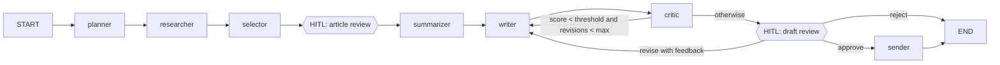

# Newsletter Agent — Design Spec

Date: 2026-10-14
Status: Approved in brainstorming; pending written-spec review

## 1. Purpose and Success Criteria

Build a single autonomous AI "Newsletter Agent" for an AI Developer hiring assignment. Given a plain-English goal such as *"Create a weekly newsletter on latest AI agent news and send it to our subscribers."*, the agent researches the latest AI agent news, summarizes the top 5-7 articles, generates a clean HTML newsletter, and simulates sending it.

Success means a reviewer can:

1. Open a public URL (Streamlit Community Cloud) with no setup or API keys of their own.
2. Run the agent in **Fully Autonomous** and **Human-in-the-Loop** modes.
3. See the multi-step reasoning, tool use, and self-critique happening in a live trace.
4. Download the resulting newsletter (`.html`) and simulated email (`.eml`).
5. Read clean, well-structured code on GitHub that follows SOLID principles with descriptive naming.

### Assignment requirements → design mapping

| Requirement | Where it is satisfied |
|---|---|
| Plain-English goal input | Goal text area in UI; `goal` argument to `run_newsletter_agent` |
| Research latest news | `researcher` node with `web_search` (Tavily) + `news_feed` (Google News RSS) tools |
| Summarize top 5-7 articles | `selector` + `summarizer` nodes |
| Generate clean newsletter | `writer` node + `render_html` tool (Jinja2 email-safe template) |
| Simulate sending | `send_email` tool writes `.eml` per mock subscriber + `newsletter.html` to `outbox/` |
| Multi-step reasoning | LangGraph stages: plan → research → select → summarize → write → critique → review → send |
| 2-3+ tools | Five tools: `web_search`, `news_feed`, `fetch_article`, `render_html`, `send_email` |
| Self-reflection / critique | `critic` node scores draft; conditional edge loops back to `writer` for revision |
| One-call autonomy | `run_newsletter_agent(goal, mode="auto")` |
| Autonomous / HITL toggle | `mode` parameter; LangGraph `interrupt()` at two checkpoints in HITL mode |
| LangChain / LangGraph | LangGraph `StateGraph` with LangChain tools and chat model |
| LLM choice | Google Gemini Flash via `langchain-google-genai` |
| Simple frontend | Streamlit `app.py` |

## 2. Decisions

| Decision | Choice | Reason |
|---|---|---|
| LLM | Gemini Flash (model name from config) | Free tier keeps hosted demo at zero cost |
| Research | Tavily **and** Google News RSS, merged | Real web search plus a no-key source; demo survives one source failing |
| Frontend + hosting | Streamlit on Streamlit Community Cloud | Pure Python, free, deploys from GitHub, built-in secrets |
| HITL checkpoints | Article selection + final draft | Shows human control clearly without slowing the demo |
| Sending | Mock `subscribers.json` + `.eml` outbox + downloads | Matches "simulate sending" exactly, no real email risk |
| Agent architecture | LangGraph backbone with LLM decisions inside nodes | Visible stages, reliable, agentic where it matters (research loop, critique loop) |

Rejected: single ReAct agent (unreliable stage ordering, awkward HITL placement); supervisor-routed graph (extra LLM calls, overkill for a linear pipeline); FastAPI + React (2-3x effort, two deploys).

## 3. Architecture

### 3.1 Graph



In autonomous mode, `article_review` and `draft_review` pass through without interrupting (draft review auto-approves).

### 3.2 State (`NewsletterState`, TypedDict)

| Field | Type | Written by |
|---|---|---|
| `goal` | `str` | runner |
| `mode` | `Literal["auto", "hitl"]` | runner |
| `plan` | `NewsletterPlan` | planner |
| `candidate_articles` | `list[Article]` | researcher |
| `selected_articles` | `list[Article]` | selector, article_review |
| `article_summaries` | `list[ArticleSummary]` | summarizer |
| `draft` | `NewsletterDraft` | writer, draft_review (human edits) |
| `critique_history` | `list[CritiqueReport]` | critic |
| `revision_count` | `int` | writer |
| `human_feedback` | `str \| None` | draft_review |
| `review_decision` | `Literal["approve", "revise", "reject"] \| None` | draft_review |
| `trace_log` | `list[TraceEntry]` (append reducer) | every node |
| `delivery_report` | `DeliveryReport \| None` | sender |

### 3.3 Domain models (Pydantic, `domain/models.py`)

- `Article`: `title`, `url`, `source_name`, `published_at`, `snippet`, `content` (optional full text).
- `NewsletterPlan`: `topic`, `audience`, `tone`, `search_queries: list[str]`, `recency_days`, `relevance_criteria: list[str]`, `section_outline: list[str]`.
- `ArticleSummary`: `article`, `summary` (2-3 sentences), `why_it_matters` (1 sentence).
- `NewsletterDraft`: `subject`, `preheader`, `intro`, `items: list[ArticleSummary]`, `outro`, `html_body`, `markdown_body`.
- `CritiqueReport`: `score` (1-10), `issues: list[str]`, `suggested_fixes: list[str]`, `passes: bool`.
- `TraceEntry`: `step`, `message`, `timestamp`.
- `DeliveryReport`: `recipient_count`, `subject`, `outbox_paths: list[str]`, `html_path`.

### 3.4 Nodes (`agent/nodes/`, one file each)

1. **planner** — LLM with structured output converts the goal into a `NewsletterPlan` (search queries, 7-day recency window, relevance criteria, section outline).
2. **researcher** — tool-calling loop: the LLM is bound to `web_search` and `news_feed`, chooses queries from the plan, and decides when it has enough. Hard cap of `MAX_RESEARCH_TOOL_CALLS` (4). Results are merged and de-duplicated by the news aggregator. If fewer than `MIN_ARTICLES` (5) relevant candidates are found, widens the window to 14 days and retries once.
3. **selector** — LLM with structured output ranks candidates on relevance, recency, and source diversity; picks the top `MIN_ARTICLES`–`MAX_ARTICLES` (5-7).
4. **article_review** — HITL only: `interrupt()` with the selected articles and the remaining candidates; resumes with the human's final selection. Auto mode: no-op.
5. **summarizer** — for each selected article, calls `fetch_article` for full text (falls back to the snippet), then the LLM writes `summary` + `why_it_matters`.
6. **writer** — LLM writes subject, preheader, intro, items, and outro; on revision it receives the latest `CritiqueReport` and any `human_feedback`. Calls `render_html` to produce `html_body`. Increments `revision_count` only for critique-driven revisions (when no `human_feedback` is present); human-requested rewrites clear `human_feedback` after use and do not count.
7. **critic** — LLM evaluates the draft against a checklist: factual consistency with source summaries, every item linked, clarity, length, subject quality, tone. Produces a `CritiqueReport`.
8. **draft_review** — HITL only: `interrupt()` with the draft and critique; resumes with `{decision, edited_subject?, edited_markdown?, feedback?}`. Auto mode: sets `review_decision="approve"`.
9. **sender** — calls `send_email` with the draft and the subscriber list; records a `DeliveryReport`.

### 3.5 Routing (`agent/routing.py`)

- `route_after_critique(state)` → `"writer"` if `score < QUALITY_THRESHOLD` (8) and `revision_count < MAX_REVISIONS` (2), else `"draft_review"`.
- `route_after_draft_review(state)` → `"sender"` on approve, `"writer"` on revise, `END` on reject.

Human-requested revisions are not limited by `MAX_REVISIONS`; each one is an explicit human action.

### 3.6 Tools (`tools/`, thin `@tool` wrappers over services)

| Tool | Delegates to | Purpose |
|---|---|---|
| `web_search(query)` | `TavilyNewsSource` | Recent web/news results for a query |
| `news_feed(query)` | `GoogleNewsRssSource` | Google News RSS results for a query, no key |
| `fetch_article(url)` | `HttpArticleFetcher` | Extract readable article text |
| `render_html(draft)` | `NewsletterRenderer` | Render email-safe HTML from a Jinja2 template |
| `send_email(draft, recipients)` | `EmlFileOutbox` | Write `.eml` per recipient and `newsletter.html` |

### 3.7 Runner (`agent/runner.py`) — public API

- `run_newsletter_agent(goal: str, mode: Literal["auto", "hitl"] = "auto", thread_id: str | None = None) -> AgentRunResult`
- `resume_newsletter_agent(thread_id: str, human_decision: dict) -> AgentRunResult`
- `stream_newsletter_agent(...)` — generator over graph updates for the UI's live trace.

`AgentRunResult` holds: `status` (`completed`, `awaiting_human`, `rejected`, `failed`), `thread_id`, `pending_interrupt` (payload for the UI when awaiting a human), and `final_state`.

The graph is compiled once with a `MemorySaver` checkpointer. In auto mode, `run_newsletter_agent(goal)` performs the full job in one call.

## 4. Code Structure and Standards

```
newsletter-agent/
  newsletter_agent/
    config.py
    domain/models.py
    services/
      llm_factory.py
      news_sources.py
      news_aggregator.py
      article_fetcher.py
      email_outbox.py
      newsletter_renderer.py
      templates/newsletter.html.j2
    tools/
      search_tools.py
      content_tools.py
      delivery_tools.py
    agent/
      state.py
      prompts.py
      nodes/ (planner.py, researcher.py, selector.py, article_review.py,
              summarizer.py, writer.py, critic.py, draft_review.py, sender.py)
      routing.py
      graph.py
      runner.py
  data/subscribers.json
  app.py
  main.py
  tests/
  requirements.txt
  pyproject.toml          # ruff + pytest config
  .env.example
  .streamlit/config.toml
  README.md
```

### Principles

- **Single responsibility:** one node per pipeline step; one service per external concern; `graph.py` only wires nodes and edges; `app.py` only presents.
- **Open/closed:** new news sources implement the `NewsSource` protocol and are registered in the aggregator without editing existing code.
- **Liskov substitution:** any `NewsSource`, `ArticleFetcher`, or `EmailSender` implementation (including test fakes) is interchangeable.
- **Interface segregation:** small protocols — `NewsSource.search(query, recency_days)`, `ArticleFetcher.fetch(url)`, `EmailSender.send(draft, recipients)`.
- **Dependency inversion:** nodes are created by factory functions that receive the chat model and services (`build_planner_node(chat_model)`, etc.); `graph.py` assembles them from an `AgentDependencies` container. Tests pass fakes.

### Conventions

- Descriptive names everywhere; **no single-character identifiers**, including loop variables, comprehension variables, lambdas, and exception aliases (`except httpx.HTTPError as http_error`).
- Full type hints; docstrings on public functions and classes.
- No magic numbers: `MIN_ARTICLES=5`, `MAX_ARTICLES=7`, `QUALITY_THRESHOLD=8`, `MAX_REVISIONS=2`, `MAX_RESEARCH_TOOL_CALLS=4`, `DEFAULT_RECENCY_DAYS=7`, `FETCH_TIMEOUT_SECONDS=8`, `RUNS_PER_SESSION=3` live in `config.py`.
- All prompts in `agent/prompts.py`.
- `ruff check` and `ruff format` enforce lint and formatting.

## 5. Frontend (`app.py`)

**Sidebar:** mode radio (`Fully Autonomous` / `Human-in-the-Loop`), goal text area pre-filled with the assignment goal, `Run agent` button, runs-remaining counter.

**Main area, in order:**

1. **Agent trace** — `st.status` streaming each node's `TraceEntry` as it completes (planner queries, each tool call and result count, critique score and revise decision).
2. **Article review (HITL pause 1)** — article cards with checkbox, title, source, date, link; `Approve selection` button.
3. **Draft review (HITL pause 2)** — rendered HTML preview alongside editable subject and Markdown body, feedback text box, and `Approve & send` / `Request revision` / `Reject` buttons. Critique report shown.
4. **Result** — email preview (From, To: N subscribers, Subject, rendered body), critique score history, download buttons for `newsletter.html` and `newsletter.eml`.

`thread_id` lives in `st.session_state`; the compiled graph and checkpointer are cached with `st.cache_resource`. The UI calls only the runner's public functions.

## 6. Hosting

- Public GitHub repo `newsletter-agent`, deployed on Streamlit Community Cloud with `app.py` as entry point and Python 3.11.
- Secrets `GOOGLE_API_KEY` and `TAVILY_API_KEY` set in the Streamlit Cloud Secrets panel; `config.py` reads `st.secrets` when available, otherwise `.env` via pydantic-settings.
- Cost and abuse guard: `RUNS_PER_SESSION` (3) runs per browser session; capped articles and revisions; 2-minute run timeout.
- Streamlit Cloud disk is ephemeral, so the download buttons are the deliverable in the hosted app; locally, files persist in `outbox/`.
- Pinned dependencies in `requirements.txt`.
- README: live demo link, Mermaid architecture diagram, requirement mapping, local setup, and how to run the CLI.

**CLI:** `python main.py --mode auto|hitl --goal "..."`; HITL in the CLI uses terminal prompts.

## 7. Error Handling

| Failure | Behavior |
|---|---|
| One news source errors | Logged to trace; continue with the other source |
| Both news sources error | Fail run with a clear UI message |
| Fewer than 5 relevant articles | Widen recency to 14 days and retry once; then continue with what exists and let the critique note it |
| Article fetch timeout / blocked / empty | Fall back to search snippet; never fatal |
| LLM 429 / 5xx | Retry with backoff, max 3 attempts |
| Structured output parse failure | One retry with a reminder to return valid structured output; then fail the node with a readable error |
| Runaway loops | Bounded by `MAX_REVISIONS` and `MAX_RESEARCH_TOOL_CALLS` |
| Any node failure in UI | `st.error` naming the failing step; trace stays visible |

## 8. Testing

All tests run offline without API keys (pytest).

- **Unit:** aggregator de-duplication and partial-source failure; RSS parsing against a stored feed fixture; renderer output contains subject and every article link; `EmlFileOutbox` writes `.eml` files that parse back via the `email` package; routing functions at threshold boundaries.
- **Node:** each node with a fake chat model and fake services, asserting its state update.
- **Graph:** autonomous run end-to-end with fakes produces one outbox file per subscriber; HITL run pauses at both interrupts and resumes correctly for approve, edit, revise, and reject.
- **Smoke (opt-in marker):** one real run against Gemini and Tavily before deploying.
- Pre-push gate: `ruff check`, `ruff format --check`, `pytest` all pass.

## 9. Prerequisites

- Python 3.11 is not currently installed on the development machine; install it before implementation.
- Git user name and email are not configured; set them before the first commit.
- API keys: Gemini (Google AI Studio) and Tavily, obtained via the Claude in Chrome prompt.
- GitHub account for the public repo (`gh` CLI is installed).

## 10. Out of Scope

Real email delivery, persistent databases, user accounts, scheduling recurring weekly runs, multiple LLM providers in the UI.
